```{=html}
<header class="lecture-header">
  <div class="eyebrow">APM 5DA12 TP · Deep Learning for Computer Vision</div>
  <h1>From pixels to structured scene understanding</h1>
  <p>Lecture 1 · Jhony H. Giraldo · Télécom Paris, Institut Polytechnique de Paris</p>
  <div class="lecture-meta"><span>Lecture: 13 November 2026</span><span>Web note revised: 16 November 2026</span><span>Click any figure to enlarge it</span></div>
  <div class="button-row">
    <a class="button-link primary" href="/assets/pdf/DL4CV-Lecture-01-Deep-Learning-for-Computer-Vision.pdf">Download the original slides</a>
    <a class="button-link secondary" href="/teaching/deep-learning-for-computer-vision/index.qmd">Back to the course</a>
  </div>
</header>
```

A classifier looks at an image and returns one word. A vision system usually needs much more: *where* each object is, *how many* there are, *which pixels* belong to the road, *where* a person's joints are, and whether the person in this frame is the one from the last frame. Each of these questions has its own output representation, loss, and metric.

This note first recaps computer vision, convolutional networks (CNNs), and Vision Transformers (ViTs), then climbs the ladder of structured outputs: **object detection**, **segmentation**, **pose estimation**, and **multi-object tracking**. One idea organizes everything: *the backbone is reusable; the representation, head, loss, metric, and inference must match the task.* Most figures annotate the same street scene with the outputs of real pretrained models, so the numbers in the figures are measurements, not illustrations.

## Learning objectives

After studying this note, you should be able to:

```{=html}
<ol class="learning-objectives">
  <li>place a vision problem in the task taxonomy and name its output, loss, and metric;</li>
  <li>compute the output size, parameter count, and receptive field of convolution layers;</li>
  <li>write the Vision Transformer forward pass, from patches to the class token, with tensor shapes;</li>
  <li>compute IoU, precision, and recall, and explain anchors, NMS, and the focal loss;</li>
  <li>explain what changed from R-CNN to Fast R-CNN to Faster R-CNN, and how DETR removes anchors and NMS;</li>
  <li>design a segmentation network from an encoder, a decoder, skip connections, and atrous convolutions;</li>
  <li>describe Mask R-CNN and Keypoint R-CNN as heads on a shared detector;</li>
  <li>assemble a tracking-by-detection loop with a cost matrix and one-to-one assignment.</li>
</ol>
```

::: {.checkpoint}
**What you should already know**

Linear algebra (vectors, matrices, tensors, dot products), optimization (gradients, SGD, regularization), basic deep learning (losses, backpropagation, CNN basics), and Python with basic PyTorch. The recaps below are compact; the [preliminary notes of Machine Learning with Graphs](../machine-learning-with-graphs/preliminaries-machine-learning.qmd) cover the perceptron, MLPs, backpropagation, and SGD from scratch.
:::

```{=html}
<div class="note-part"><span>Part I</span>Computer vision recap</div>
```

## What can machines understand from pixels?

::: {.figure-panel}
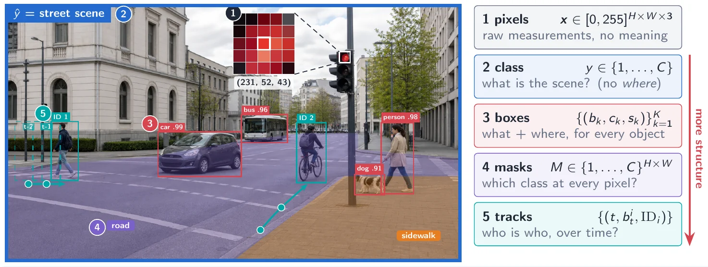{#fig-beyond-label fig-alt="The street scene annotated with a pixel zoom, an image label, detection boxes, road and sidewalk masks, and pedestrian tracks, beside a legend of five output types"}
:::

| | Output | Formal object | Question it answers |
|---|---|---|---|
| 1 | pixels | $\mathbf{x}\in[0,255]^{H\times W\times 3}$ | raw measurements, no meaning |
| 2 | class | $y\in\{1,\dots,C\}$ | what is the scene? (no *where*) |
| 3 | boxes | $\{(\mathbf{b}_k,c_k,s_k)\}_{k=1}^{K}$ | what and where, for every object |
| 4 | masks | $\mathbf{M}\in\{1,\dots,C\}^{H\times W}$ | which class at every pixel? |
| 5 | tracks | $\{(t,\mathbf{b}^i_t,\mathrm{ID}_i)\}$ | who is who, over time? |

: Output representations covered in this lecture. {#tbl-outputs}

Here $H$ and $W$ are the image height and width in pixels, and $C$ is the number of classes. A detection is a box $\mathbf{b}_k$ with class $c_k$ and confidence score $s_k$, and $K$ is the number of detections. A mask $\mathbf{M}$ stores one class per pixel. A track pairs a frame index $t$ with the box $\mathbf{b}^i_t$ of object $i$ and its identity $\mathrm{ID}_i$.

Each step down the table makes the output more structured and the supervision costlier. In practice many engineering tricks are needed to make each of these systems work; this lecture cannot cover them all, but you should expect to meet them.

### Encode, then decode

::: {.figure-panel}
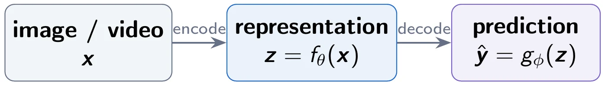{#fig-encode-decode fig-alt="Three boxes: image x, representation z equals f theta of x, prediction y hat equals g phi of z"}
:::

$$
\mathbf{z}=f_\theta(\mathbf{x}),
\qquad
\hat{\mathbf{y}}=g_\phi(\mathbf{z}),
$$

where $\mathbf{x}$ is the image (or video), $f_\theta$ is a neural network — convolution- or attention-based — with parameters $\theta$, $\mathbf{z}$ is the representation, and $g_\phi$ is a second network, the **prediction head**, with parameters $\phi$, producing the prediction $\hat{\mathbf{y}}$. The central learning question is: *what representation makes the target predictable from finite data?*

### Computer vision is an inverse problem

::: {.figure-panel}
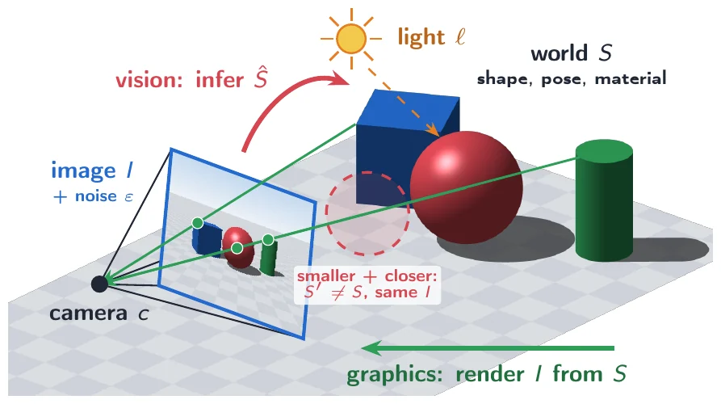{#fig-inverse fig-alt="A 3D scene with a light, a camera, a cube, a sphere, and a cylinder, with arrows labelled graphics render and vision infer"}
:::

Image formation can be written as

$$
I=R(S,\ell,c)+\varepsilon,
$$

where $I$ is the observed image, $S$ is the 3D world (shape, pose, material), $\ell$ the lighting, $c$ the camera, $R$ the image-formation (rendering) process, and $\varepsilon$ noise or unmodelled effects. Vision must recover an estimate $\hat S$ of the world from $I$. The problem is **ill-posed**: a different world $S'\neq S$ can produce the same $I$. Vision succeeds by combining **data with priors** — assumptions about which worlds are plausible.

### Why computer vision is hard

::: {.figure-panel}
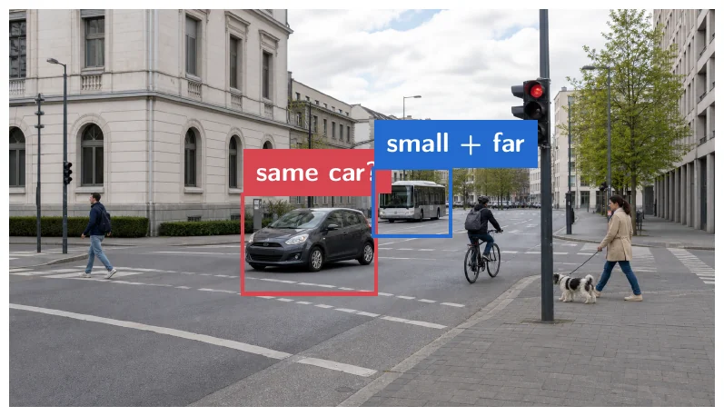{#fig-why-hard fig-alt="Street scene with a red box labelled same car and a blue box labelled small plus far around a bus"}
:::

- **Projection:** depth collapses onto the image plane.
- **Appearance:** lighting, weather, texture, sensor noise.
- **Geometry:** viewpoint, deformation, articulation, scale.
- **Visibility:** occlusion, clutter.
- **Semantics:** context and ambiguous categories.
- **Open world:** rare and unseen cases matter.

Useful **invariance** (a shifted car is still a car) must coexist with **sensitivity** to location, shape, and identity (the box must move with the car).

### Task taxonomy

| Task | Output unit | Central question |
|---|---|---|
| Classification | image | What is present? |
| Localization | one box + class | Where is the main object? |
| Detection | set of boxes | What objects, and where? |
| Semantic segmentation | pixel | Which class per pixel? |
| Instance segmentation | object mask | Which pixels belong together? |
| Pose estimation | keypoint / part | Where are the articulated parts? |
| Tracking | trajectory + ID | Which observation is the same entity? |

: The output space determines annotation cost, architecture, loss, inference, and metric. {#tbl-taxonomy}

::: {.figure-panel}
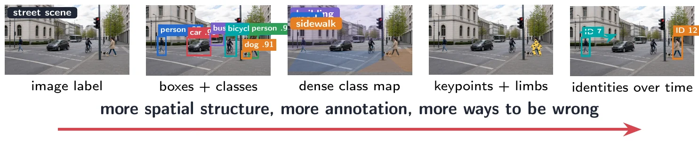{#fig-progressive fig-alt="Five thumbnails of the scene with an image label, boxes, a dense class map, keypoints, and identities over time"}
:::

## A brief history

::: {.figure-panel}
![Milestones: the visual cortex [@hubel1962receptive], the Summer Vision Project [@papert1966summer], LeNet [@lecun1998gradient], SIFT and HOG [@lowe2004distinctive; @dalal2005histograms], ImageNet [@deng2009imagenet], AlexNet [@krizhevsky2012imagenet], ViT [@dosovitskiy2021image], and foundation models. Three eras: hand-designed features, supervised deep learning, and pretraining at scale.](../../assets/figures/dl4cv/l01-history.webp){#fig-history fig-alt="A timeline from 1959 to 2023 with eight milestones and three era labels"}
:::

### From handcrafted features to learned representations

::: {.figure-panel}
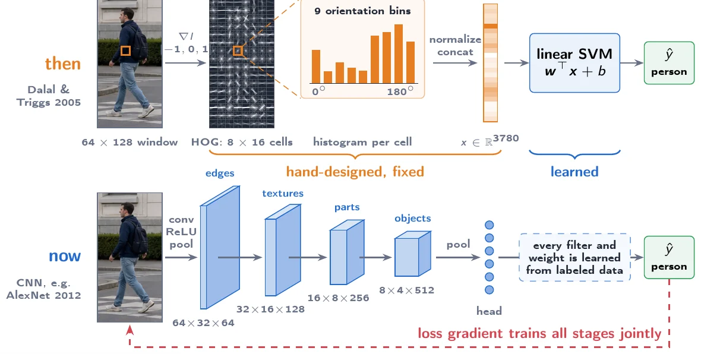{#fig-hog fig-alt="Top, the HOG pipeline with gradients, cells, orientation histograms, and an SVM; bottom, a CNN with stacked feature blocks"}
:::

The HOG detector [@dalal2005histograms] computes the image gradient $\nabla I$ of the input image $I$ with the filter $[-1,0,1]$, divides a $64\times128$ window into $8\times16$ cells of $8\times8$ pixels, builds a 9-bin orientation histogram per cell, normalizes overlapping $2\times2$-cell blocks, and concatenates everything into a descriptor $\mathbf{x}\in\mathbb{R}^{3780}$ ($7\times15$ blocks $\times$ 4 cells $\times$ 9 bins). A linear SVM then predicts the label $\hat y=\operatorname{sign}(\mathbf{w}^\top\mathbf{x}+b)$, where $\mathbf{w}$ and $b$ are the learned SVM weights and bias.

Every stage has a CNN counterpart — gradient filters are a first convolution, histograms are a nonlinearity plus pooling, block normalization is a normalization layer, the SVM is a linear head — but in a CNN all of them are **learned jointly** from the loss. End-to-end learning replaces hand-designed interfaces, but not the need for good assumptions or evaluation.

### Why deep learning changed computer vision

::: {.figure-panel}
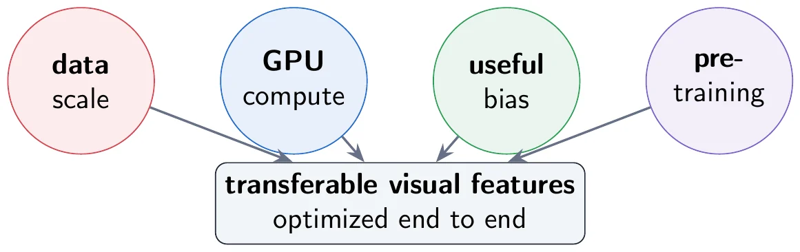{#fig-why-dl fig-alt="Four circles labelled data scale, GPU compute, useful bias, and pre-training, pointing to transferable visual features"}
:::

Convolution encoded locality; attention later added adaptive global interaction. Large labelled datasets made comparisons credible, and large unlabelled datasets widened pretraining. Better optimization, normalization, and residual connections made much deeper networks trainable.

## Supervised learning for images

Given a training set $\mathcal{D}_{\text{train}}=\{(\mathbf{x}_i,\mathbf{y}_i)\}_{i=1}^{N}$ and predictions $\hat{\mathbf{y}}_i=f_\theta(\mathbf{x}_i)$, we learn

$$
\theta^{*}=\arg\min_{\theta}\;\frac{1}{N}\sum_{i=1}^{N}\mathcal{L}\big(f_\theta(\mathbf{x}_i),\mathbf{y}_i\big)+\lambda\,\Omega(\theta),
$$

where $\mathbf{x}_i$ is input image $i$, $\mathbf{y}_i$ its target (label), $N$ the number of training examples, $f_\theta$ the model with parameters (weights) $\theta$, $\mathcal{L}$ the loss — how wrong one prediction is — $\Omega(\theta)$ a regularizer with strength $\lambda\ge0$, and $\theta^*$ the learned parameters.

The loss is optimized on the **training** data; choices (architecture, learning rate, epochs) are made on the **validation** data; the **test** set estimates final generalization and is used once, at the very end.

### Image classification

A classifier outputs one score per class and turns the scores into probabilities with a softmax:

$$
\mathbf{s}=f_\theta(\mathbf{x})\in\mathbb{R}^{C},
\qquad
p(y=c\mid\mathbf{x})=\frac{e^{s_c}}{\sum_{k=1}^{C}e^{s_k}},
\qquad
\mathcal{L}_{\text{CE}}=-\log p(y\mid\mathbf{x}),
$$

where $\mathbf{x}$ is the input image, $C$ the number of classes, $\mathbf{s}$ the class scores (logits), $s_c$ the score of class $c$, $k$ an index over all classes, $p(y=c\mid\mathbf{x})$ the predicted probability of class $c$, $y$ the true class, and $\mathcal{L}_{\text{CE}}$ the cross-entropy loss. Cross-entropy rewards probability on the ground-truth class.

| class | street scene | parking lot | bus station | other |
|---|---|---|---|---|
| probability | **0.84** | 0.09 | 0.05 | 0.02 |

: A ResNet's prediction for the street scene. {#tbl-classification}

If the true class is "street scene", $\mathcal{L}_{\text{CE}}=-\ln0.84=0.17$; had the model given it only $0.09$, the loss would be $-\ln0.09=2.41$.

### A machine-learning pipeline for images

::: {.figure-panel}
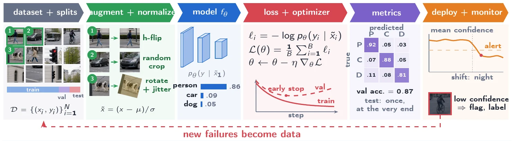{#fig-pipeline fig-alt="Six connected panels: dataset and splits, augment and normalize, model, loss and optimizer, metrics, deploy and monitor"}
:::

Before an image enters the network, it is **normalized**: each colour channel is shifted and rescaled so that its values have roughly zero mean and unit variance, which keeps the network's inputs in a well-conditioned range and makes optimization easier. The mean and standard deviation are computed once, per channel, over a large training set, and then kept fixed. For ImageNet, there are well-established values that are used almost everywhere: for images with pixel values scaled to $[0,1]$, the per-channel means are $\boldsymbol\mu=(0.485,0.456,0.406)$ and the standard deviations $\boldsymbol\sigma=(0.229,0.224,0.225)$, for the red, green, and blue channels. Most pretrained backbones were trained with exactly these values, so we reuse them whenever we start from such a backbone.

Each training step normalizes and augments the images, then updates the weights on a mini-batch:

$$
\tilde{\mathbf{x}}=\frac{\mathbf{x}-\boldsymbol\mu}{\boldsymbol\sigma},
\qquad
\ell_i=-\log p_\theta(y_i\mid\tilde{\mathbf{x}}_i),
\qquad
\mathcal{L}(\theta)=\frac1B\sum_{i=1}^{B}\ell_i,
\qquad
\theta\leftarrow\theta-\eta\,\nabla_\theta\mathcal{L},
$$

where $\boldsymbol\mu$ and $\boldsymbol\sigma$ are the per-channel mean and standard deviation (the subtraction and division are applied to each channel separately), $\tilde{\mathbf{x}}$ the normalized image, $p_\theta(y\mid\tilde{\mathbf{x}})$ the predicted class probabilities, $\ell_i$ the loss of example $i$, $B$ the batch size, $\mathcal{L}(\theta)$ the batch loss, $\eta$ the learning rate, and $\nabla_\theta\mathcal{L}$ the gradient with respect to $\theta$.

::: {.checkpoint}
**Before training, and the most common leakage**

*Before training:* define the target, fix the split, inspect the labels, and establish a simple baseline.

*Leakage:* the validation or test data are not truly independent of the training data, so the measured performance looks better than the model's real ability to generalize — for example, consecutive frames of one video split across train and test. Split by the unit you want to generalize over (video, patient, location).
:::

```{=html}
<div class="note-part"><span>Part II</span>Recap: convolutional neural networks</div>
```

## Convolutional networks

### Convolution: a learned local pattern detector

::: {.figure-panel}
{#fig-convolution fig-alt="A grayscale crop, an 8 by 8 grid of pixel values with a highlighted window, a Sobel kernel, the response 906, and the output feature map"}
:::

$$
y_{i,j}=b+\sum_{u,v,c}K_{u,v,c}\,x_{i+u,\,j+v,\,c},
$$ {#eq-conv}

where $\mathbf{x}$ is the input image, $\mathbf{y}$ the output feature map, $K$ the kernel weights, $b$ the bias, $(i,j)$ the output row and column, $(u,v)$ the offset inside the kernel, and $c$ the input channel (a single one for a grayscale image).

::: {.worked-example}
**Worked example — One output of the Sobel filter**

With $K=\begin{bmatrix}-1&0&1\\-2&0&2\\-1&0&1\end{bmatrix}$, the window's left column $(21,19,23)$, right column $(248,247,246)$, and $b=0$:
$$
y=-21+248-2\cdot19+2\cdot247-23+246=906 .
$$
A large positive value means "dark on the left, bright on the right": a vertical edge.
:::

The same weights are used at every location; a high response means a local pattern match; training learns $K$, and sliding records where the pattern occurs. **Convolution is a local linear operator with shared parameters.**

### Channels, kernels, and feature maps

::: {.figure-panel}
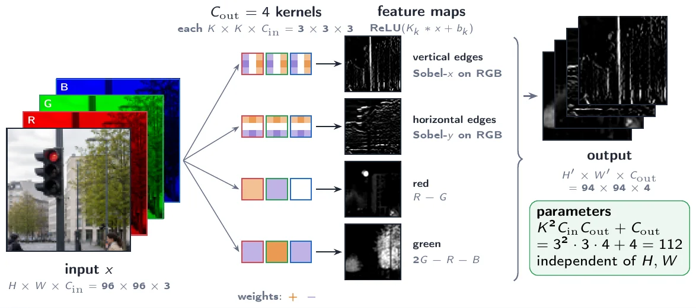{#fig-conv-layer fig-alt="An RGB crop split into channels, four colour-coded kernels, and four feature maps"}
:::

A layer maps an input $\mathbf{x}$ of size $H\times W\times C_{\text{in}}$ to an output of size $H'\times W'\times C_{\text{out}}$, where $H,W$ are the input height and width, $H',W'$ the output height and width, and $C_{\text{in}},C_{\text{out}}$ the numbers of input and output channels. Output channel $k$ is $\operatorname{ReLU}(K_k*\mathbf{x}+b_k)$, where $K_k$ and $b_k$ are the weights and bias of kernel $k$ and $*$ is convolution. With kernel side $K$,

$$
\#\text{params}=K^{2}C_{\text{in}}C_{\text{out}}+C_{\text{out}},
$$

which for @fig-conv-layer is $3^2\cdot3\cdot4+4=112$, independent of $H$ and $W$. Each output channel mixes **all** input channels but only a **local** spatial neighbourhood. A $1\times1$ convolution changes the number of channels without enlarging the spatial receptive field.

### Stride, padding, and dilation

::: {.figure-panel}
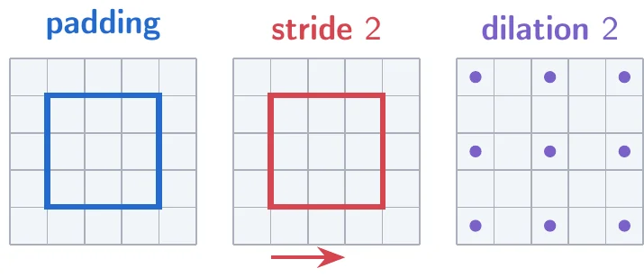{#fig-stride fig-alt="Three grids illustrating padding, stride two, and dilation two"}
:::

For one spatial dimension,

$$
H'=\left\lfloor\frac{H+2P-D(K-1)-1}{S}\right\rfloor+1,
$$ {#eq-conv-size}

where $H$ is the input size, $H'$ the output size, $K$ the kernel size, $P$ the zero padding per side, $S$ the stride (sampling step), $D$ the dilation (spacing inside the kernel), and $\lfloor\cdot\rfloor$ rounds down. The effective kernel size is $D(K-1)+1$.

For example, $H=32$, $K=3$, $S=2$, $P=1$, $D=1$ gives $H'=\lfloor31/2\rfloor+1=16$; reducing the stride to $S=1$ gives $H'=32$. These hyperparameters determine resolution, compute, and visible context.

### Pooling: invariance versus spatial precision

::: {.figure-panel}
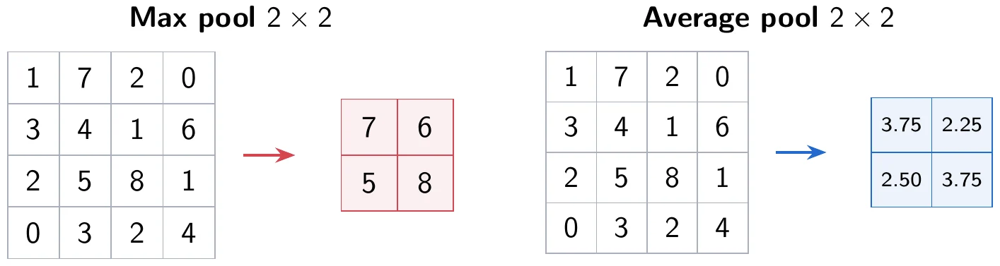{#fig-pooling fig-alt="A 4 by 4 grid reduced to 2 by 2 by max pooling and by average pooling"}
:::

For the top-left window $\{1,7,3,4\}$, max pooling keeps $7$ and average pooling gives $15/4=3.75$. Pooling summarizes a neighbourhood and reduces resolution and compute. It increases tolerance to small shifts, but exact boundaries and keypoints become harder to recover. Modern networks often downsample with a strided convolution instead.

### Receptive field

::: {.figure-panel}
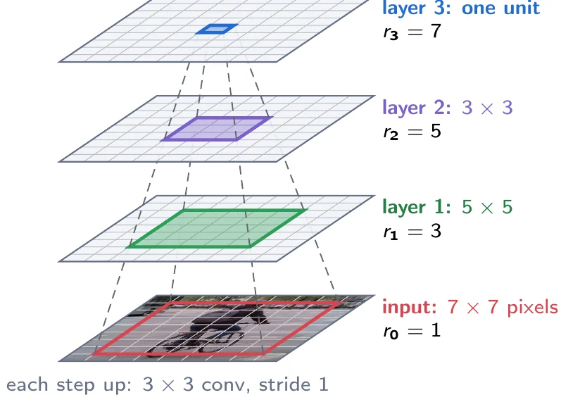{#fig-receptive-field fig-alt="Four stacked grids with highlighted squares of growing size, r0 equals 1 up to r3 equals 7"}
:::

$$
j_\ell=j_{\ell-1}\,s_\ell,
\qquad
r_\ell=r_{\ell-1}+(k_\ell-1)\,d_\ell\,j_{\ell-1},
\qquad j_0=r_0=1,
$$

where $\ell$ is the layer index ($\ell=0$ is the input), $k_\ell$, $s_\ell$, $d_\ell$ are the kernel size, stride, and dilation of layer $\ell$, $j_\ell$ is the number of input pixels between neighbouring units of layer $\ell$, and $r_\ell$ is the receptive-field size of one unit, in input pixels.

With $k_\ell=3$ and $s_\ell=d_\ell=1$, $r_\ell=1+2\ell$. If instead the second layer has stride $s_2=2$, then $j_2=2$ and $r_3=5+2\cdot2=9$. Depth, stride, and dilation expand context; dense prediction needs both broad context and high-resolution detail.

### The recurring CNN architecture pattern

::: {.figure-panel}
{#fig-cnn-pattern fig-alt="A block diagram above ResNet-18 activation maps shrinking from 224 by 224 to 7 by 7, ending in class probabilities"}
:::

Here $H,W$ are the feature-map height and width, and each $\downarrow2$ halves both. Two trades happen together. **Spatial trade:** $H,W$ decrease while the receptive field and semantic abstraction increase. **Channel trade:** more channels preserve diverse evidence as resolution shrinks. A classifier discards spatial detail at the end; dense tasks tap the intermediate maps.

### VGG: small filters, deep and simple

::: {.figure-panel}
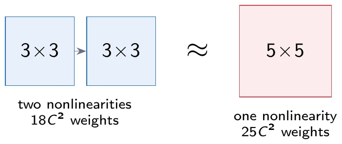{#fig-vgg fig-alt="Two 3 by 3 boxes approximately equal to one 5 by 5 box with weight counts 18 C squared and 25 C squared"}
:::

If every layer has $C$ input and output channels, two $3\times3$ layers cost $18C^2=2\times(3\cdot3\cdot C\cdot C)$ weights against $25C^2$ for one $5\times5$ layer — cheaper, and with two nonlinearities instead of one. VGG [@simonyan2015very] uses only $3\times3$ convolutions in 16 or 19 weight layers; VGG-16 has about 138M parameters, most of them in its heavy fully connected classifier. Its clean design became a template, even though later networks are far more efficient.

### ResNet: learn a residual correction

::: {.figure-panel}
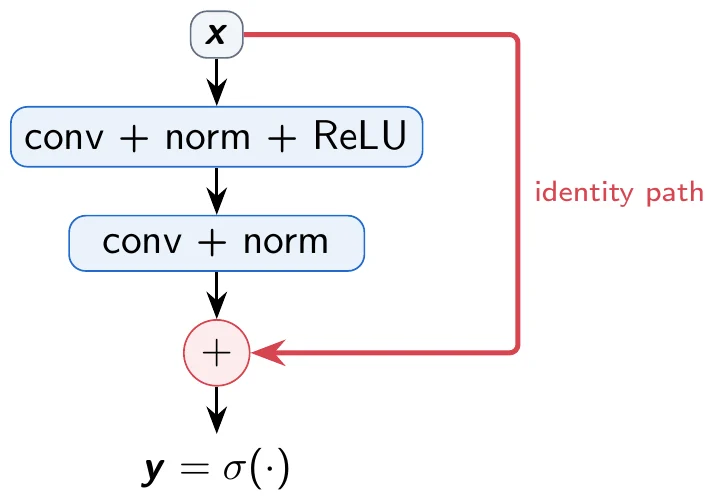{#fig-resnet fig-alt="A block diagram with x passing through two conv layers and an identity path, added, then sigma"}
:::

Before ResNet, deeper models were not better than shallower ones, although a deeper model contains the shallower one (extra layers could copy their input). The problem was optimization, not capacity. ResNet [@he2016deep] makes the identity easy to learn:

$$
\mathbf{y}=\sigma\big(\mathcal{F}(\mathbf{x};\theta)+\mathbf{x}\big),
$$

where $\mathbf{x}$ is the block input, $\mathbf{y}$ the block output, $\mathcal{F}$ the residual branch (the convolutional layers) with weights $\theta$, and $\sigma$ the activation (ReLU). Identity paths carry signal and gradients — ignoring $\sigma$, $\partial\mathbf{y}/\partial\mathbf{x}=\mathbf{I}+\partial\mathcal{F}/\partial\mathbf{x}$ — so very deep networks become trainable and reusable.

### Normalization and activations

::: {.figure-panel}
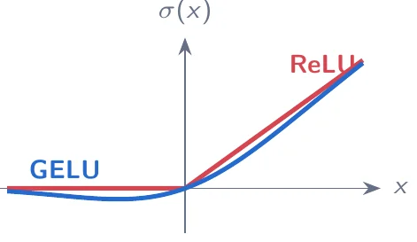{#fig-activations fig-alt="Plot of the ReLU and GELU activation functions"}
:::

**Batch normalization** [@ioffe2015batch] normalizes each channel with statistics computed over the mini-batch:

$$
\hat{\mathbf{x}}=\frac{\mathbf{x}-\boldsymbol{\mu}_{\mathcal{B}}}{\sqrt{\boldsymbol{\sigma}_{\mathcal{B}}^{2}+\epsilon}},
\qquad
\mathbf{y}=\boldsymbol{\gamma}\odot\hat{\mathbf{x}}+\boldsymbol{\beta},
$$

where $\mathcal{B}$ is the current mini-batch, $\mathbf{x}\in\mathbb{R}^{C}$ the activations of one example at one position, with one entry per channel ($C$ channels), $\boldsymbol{\mu}_{\mathcal{B}}$ and $\boldsymbol{\sigma}^2_{\mathcal{B}}\in\mathbb{R}^{C}$ the per-channel mean and variance over $\mathcal{B}$ (and over all positions), $\epsilon$ a tiny constant that avoids division by zero, $\hat{\mathbf{x}}$ the normalized activations, $\boldsymbol{\gamma}$ and $\boldsymbol{\beta}\in\mathbb{R}^{C}$ a learned per-channel scale and shift, $\odot$ the element-wise product, and $\mathbf{y}$ the output. The subtraction, square root, and division are also applied element-wise, so each channel is normalized independently. It improves optimization and permits larger learning rates, but its behaviour depends on batch statistics and on train/eval mode (`model.eval()` switches to running averages). **LayerNorm** normalizes within one token or example and needs no batch statistics.

For an activation function $\sigma(x)$ with input $x$: **ReLU**, $\max(0,x)$, is cheap, sparse, and piecewise linear; **GELU** [@hendrycks2016gaussian] is a smooth gate common in transformers.

### Transfer learning

A pretrained backbone provides generic visual features; a new head maps them to the $C$ classes of the target data.

| Strategy | Trainable weights | Best when | Main risk |
|---|---|---|---|
| Linear probe | head only | little data; diagnose the representation | under-adaptation |
| Partial fine-tune | head + late blocks | moderate data / related domain | difficult layer choice |
| Full fine-tune | all weights | enough data and compute | overfitting / forgetting |

: Transfer-learning strategies. {#tbl-transfer}

Always adapt the preprocessing and normalization to the exact pretrained checkpoint.

### A hierarchy of visual features

::: {.figure-panel}
![What ResNet-18 computes on the scene. Early: 64 first-layer filters ($7\times7\times3$) detect edges, colour, and micro-texture. Middle: the patches that most activate three layer-3 units look like wheels, heads, and legs. Late: class activation maps [@zhou2016learning] localize whole objects. A task head reads these features.](../../assets/figures/dl4cv/l01-feature-hierarchy.webp){#fig-hierarchy fig-alt="Panels of first-layer filters, part detectors, class activation maps, and a detection head output"}
:::

Resolution decreases and abstraction increases with depth. Classification can use the final semantic vector; detection and segmentation combine late semantics with earlier spatial detail. "Features" are task- and training-dependent, not a universal visual vocabulary.

### Feature pyramids

::: {.figure-panel}
{#fig-fpn fig-alt="Backbone maps C2 to C5 connected by lateral convolutions and top-down arrows to pyramid maps P2 to P5, with detections on the scene"}
:::

Objects come in very different sizes. A feature pyramid network [@lin2017feature] gives every scale strong semantics:

$$
P_5=\operatorname{conv}_{1\times1}(C_5),
\qquad
P_\ell=\operatorname{conv}_{3\times3}\!\Big(\operatorname{conv}_{1\times1}(C_\ell)+\operatorname{up}_{2\times}(P_{\ell+1})\Big),
$$

where $\ell\in\{2,\dots,5\}$ is the stage or pyramid level, $C_\ell$ is the backbone output after stage $\ell$ (stride $2^\ell$), $P_\ell$ the pyramid output at the same stride with 256 channels, $\operatorname{conv}_{k\times k}$ a convolution with a $k\times k$ kernel, and $\operatorname{up}_{2\times}$ a $2\times$ upsampling (doubling $H$ and $W$). Each level predicts objects of a suitable size: objects of 224 pixels or more go to $P_4$, of 448 or more to $P_5$.

### CNN strengths: a useful inductive bias

::: {.definition}
**Definition 1 — Translation equivariance**

If $T_\delta$ shifts an image $\mathbf{x}$ by $\delta$ pixels, convolution with a kernel $K$ shifts the feature map by the same amount:
$$
K*(T_\delta\mathbf{x})=T_\delta(K*\mathbf{x}).
$$
:::

Equivariance preserves *where*; pooling can later create partial invariance. CNNs also build in **locality** (nearby pixels interact first), **parameter sharing** (the same detector works everywhere), **hierarchical composition** (local evidence builds into parts and objects), **data efficiency** (built-in assumptions constrain the hypothesis space), and **multi-scale maps** for dense tasks. A good inductive bias says which solutions should be easy to learn.

### CNN limitations: global context is indirect

::: {.figure-panel}
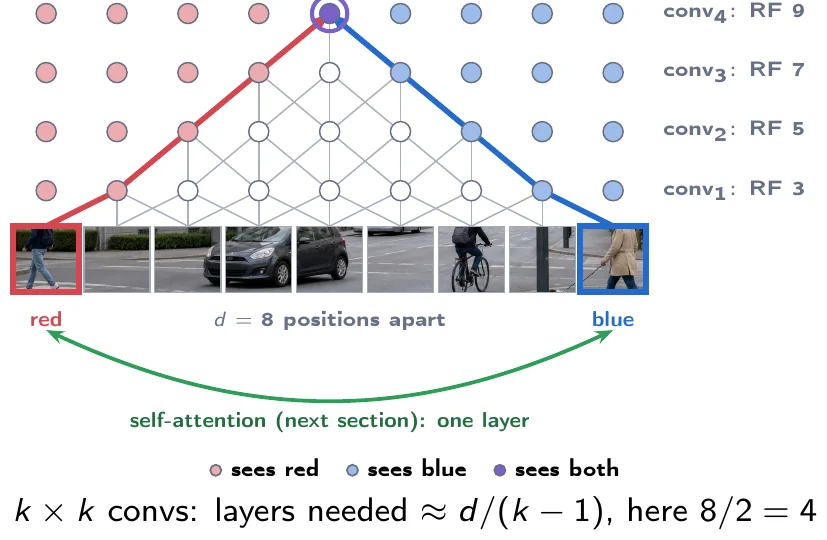{#fig-cnn-limits fig-alt="A triangular lattice of units over a row of patches, with red and blue paths meeting at layer 4"}
:::

With kernel size $k$, two inputs at distance $d$ first interact after about $d/(k-1)$ layers ($8/2=4$ here). Long-range interaction therefore needs depth, large kernels, dilation, or pooling; repeated downsampling discards fine detail; fixed local mixing does not adapt its connectivity to the image; and strong locality can favour texture or shortcuts over global shape [@geirhos2019imagenet]. Modern CNNs can nevertheless be very strong [@liu2022convnet], and transformers introduce their own costs.

```{=html}
<div class="note-part"><span>Part III</span>Recap: Vision Transformers</div>
```

## Vision Transformers

### Attention: content-dependent interaction

::: {.figure-panel}
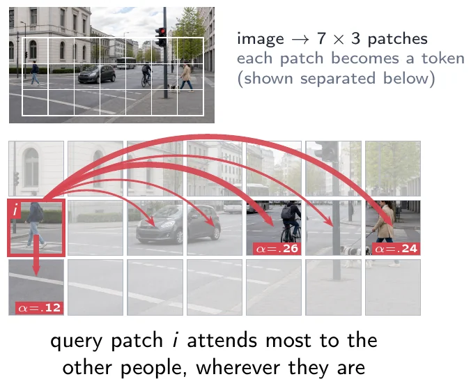{#fig-attention-intuition fig-alt="The scene split into patches with arcs from one pedestrian patch to other patches labelled with attention weights"}
:::

$$
\mathbf{z}'_i=\sum_{j}\alpha_{ij}\,\mathbf{v}_j,
\qquad
\sum_{j}\alpha_{ij}=1,
$$

where $i$ is the query token (patch), $j$ ranges over all $N$ tokens (including $i$), $\mathbf{v}_j$ is the value vector — the content — of token $j$, $\alpha_{ij}$ the attention weight of $i$ on $j$, and $\mathbf{z}'_i$ the updated vector of token $i$. The weights depend on token content; interaction is global; geometry must be supplied through position information; and full attention costs $O(N^2)$ token interactions.

### From an image to a sequence of patches

::: {.figure-panel}
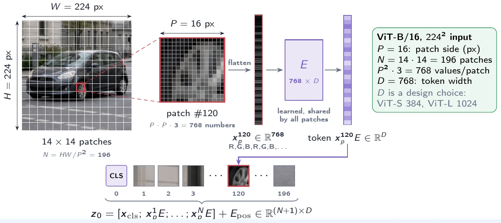{#fig-patchify fig-alt="A car image with a 14 by 14 patch grid, one patch flattened and projected, and the token sequence with a CLS token"}
:::

$$
N=\frac{HW}{P^2},
\qquad
\mathbf{z}_0=\big[\mathbf{x}_{\text{cls}};\,\mathbf{x}_p^{1}\mathbf{E};\,\dots;\,\mathbf{x}_p^{N}\mathbf{E}\big]+\mathbf{E}_{\text{pos}}\in\mathbb{R}^{(N+1)\times D},
$$

where $H,W$ are the image height and width, $P$ the patch side, $N$ the number of patches, $\mathbf{x}_p^{k}$ the flattened patch $k$ (with $P^2\cdot3$ values), $\mathbf{E}$ the learned projection to the token width $D$, $\mathbf{x}_{\text{cls}}$ a learned class token, $\mathbf{E}_{\text{pos}}$ learned position embeddings, $[\,\cdot\,;\,\cdot\,]$ stacking as rows, and $\mathbf{z}_0$ the transformer input.

For ViT-B/16 at $224^2$: $P=16$, $N=14\cdot14=196$, $P^2\cdot3=768$ values per patch, and $D=768$. $D$ is a design choice (ViT-S uses 384, ViT-L 1024). Smaller patches preserve detail but increase $N$ and the attention cost. The class token is a learnable global readout; averaging the patch tokens is an alternative.

### The Vision Transformer pipeline

::: {.figure-panel}
{#fig-vit-pipeline fig-alt="Pipeline from patches through embeddings and L transformer blocks to a classification head and a dense decoder"}
:::

Here $L$ is the number of encoder blocks and $\mathbf{W}$ the weights of the linear head. Every block keeps the shape $(N+1)\times D$: self-attention mixes all tokens, then an MLP processes each token [@dosovitskiy2021image].

### Self-attention: query, key, value

::: {.figure-panel}
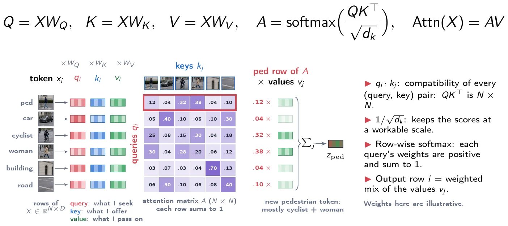{#fig-qkv fig-alt="Six token thumbnails, their query, key, and value vectors, and a 6 by 6 attention matrix with the pedestrian row highlighted"}
:::

$$
\mathbf{Q}=\mathbf{X}\mathbf{W}_Q,
\quad
\mathbf{K}=\mathbf{X}\mathbf{W}_K,
\quad
\mathbf{V}=\mathbf{X}\mathbf{W}_V,
\qquad
\mathbf{A}=\operatorname{softmax}\!\left(\frac{\mathbf{Q}\mathbf{K}^{\top}}{\sqrt{d_k}}\right),
\qquad
\operatorname{Attn}(\mathbf{X})=\mathbf{A}\mathbf{V},
$$ {#eq-attention}

where $\mathbf{X}\in\mathbb{R}^{N\times D}$ holds the input tokens, one per row ($\mathbf{x}_i$ is row $i$); $\mathbf{W}_Q,\mathbf{W}_K,\mathbf{W}_V$ are learned projection matrices; $\mathbf{Q},\mathbf{K},\mathbf{V}$ are the queries, keys, and values (rows $\mathbf{q}_i,\mathbf{k}_i,\mathbf{v}_i$); $d_k$ is the query and key length; $\mathbf{K}^\top$ is the transpose of $\mathbf{K}$; $\mathbf{A}$ is the $N\times N$ matrix of attention weights; and $\operatorname{Attn}(\mathbf{X})$ holds the new tokens [@vaswani2017attention].

- The **query** $\mathbf{q}_i$ is what token $i$ seeks, the **key** $\mathbf{k}_j$ what token $j$ offers, the **value** $\mathbf{v}_j$ what it passes on.
- $\mathbf{q}_i\cdot\mathbf{k}_j$ scores the compatibility of every pair, so $\mathbf{Q}\mathbf{K}^\top$ is $N\times N$.
- Dividing by $\sqrt{d_k}$ keeps the scores at a workable scale: with unit-variance entries, $\mathbf{q}\cdot\mathbf{k}$ has variance $d_k$, which would saturate the softmax.
- The row-wise softmax makes each query's weights positive and sum to one; output row $i$ is a weighted mix of the values.

### Multi-head attention

::: {.figure-panel}
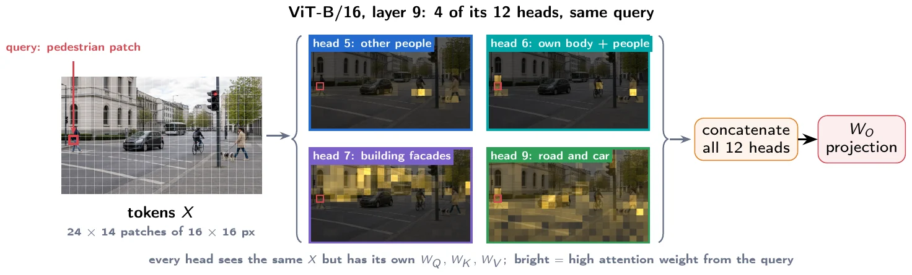{#fig-mha fig-alt="The scene with a query patch and four attention heat maps for heads 5, 6, 7, and 9, feeding a concatenation and output projection"}
:::

$$
\operatorname{MHA}(\mathbf{X})=\operatorname{Concat}(\text{head}_1,\dots,\text{head}_h)\,\mathbf{W}_O,
$$

where $\mathbf{X}$ holds the input tokens, $h$ is the number of heads (12 here), $\text{head}_m$ is the output of head $m$ with its own $\mathbf{W}_Q,\mathbf{W}_K,\mathbf{W}_V$, $\operatorname{Concat}$ places the heads side by side, and $\mathbf{W}_O$ is a learned output projection. Heads provide separate learned subspaces, not guaranteed human-interpretable roles.

### The transformer block

::: {.figure-panel}
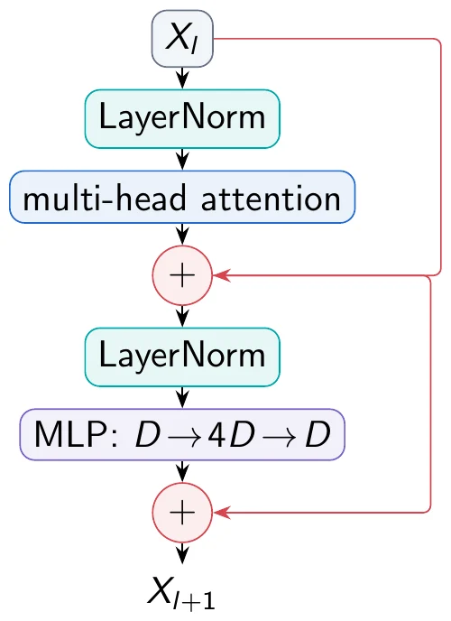{#fig-transformer-block fig-alt="A vertical block diagram with LayerNorm, multi-head attention, an MLP, and two residual additions"}
:::

$$
\mathbf{X}'=\mathbf{X}_\ell+\operatorname{MHA}\big(\operatorname{LN}(\mathbf{X}_\ell)\big),
\qquad
\mathbf{X}_{\ell+1}=\mathbf{X}'+\operatorname{MLP}\big(\operatorname{LN}(\mathbf{X}')\big),
$$

where $\mathbf{X}_\ell$ are the tokens entering block $\ell$, $\mathbf{X}_{\ell+1}$ those leaving it, $\operatorname{LN}$ is LayerNorm, and the MLP maps the token width $D$ to $4D$ and back. **Attention mixes information between tokens; the MLP mixes information between channels**, independently at each token. Residual paths stabilize deep optimization, pre-normalization is common in modern variants, and position information prevents permutation ambiguity.

### Hybrid and hierarchical vision models

::: {.figure-panel}
{#fig-swin fig-alt="A pipeline from an image through a conv stem, windowed tokens, patch merging, shifted window attention, and a multi-scale pyramid"}
:::

Here $H,W$ are the height and width of the token grid and $C$ the channels per token. The Swin Transformer [@liu2021swin] combines three ideas: **local windows** reduce the attention cost (attention is computed only inside small windows, so the cost grows linearly with the number of tokens); **shifted windows** exchange information between windows; and a **hierarchy** — patch merging halves $H,W$ and doubles $C$ — produces multiple scales for detection and segmentation.

### The backbone: a reusable feature extractor

::: {.figure-panel}
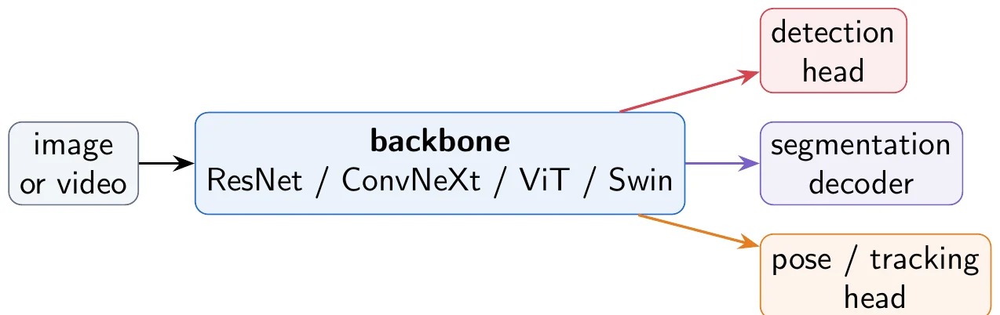{#fig-backbone fig-alt="An image feeding a backbone that feeds a detection head, a segmentation decoder, and a pose or tracking head"}
:::

A backbone outputs feature vectors or maps; the head maps them to a task representation. Pretraining can be supervised, self-supervised, or multimodal.

::: {.checkpoint}
**Classification is not enough**

"Street scene, $0.84$" discards the object count, each object's location and scale, their overlaps and relationships, and the uncertainty per object. Mapping an image to a **set of objects** changes both the prediction space and the evaluation protocol.
:::

```{=html}
<div class="note-part"><span>Part IV</span>Object detection</div>
```

## The detection problem {#sec-detection}

### Localization versus detection

::: {.figure-panel}
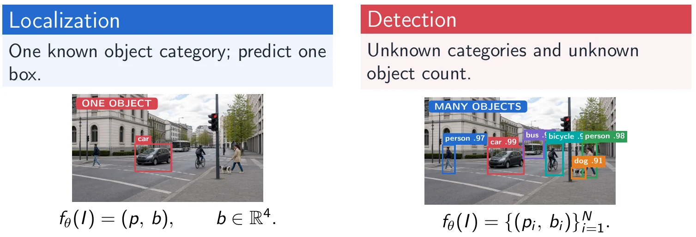{#fig-loc-vs-det fig-alt="Two versions of the scene, one with a single box, one with six labelled boxes"}
:::

$$
\text{localization: } f_\theta(I)=(\mathbf{p},\mathbf{b}),\ \mathbf{b}\in\mathbb{R}^4;
\qquad
\text{detection: } f_\theta(I)=\{(\mathbf{p}_i,\mathbf{b}_i)\}_{i=1}^{N},
$$

where $I$ is the input image, $f_\theta$ the network with weights $\theta$, $\mathbf{p},\mathbf{p}_i$ class probabilities, $\mathbf{b},\mathbf{b}_i$ boxes (four real numbers each), $N$ the number of objects in the image, and $i$ the object index. Detection adds a **cardinality problem**: the model must decide which candidates correspond to real objects.

### Bounding-box parameterization

::: {.figure-panel}
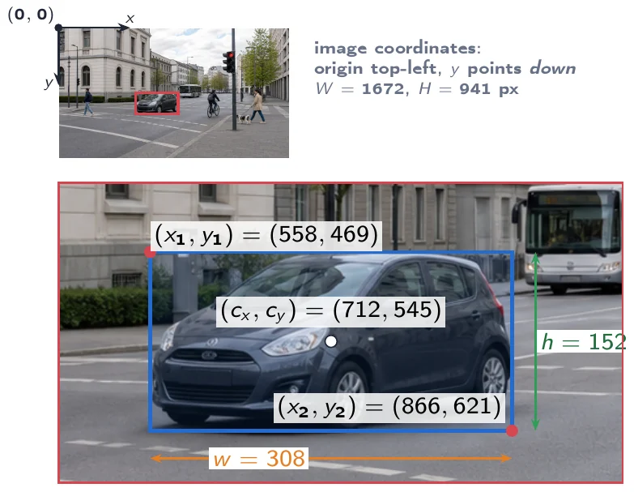{#fig-box-param fig-alt="The car with its box annotated with corners, centre, width 308, and height 152"}
:::

$$
(x_1,y_1,x_2,y_2)=(558,469,866,621)
\;\Longleftrightarrow\;
(c_x,c_y,w,h)=(712,545,308,152),
$$

where $(x_1,y_1)$ is the top-left corner, $(x_2,y_2)$ the bottom-right corner, $(c_x,c_y)$ the box centre, and $w,h$ the box width and height, all in pixels. Dividing by the image width and height $(W,H)=(1672,941)$ gives $(0.426,0.579,0.184,0.162)$. Normalize coordinates by the image size, enforce $w,h>0$ through a suitable transform, and regress relative offsets, which are easier to learn across scales.

### The detection output

A detector emits a fixed budget of predictions

$$
\hat{\mathcal{Y}}=\{(\hat{\mathbf{p}}_i,\hat{\mathbf{b}}_i)\}_{i=1}^{K},
\qquad
\hat{\mathbf{p}}_i\in[0,1]^{C+1},
\qquad
\hat{\mathbf{b}}_i\in\mathbb{R}^4,
$$

where the hat marks predicted values, $i$ indexes predictions, $K$ is the (fixed) number of predictions, $C$ the number of object classes (plus one "no object" or background class), $\hat{\mathbf{p}}_i$ the class probabilities, and $\hat{\mathbf{b}}_i$ the box. The number of true objects $N$ varies, and usually $K\gg N$; assignment and filtering select the detections. Producing predictions is easy to tensorize — deciding which ones count is the central difficulty.

### Detection as multitask learning

::: {.figure-panel}
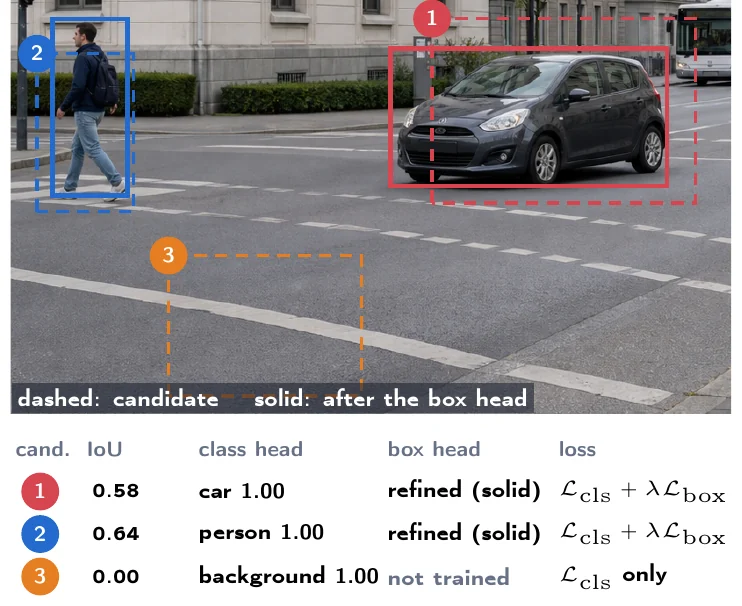{#fig-multitask fig-alt="The scene with three numbered candidate boxes above a table of IoU, class head output, box head status, and loss"}
:::

$$
\mathcal{L}_i=\mathcal{L}_{\text{cls}}(\mathbf{p}_i,c_i)+\lambda\,\mathbf{1}[c_i\neq\varnothing]\,\mathcal{L}_{\text{box}}(\mathbf{b}_i,\mathbf{b}_i^{*}),
$$ {#eq-det-loss}

where $\mathcal{L}_i$ is the loss of candidate $i$, $\mathcal{L}_{\text{cls}}$ a classification loss, $\mathcal{L}_{\text{box}}$ a box-regression loss, $\mathbf{p}_i$ the class probabilities, $c_i$ the assigned true class, $\varnothing$ background, $\mathbf{1}[\cdot]$ equal to 1 if its argument is true and 0 otherwise, $\mathbf{b}_i$ the predicted box, $\mathbf{b}_i^{*}$ the matched true box, and $\lambda$ a loss weight. Every candidate learns foreground versus background; only matched positives receive box supervision; the loss scales must be balanced.

### Intersection over Union

::: {.figure-panel}
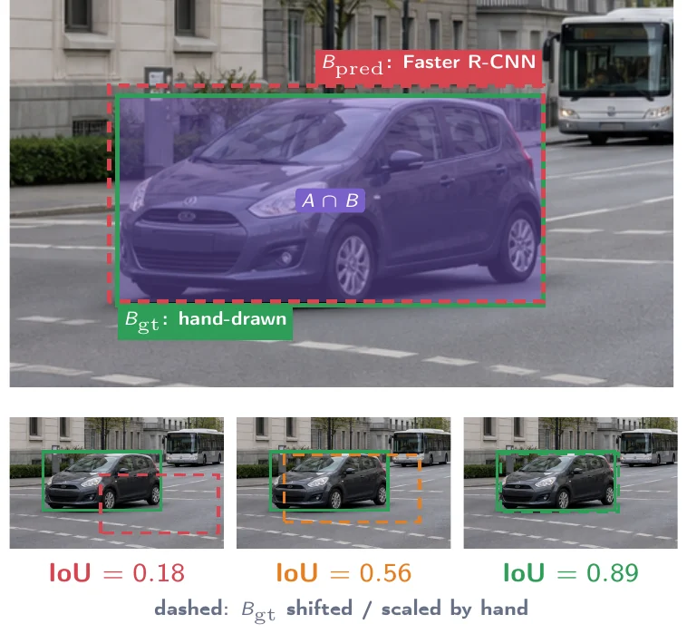{#fig-iou fig-alt="The car with overlapping predicted and true boxes, and three examples with IoU 0.18, 0.56, and 0.89"}
:::

$$
\operatorname{IoU}(A,B)=\frac{|A\cap B|}{|A\cup B|}\in[0,1],
$$

where $A$ and $B$ are two boxes (for example the true box $B_{\text{gt}}$ and the predicted box $B_{\text{pred}}$), $|\cdot|$ is an area in pixels², and $\cap,\cup$ are intersection and union. IoU is $0$ for disjoint boxes and $1$ for identical ones; it is scale invariant and used both for matching and for evaluation.

### Precision and recall for detection

::: {.figure-panel}
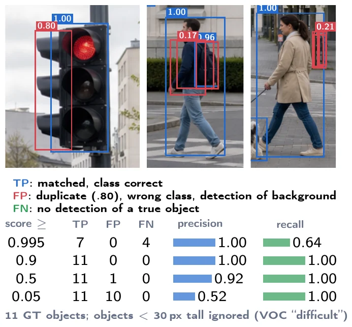{#fig-pr fig-alt="Three crops with true-positive and false-positive boxes above a table of thresholds with TP, FP, FN, precision, and recall"}
:::

A prediction is a **true positive** (TP) when its class is correct, its IoU with a true object is at least $\tau$ (the IoU threshold, e.g. $0.5$), and that object is not already matched; otherwise it is a **false positive** (FP). True objects left unmatched are **false negatives** (FN, missed objects). Then

$$
\mathrm{P}=\frac{\mathrm{TP}}{\mathrm{TP}+\mathrm{FP}},
\qquad
\mathrm{R}=\frac{\mathrm{TP}}{\mathrm{TP}+\mathrm{FN}},
$$

where P is the precision — how accurate the predictions are — and R the recall — how good the detector is at finding all objects. On the scene, a score threshold of $0.995$ gives P $=1.00$ and R $=7/11=0.64$; a threshold of $0.05$ gives R $=1.00$ but P $=11/21=0.52$. Raising the threshold usually raises precision and lowers recall; duplicates count as false positives. A detector is therefore evaluated **over a confidence sweep**: the area under the precision–recall curve is the average precision (AP), and its mean over classes is the mAP [@everingham2010pascal; @lin2014microsoft].

## Two-stage detectors

### Why not slide a classifier everywhere?

::: {.figure-panel}
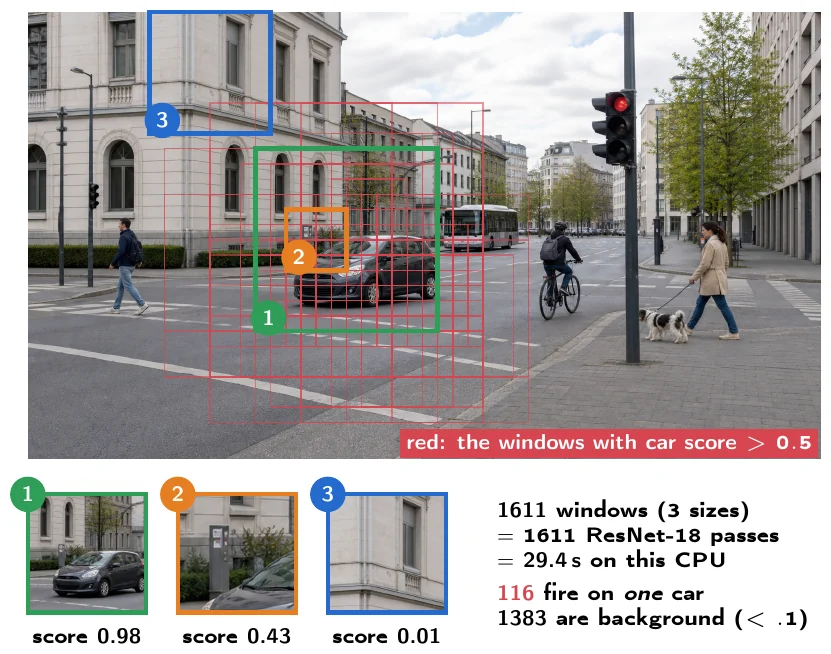{#fig-sliding fig-alt="The scene covered by red windows, with three example windows and their car scores"}
:::

Adjacent windows repeat almost identical computation; object size and aspect ratio are unknown; one object activates many overlapping windows; and background windows vastly outnumber objects. The question that drives everything below: *which computation can be shared across all windows?*

### Proposals, then decisions

::: {.figure-panel}
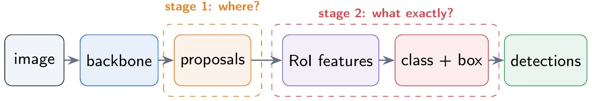{#fig-two-stage fig-alt="A pipeline: image, backbone, proposals, RoI features, class plus box, detections"}
:::

Object detectors come in two families: **two-stage** and **one-stage**. A two-stage detector applies expensive per-object reasoning only to a sparse proposal set, at the cost of extra latency and pipeline complexity. Its key component is the region-proposal step.

### Region proposals

::: {.figure-panel}
{#fig-proposals fig-alt="Three stages of hierarchical region merging on the scene and the resulting proposal boxes"}
:::

A region-proposal algorithm such as selective search [@uijlings2013selective] or EdgeBoxes [@zitnick2014edge] returns a few thousand **class-agnostic** boxes that probably contain an object; it never says which class — stage 2 decides. The goal is **high recall with few boxes** (thousands, not millions of windows), using generic cues only: colour, texture, edges, closed contours. Most proposals are background, which the detector rejects. Selective search takes about 2 s per image on a CPU.

### Non-maximum suppression

::: {.figure-panel}
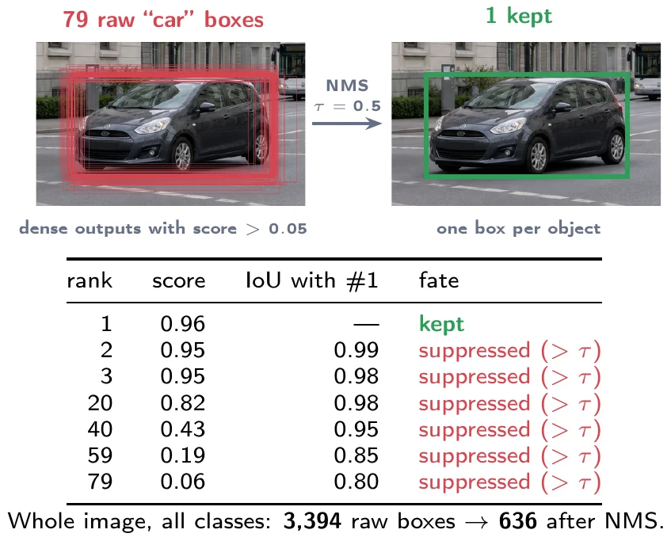{#fig-nms fig-alt="A car covered with 79 red boxes and the same car with one green box, above a table of scores, IoUs, and fates"}
:::

Detectors produce many overlapping boxes per object. **Non-maximum suppression** [@neubeck2006efficient] keeps one:

1. select the highest-scoring box (score = detector confidence);
2. remove every remaining box of the same class whose IoU with it exceeds the threshold $\tau_{\text{nms}}$;
3. repeat until no candidates remain.

::: {.figure-panel}
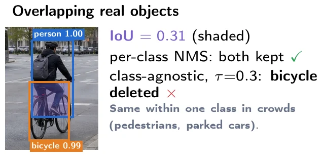{#fig-nms-limits fig-alt="A cyclist crop with overlapping person and bicycle boxes and the outcome of NMS"}
:::

NMS has limitations: real objects may overlap strongly in **crowds**; one **threshold** $\tau$ does not fit every class and scale; and NMS is a **discrete step**, not learned end to end.

### R-CNN: a CNN on every region proposal

::: {.figure-panel}
{#fig-rcnn fig-alt="Four steps: region proposals, warped crops, a CNN per crop, and per-class SVMs and box regressors, ending in detections"}
:::

R-CNN [@girshick2014rich] is **trained in separate stages**: fine-tune the CNN on warped crops, fit one SVM per class on its (cached) features, then fit the box regressors — three separate objectives. Its bottleneck is step 3: about 2000 CNN passes per image recompute the same convolutions on overlapping crops, about 47 s per image with VGG-16 on a GPU.

### Fast R-CNN: one CNN pass, then pool every proposal

::: {.figure-panel}
{#fig-fast-rcnn fig-alt="Pipeline: image with proposals, a shared feature map, RoI pooling into 7 by 7 bins, and two sibling heads for class and box"}
:::

Fast R-CNN [@girshick2015fast] shares the convolutions and is trained jointly, given the proposals, with one multitask loss per RoI:

$$
L=\mathcal{L}_{\text{cls}}(\mathbf{p},u)+\lambda\,[u\ge1]\,\mathcal{L}_{\text{loc}}(\mathbf{t}^{u},\mathbf{v}),
\qquad
\mathcal{L}_{\text{cls}}=-\log p_u,
\qquad
\mathcal{L}_{\text{loc}}=\sum_{i\in\{x,y,w,h\}}\operatorname{smooth}_{L_1}\!\big(t_i^{u}-v_i\big),
$$

where $\mathbf{p}$ is the softmax over $K+1$ classes ($K$ object classes plus background), $u$ the true class ($0$ for background), $\mathbf{t}^{u}$ the predicted box offsets for class $u$, $\mathbf{v}$ the target offsets, $i$ one of $x,y,w,h$, $[u\ge1]$ equal to 1 for an object and 0 for background, and $\lambda$ a balance weight (1 in the paper). The robust loss $\operatorname{smooth}_{L_1}(z)$ equals $0.5z^2$ if $|z|<1$ and $|z|-0.5$ otherwise.

Shared convolutions bring the cost from 47 s to about 0.32 s per image (VGG-16), with no SVMs. The bottleneck is now the proposals: selective search still takes about 2 s per image. The next step is to make the proposals **learnable**.

### Anchor boxes

::: {.figure-panel}
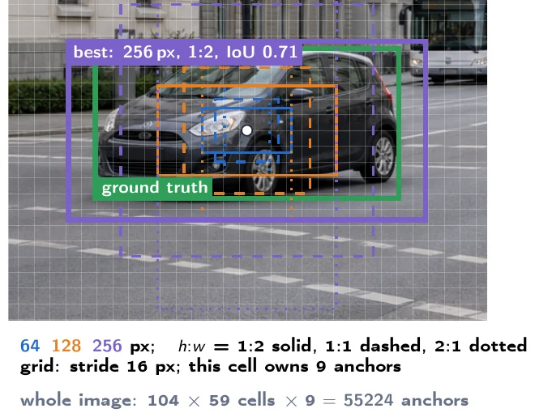{#fig-anchors fig-alt="The car with nine anchor boxes of different sizes and shapes centred on one grid cell"}
:::

Each location owns reference boxes $\mathbf{a}=(c_x^a,c_y^a,w_a,h_a)$ with several scales and aspect ratios [@ren2015faster; @liu2016ssd]. The head predicts objectness, class, and offsets $(t_x,t_y,t_w,t_h)$, decoded as

$$
\hat c_x=c_x^a+t_x w_a,
\qquad
\hat c_y=c_y^a+t_y h_a,
\qquad
\hat w=w_a e^{t_w},
\qquad
\hat h=h_a e^{t_h},
$$ {#eq-anchor-decode}

where $(c_x^a,c_y^a)$ is the anchor centre, $w_a,h_a$ its width and height, and $(\hat c_x,\hat c_y,\hat w,\hat h)$ the centre and size of the predicted box $\hat{\mathbf{b}}$. The exponential keeps the size positive.

### Anchor matching

::: {.figure-panel}
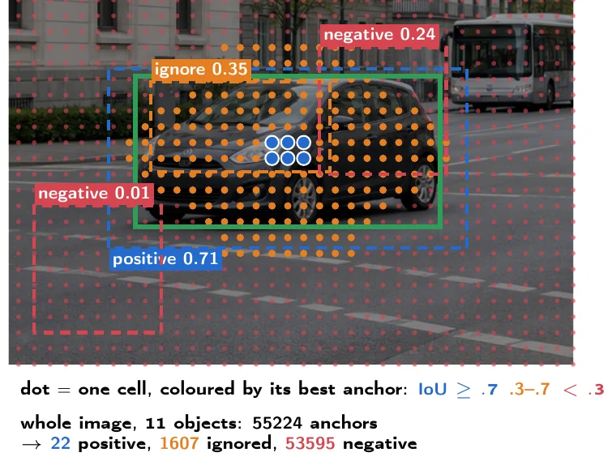{#fig-anchor-matching fig-alt="The car covered by a grid of coloured dots, with example anchors labelled negative, ignore, and positive"}
:::

$$
y(\mathbf{a},\mathbf{g})=
\begin{cases}
+1 & \operatorname{IoU}(\mathbf{a},\mathbf{g})\ge\tau_+,\\
0 & \operatorname{IoU}(\mathbf{a},\mathbf{g})<\tau_-,\\
\perp & \text{otherwise},
\end{cases}
$$

where $\mathbf{a}$ is an anchor, $\mathbf{g}$ a ground-truth box, $y(\mathbf{a},\mathbf{g})$ the training label of $\mathbf{a}$ ($+1$ object, $0$ background, $\perp$ ignored, no label), and $\tau_+,\tau_-$ the positive and negative IoU thresholds ($0.7$ and $0.3$ in the Faster R-CNN RPN). Thresholds are design choices, not universal constants; ignored anchors contribute no classification loss; and **the assignment defines the labels seen during training**.

### Faster R-CNN: Fast R-CNN + a learned RPN

::: {.figure-panel}
{#fig-faster-rcnn fig-alt="Faster R-CNN pipeline with a shared backbone, RPN objectness map, top proposals, RoIAlign crops, class and box outputs, and final detections"}
:::

Faster R-CNN [@ren2015faster] replaces selective search by a learned **region proposal network** that reuses the detector's feature map. Per cell, $k$ anchors give objectness plus 4 offsets, and NMS keeps the top $N$ proposals ($k=9$, $N=300$ in the paper). Proposals are class-agnostic; the second stage classifies and refines each RoI. Proposals now take about 10 ms instead of about 2 s, and the whole detector runs at about 5 frames per second.

### From R-CNN to Faster R-CNN: what changed

::: {.figure-panel}
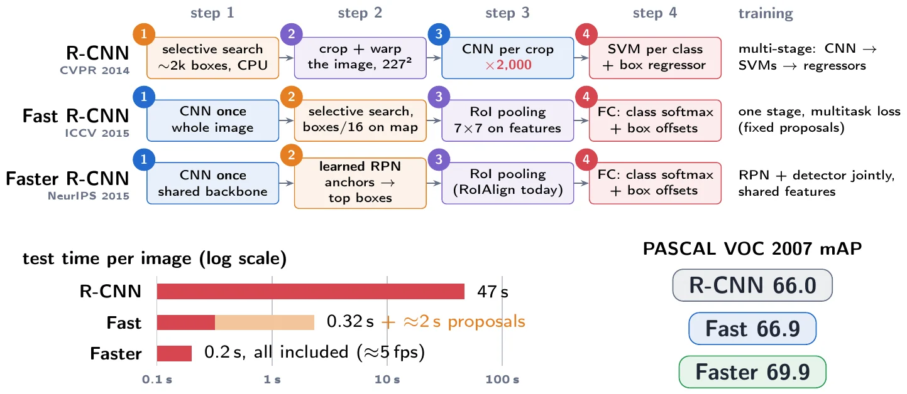{#fig-rcnn-family fig-alt="A table of the four steps of R-CNN, Fast R-CNN, and Faster R-CNN, with a log-scale bar chart of test time and their mAP"}
:::

| | Proposals | CNN | Per-region features | Training |
|---|---|---|---|---|
| R-CNN (2014) | selective search, CPU | on every warped crop | — | CNN → SVMs → regressors |
| Fast R-CNN (2015) | selective search, CPU | once per image | RoI pooling | one multitask loss |
| Faster R-CNN (2015) | learned RPN on shared features | once per image | RoI pooling (RoIAlign today) | RPN and detector jointly |

: Each step removed the slowest part: the CNN moved before the cropping (Fast), then the proposals were learned (Faster). {#tbl-rcnn-family}

## One-stage detectors

::: {.figure-panel}
{#fig-one-stage fig-alt="Three brightened copies of the scene for pyramid levels P3, P4, and P5, and the final detections"}
:::

A one-stage detector [@liu2016ssd; @lin2017focal] has no explicit proposal or RoI stage: it predicts densely at several resolutions in one pass, with $K$ the number of classes. This gives low latency and simple batching, and the multi-scale maps serve different object sizes — but dense supervision creates severe **class imbalance**.

### YOLO

::: {.figure-panel}
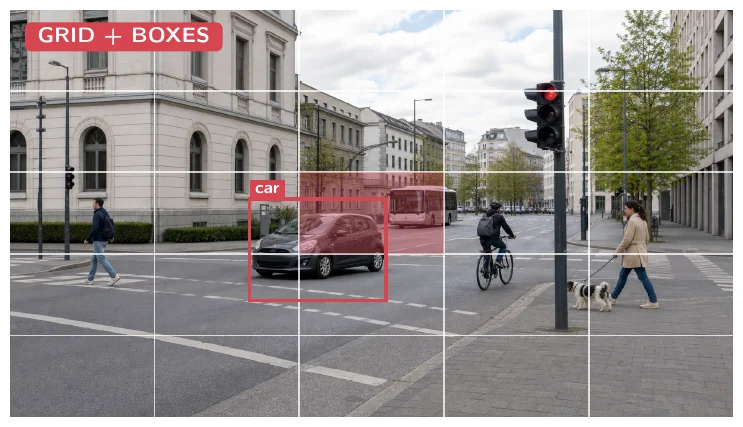{#fig-yolo fig-alt="The scene with a coarse grid and the car's box in the cell containing its centre"}
:::

YOLO [@redmon2016you] maps pixels directly to an output tensor of size

$$
S\times S\times(B\cdot5+C),
$$

where $S$ is the grid size, $B$ the number of boxes per cell, $5$ the values per box ($x,y,w,h$, confidence), and $C$ the number of classes. One network maps pixels directly to detections and reasons with global image context. Modern YOLO variants use different heads and assignment rules.

### The problem with one-stage detectors

::: {.figure-panel}
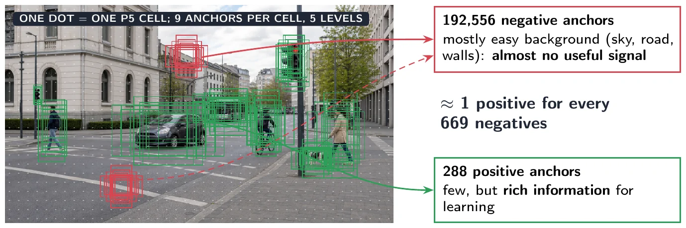{#fig-imbalance fig-alt="The scene with grey negative and green positive anchors, and boxes counting negatives and positives"}
:::

A one-stage detector classifies every anchor — here 193 374 anchors densely cover the image — which creates a **foreground–background imbalance**. Two-stage detectors avoid it by filtering first: about 2000 proposals, then mini-batches sampled with about 25% positives.

### Motivation of the focal loss

::: {.figure-panel}
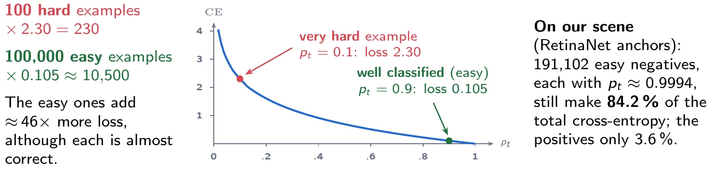{#fig-focal-motivation fig-alt="The cross-entropy curve with a hard and an easy example marked, and the total losses of many hard and easy examples"}
:::

Recall the cross-entropy of the true class:

$$
\operatorname{CE}(p_t)=-\log p_t,
\qquad
p_t=\begin{cases}p & \text{if } y=1,\\ 1-p & \text{otherwise},\end{cases}
$$

where $p$ is the predicted probability of "object", $y\in\{0,1\}$ the true label, and $p_t$ the probability given to the true class: a **hard** example has small $p_t$ (a mistake), an **easy** one has $p_t$ close to 1. On the scene, RetinaNet's 191 102 easy negatives, each with $p_t\approx0.9994$, still make 84.2% of the total cross-entropy, while the positives make only 3.6%. Many tiny losses dominate the total loss and its gradient. *How can we down-weight the examples that are already well classified?*

### The focal loss {#sec-focal}

::: {.figure-panel}
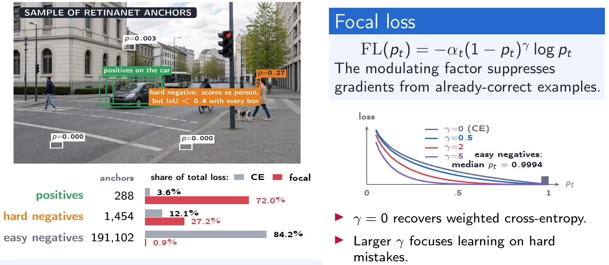{#fig-focal fig-alt="Scene with example anchors, a bar chart of loss shares under cross-entropy and focal loss, and loss curves for several gamma values"}
:::

$$
\operatorname{FL}(p_t)=-\alpha_t\,(1-p_t)^{\gamma}\log p_t,
$$

where $p_t$ is the probability of the true class, $\alpha_t$ a class weight, $\gamma\ge0$ the focusing parameter, and $(1-p_t)^\gamma$ the **modulating factor** [@lin2017focal]. The factor is near 0 for already-correct examples ($p_t\to1$) and near 1 for mistakes, so it suppresses the gradients of easy examples. With $\gamma=0$ the focal loss is weighted cross-entropy; larger $\gamma$ focuses learning on hard mistakes. For an easy negative with $p_t=0.9994$ and $\gamma=2$, the factor is $(0.0006)^2\approx3.6\times10^{-7}$. The focal loss enabled accurate dense one-stage detection in RetinaNet.

## Modern detectors with transformers

### Detection as set prediction

::: {.figure-panel}
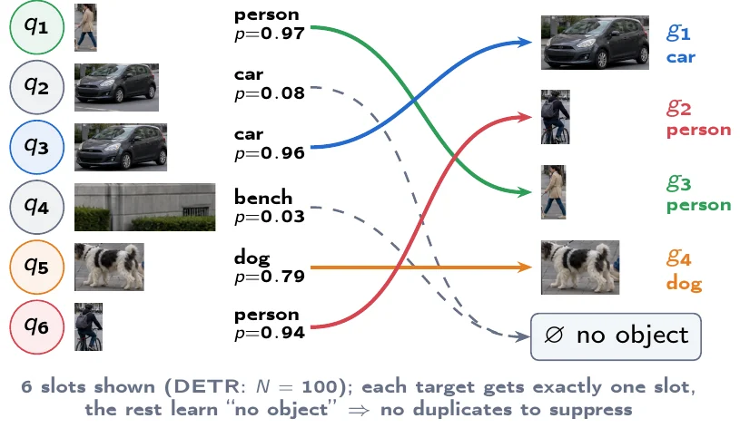{#fig-set-prediction fig-alt="Six prediction slots connected by coloured lines to four targets and a no-object node"}
:::

DETR [@carion2020end] predicts a **fixed-size unordered set** of $N$ slots ($N=100$), where $q_i$ is prediction slot $i$, $g_j$ ground-truth object $j$, $\varnothing$ the "no object" class, and $p$ a predicted class score. Each object is matched to exactly one slot; unmatched slots are trained as "no object". Because a duplicate is penalized, **duplicate removal is part of the learning objective** — no NMS is needed.

### DETR

::: {.figure-panel}
{#fig-detr fig-alt="The DETR pipeline: image, CNN tokens with positional encoding, transformer encoder and decoder with object queries, and class and box heads"}
:::

Here $H,W$ are the image height and width, $d$ is the token dimension, and $q_i$ is learned object query $i$. Global attention connects distant image regions; learned queries compete for objects in parallel; and a bipartite set loss trains the complete pipeline. The original DETR converges slowly and struggles with small objects; Deformable DETR [@zhu2021deformable] addresses both.

### Hungarian matching

::: {.figure-panel}
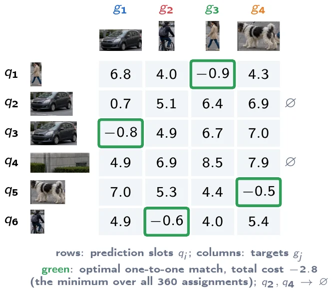{#fig-hungarian fig-alt="A 6 by 4 table of costs with four green cells marking the optimal assignment"}
:::

$$
\mathcal{C}(i,j)=-p_i(c_j)+\lambda_1\lVert\mathbf{b}_i-\mathbf{b}_j\rVert_1+\lambda_g\mathcal{L}_{\text{GIoU}}(\mathbf{b}_i,\mathbf{b}_j),
\qquad
\hat\sigma=\arg\min_{\sigma}\sum_{j}\mathcal{C}\big(\sigma(j),j\big),
$$

where $\mathcal{C}(i,j)$ is the cost of slot $q_i$ for target $g_j$, $c_j$ the class of $g_j$, $p_i(c_j)$ slot $i$'s score for $c_j$, $\mathbf{b}_i,\mathbf{b}_j$ the predicted and target boxes, $\lambda_1,\lambda_g$ weights, $\mathcal{L}_{\text{GIoU}}$ one minus the generalized IoU [@rezatofighi2019generalized] (an IoU that still gives a useful signal when boxes do not overlap), $\sigma$ an assignment $j\mapsto\sigma(j)$, and $\hat\sigma$ the cheapest one, found by the Hungarian algorithm [@kuhn1955hungarian]. For $q_3$ against $g_1$ (the car) with $\lambda_1=5$, $\lambda_g=2$: $-0.96+5\cdot0.009+2\cdot0.06=-0.80$. **Match first; then compute the class and box losses on the selected pairs.**

```{=html}
<div class="note-part"><span>Part V</span>Segmentation</div>
```

## Semantic segmentation {#sec-segmentation}

::: {.figure-panel}
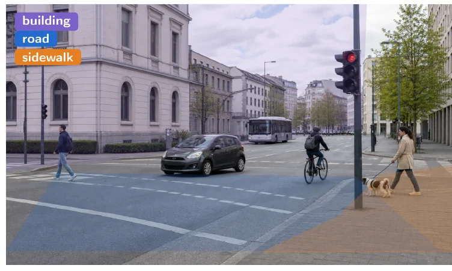{#fig-semantic fig-alt="The scene with building, road, and sidewalk regions overlaid"}
:::

$$
\mathbf{z}=f_\theta(\mathbf{x})\in\mathbb{R}^{H\times W\times C},
\qquad
\hat y_{ij}=\arg\max_{c}\,z_{ijc},
$$

where $\mathbf{x}$ is the input image, $f_\theta$ the network with weights $\theta$, $\mathbf{z}$ the per-pixel class scores, $H,W$ the image height and width, $C$ the number of classes, $z_{ijc}$ the score of class $c$ at pixel $(i,j)$, $\hat y_{ij}$ the predicted label of pixel $(i,j)$, and $\arg\max_c$ selects the highest-scoring class. The output stays aligned with the input; "stuff" (road, sky) and "things" (car, person) share one label map; and same-class objects are **not** separated into instances. Classification asks *what*; segmentation asks *what at each location*.

### Naive patch classification

::: {.figure-panel}
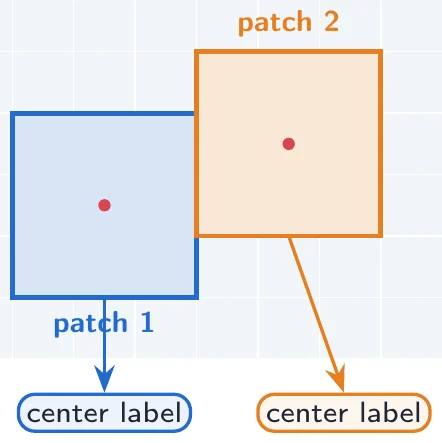{#fig-patch-classification fig-alt="Two overlapping patches, each with a centre dot pointing to a centre label"}
:::

Training a classifier on a crop around each pixel [@farabet2013learning] is correct but wasteful: neighbouring patches overlap almost completely and their features are recomputed again and again; small patches miss context while large ones multiply the cost; and a full image needs about $H\times W$ classifier calls. The missing ingredient is **shared computation**.

### Fully convolutional networks

::: {.figure-panel}
{#fig-fcn fig-alt="Pipeline: image, shared features, class-score maps, the upsampled map, and the final label map"}
:::

A fully convolutional network [@long2015fully] replaces the classifier's dense layers by convolutions, so spatial score maps emerge in one forward pass. Here $H,W$ are the image height and width, $h,w$ the feature-map height and width ($8\times$ smaller), and $C=21$ the number of classes. The network accepts variable image sizes, shares features across locations, and trades resolution for receptive field. Dense prediction does not require dense repetition.

### Encoder–decoder design

::: {.figure-panel}
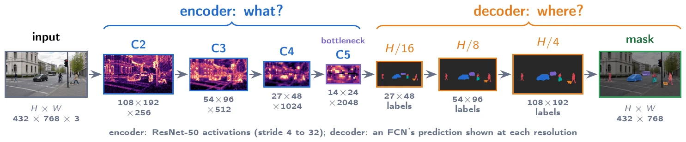{#fig-encoder-decoder fig-alt="Encoder activation maps C2 to C5 shrinking, followed by decoder label maps growing back to full resolution"}
:::

Here $H\times W$ is the input height × width, $H/s$ a map $s$ times smaller than the input, and $C_2$–$C_5$ the ResNet stages. The **encoder** answers *what?*: downsampling enlarges the receptive field and builds invariance but discards precise location. The **decoder** answers *where?*: upsampling restores spatial resolution but must reconstruct boundaries from compressed features. Segmentation needs both global context and pixel-level localization.

### Upsampling methods

::: {.figure-panel}
{#fig-upsampling fig-alt="An 8 by 8 score patch and four 16 by 16 upsampled versions"}
:::

Upsampling increases sampling density; it cannot recover detail that the encoder never preserved [@dumoulin2016guide; @odena2016deconvolution].

### Skip connections recover detail

::: {.figure-panel}
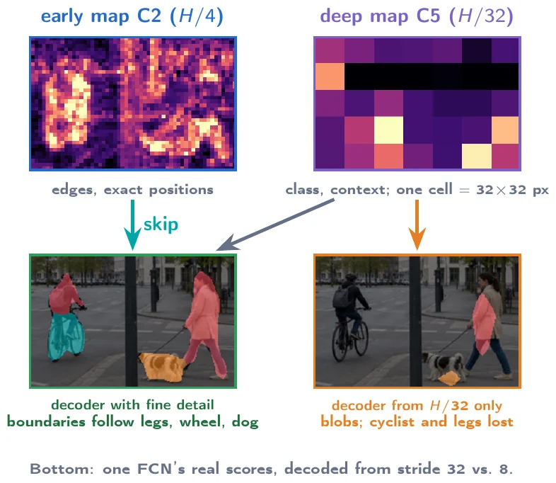{#fig-skip fig-alt="A fine and a coarse activation map above a detailed and a blobby segmentation result"}
:::

Here $H$ is the input height, and $H/4$, $H/32$ denote maps 4 and 32 times smaller. Early maps retain edges, corners, and accurate coordinates; deep maps encode class and broad context; concatenation or addition lets the decoder use both. Feature sizes must be aligned by padding, cropping, or resizing (@eq-conv-size). Unlike ResNet's residual links, which mainly ease optimization within one scale, these links **bridge scales**.

### U-Net

::: {.figure-panel}
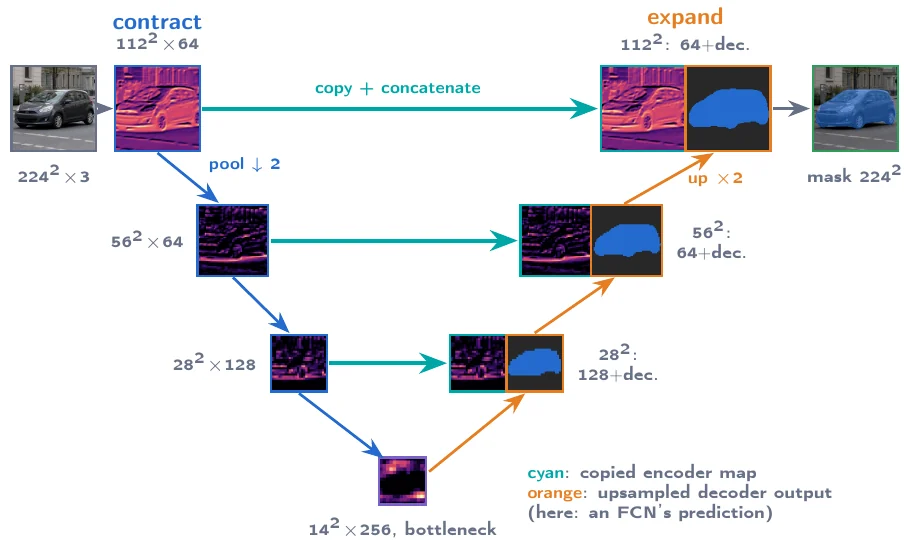{#fig-unet fig-alt="A U-shaped diagram of feature maps with horizontal copy and concatenate arrows"}
:::

In the figure, $112^2\times64$ denotes a $112\times112$ map with 64 channels, and "+dec." adds the decoder's channels. U-Net [@ronneberger2015unet] has a symmetric encoder and decoder; its skip features are **concatenated**, not merely added; and it localizes well with limited annotated data, which made it the standard in biomedical imaging. Modern U-Nets add padding, normalization, and residual blocks. The enduring idea: **pair semantics with same-scale detail.**

### DeepLab: context at multiple scales

::: {.figure-panel}
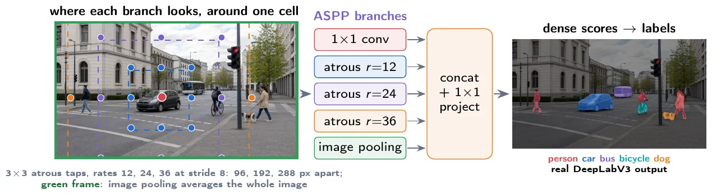{#fig-deeplab fig-alt="The scene with dilated sampling points, five parallel branches, and the resulting label map"}
:::

**Atrous** (dilated) convolution inserts gaps into the kernel:

$$
y[p]=\sum_{k}w[k]\,x[p+r k],
$$

where $x,y$ are the input and output feature maps, $p$ an output position, $k$ a kernel tap ($-1,0,1$ for a size-3 kernel), $w[k]$ a kernel weight, and $r$ the rate, the gap between taps ($r=1$ is an ordinary convolution). It enlarges the field of view without another pooling step. Running several rates in parallel (atrous spatial pyramid pooling) captures objects at different scales [@chen2017rethinking], and a light decoder can sharpen boundaries [@chen2018encoder].

### Segmentation metrics

::: {.figure-panel}
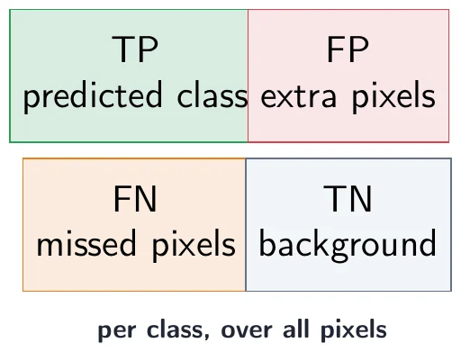{#fig-seg-metrics fig-alt="A two by two grid labelled TP, FP, FN, and TN"}
:::

$$
\text{pixel accuracy}=\frac{\sum_c\mathrm{TP}_c}{|\Omega|},
\qquad
\mathrm{IoU}_c=\frac{\mathrm{TP}_c}{\mathrm{TP}_c+\mathrm{FP}_c+\mathrm{FN}_c},
\qquad
\mathrm{mIoU}=\frac1C\sum_{c=1}^{C}\mathrm{IoU}_c,
$$

where $c$ is a class, $C$ the number of classes, $\mathrm{TP}_c$ the class-$c$ pixels predicted as $c$, $\mathrm{FP}_c$ the other pixels predicted as $c$, $\mathrm{FN}_c$ the class-$c$ pixels missed, and $\Omega$ the set of all pixels, with $|\Omega|$ their count. Accuracy can look excellent when the background dominates; mIoU gives each class equal weight. A model that predicts only "road" on images that are 70% road reaches 70% pixel accuracy, but its IoU is $0$ for every other class.

## Instance segmentation

::: {.figure-panel}
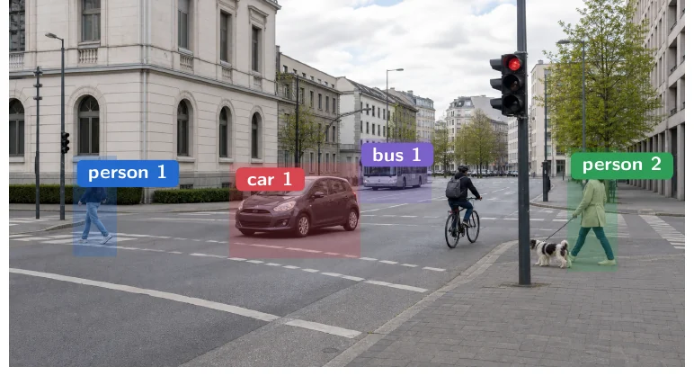{#fig-instance fig-alt="The scene with separate masks and labels for two people, a car, and a bus"}
:::

$$
\big\{(c_k,s_k,\mathbf{b}_k,\mathbf{M}_k)\big\}_{k=1}^{K},
$$

where $k$ is the instance index, $K$ the number of instances, $c_k$ the class, $s_k$ the confidence score, $\mathbf{b}_k$ the box, and $\mathbf{M}_k$ a binary mask of the object's pixels [@hariharan2014simultaneous]. Each countable thing receives an identity, overlapping objects remain separate, masks capture shape while boxes help localize proposals, and "stuff" is usually left to a semantic branch. Instance segmentation predicts classes **and** individuals.

### Mask R-CNN {#sec-mask-rcnn}

::: {.figure-panel}
{#fig-mask-rcnn fig-alt="Mask R-CNN pipeline: feature map, proposals, RoIAlign grid, class and box head, a 28 by 28 person mask, and the scene with masks"}
:::

Mask R-CNN [@he2017mask] adds **one extra branch** to Faster R-CNN: Faster R-CNN supplies proposals, classes, and boxes, and a parallel FCN predicts an $m\times m$ mask for each RoI, where $m$ is the mask side (28 here) and the box is given by its top-left and bottom-right corners $(x_1,y_1)$ and $(x_2,y_2)$. The mask uses a sigmoid per pixel and a pixel-wise binary cross-entropy loss, and detection and masks share the backbone features. **RoIAlign** replaces RoI pooling: it samples each bin by bilinear interpolation instead of rounding coordinates to the feature grid, which matters when the output is a boundary rather than a box.

```{=html}
<div class="note-part"><span>Part VI</span>Pose estimation and tracking</div>
```

## Pose estimation

::: {.figure-panel}
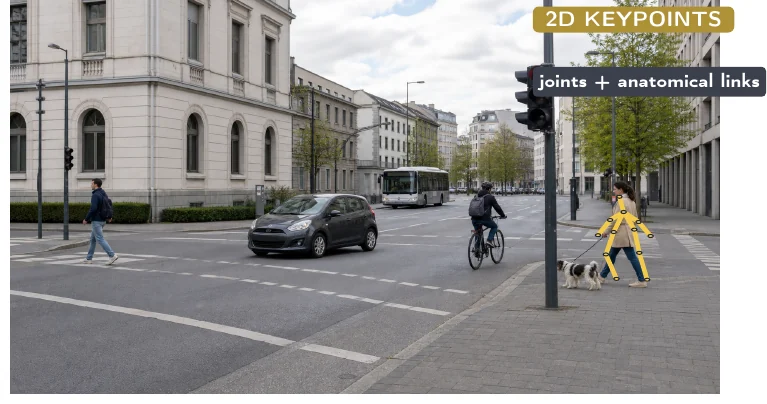{#fig-pose fig-alt="The scene with a skeleton of joints and limbs over the walking woman"}
:::

Pose estimation predicts a structured set of landmarks for a person or object:

$$
\mathcal{K}=\{(x_j,y_j,v_j)\}_{j=1}^{J},
$$

where $\mathcal{K}$ holds the keypoints of one person, $(x_j,y_j)$ is the image position of joint $j$, $v_j$ records its visibility or confidence, and $J$ is the number of joints (17 in COCO [@lin2014microsoft]). 2D pose gives keypoints in image coordinates; 3D pose gives joints in camera or world coordinates. A fixed skeleton graph connects related joints, and multiple people add a second problem: assigning joints to identities. DeepPose [@toshev2014deeppose] regressed joint coordinates directly; modern methods predict one map per joint.

### Keypoint R-CNN: one more head on Mask R-CNN

::: {.figure-panel}
{#fig-keypoint-rcnn fig-alt="Mask R-CNN pipeline with a new keypoint head producing 17 joint maps, a left-knee map, and the decoded skeleton on the scene"}
:::

The decoded joint position is

$$
\hat x=x_1+\big(\hat u+\tfrac12\big)\frac{w}{56},
\qquad
\hat y=y_1+\big(\hat v+\tfrac12\big)\frac{h}{56},
$$

where $(x_1,y_1)$ is the top-left corner of the person box, $w,h$ its width and height, $(\hat u,\hat v)$ the column and row of the arg-max cell of a $56\times56$ map, and $(\hat x,\hat y)$ the decoded joint in image pixels. For the woman's left knee, the box is $x_1=1378$, $y_1=435$, $w=121$, $h=258$ and the arg max is $(\hat u,\hat v)=(18,38)$, so $\hat x=1378+18.5\cdot121/56=1418$ px and $\hat y=435+38.5\cdot258/56=612$ px. Repeating this for all 17 maps gives one skeleton per box.

This is a **top-down** method: detect people first, then estimate each person's pose inside its box [@he2017mask]. A missed person cannot be recovered, and the cost grows with the number of people. **Bottom-up** methods such as OpenPose [@cao2017realtime] instead detect all joints in the image and group them into people.

## Multi-object tracking

::: {.figure-panel}
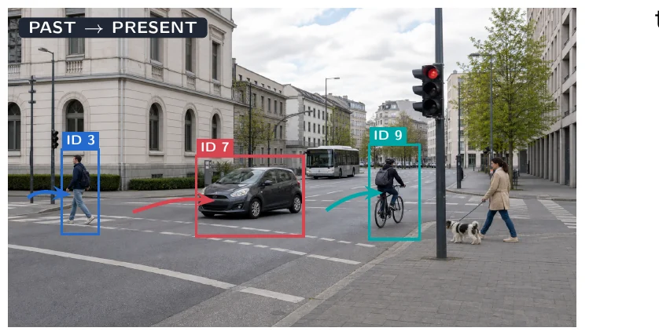{#fig-mot fig-alt="The scene with three boxes labelled ID 3, ID 7, and ID 9 and trails showing their past positions"}
:::

Given detections over a video, multi-object tracking estimates trajectories

$$
\mathcal{T}_i=\big\{(t,\mathbf{b}^{i}_t,c_i,\mathrm{ID}_i)\big\}_{t=t_s}^{t_e},
$$

where $\mathcal{T}_i$ is the trajectory of object $i$, $t$ the frame index, $\mathbf{b}^i_t$ its box at frame $t$, $c_i$ its class, $\mathrm{ID}_i$ its identity label, and $t_s,t_e$ the first and last frames of the track. A tracker must localize each object at each time, preserve a stable identity through motion and occlusion, start and terminate tracks as objects enter or leave, and be diagnosed for false or missed tracks, fragmentation, and **identity switches** [@milan2016mot16].

### Tracking by detection

::: {.figure-panel}
![One step of tracking by detection. (1) Detections $d_j$ at frame $t$ (white boxes). (2) Tracks $T_i$ predicted from $t-1$ (dashed boxes $\hat{\mathbf{b}}_i$; frame $t-1$ is simulated). (3) Cost $c_{ij}=1-\operatorname{IoU}(\hat{\mathbf{b}}_i,d_j)$, with pairs of IoU below 0.3 gated out (×). (4) Minimum-cost one-to-one matches: $T_5$, behind the pole, and $d_5$, the dog, stay unmatched. (5) Update: matched tracks are corrected by their detection; the unmatched detection starts a tentative new track; the unmatched track is kept briefly and deleted after repeated misses.](../../assets/figures/dl4cv/l01-tracking-by-detection.webp){#fig-tracking-by-detection fig-alt="Two copies of the scene with detections and predicted tracks, a 5 by 5 cost matrix with four circled matches, and the five steps"}
:::

SORT [@bewley2016simple] runs a detector on every frame and links the detections over time:

1. **detect** objects $d_j$ at frame $t$;
2. **predict** each track $T_i$ forward, giving a box $\hat{\mathbf{b}}_i$ (SORT uses a constant-velocity Kalman filter);
3. **gate and build** the cost matrix $c_{ij}=1-\operatorname{IoU}(\hat{\mathbf{b}}_i,d_j)$, removing implausible pairs;
4. find the minimum-cost **one-to-one assignment** with the Hungarian algorithm — the same tool as DETR's matching;
5. **update** each track's state and lifecycle.

A simple online loop becomes a tracker when the association and lifecycle rules are explicit. Adding appearance features to the cost, as in Deep SORT [@wojke2017simple], helps recover identities after crossings and short occlusions.

## Main takeaways

1. **Vision is an inverse problem.** One image is compatible with many 3D worlds, so a model must combine data with prior assumptions.
2. **Learning is loss minimization; the goal is generalization.** Fit on the training set, choose on the validation set, report once on the test set.
3. **Convolution is a local pattern detector with shared weights.** Stacking layers grows the receptive field and builds a hierarchy: edges → parts → objects.
4. **ViTs turn an image into patch tokens.** Self-attention lets every token use evidence from any other token in one layer, at a cost of $O(N^2)$ for $N$ tokens; position is supplied by embeddings.
5. **The backbone is reusable.** A pretrained CNN or ViT, often with a feature pyramid, serves every task; mostly the head changes.
6. **The output defines the task:** label → boxes → masks → keypoints → identities over time. Each needs its own head, loss, and metric.
7. **Detection scores many candidates and matches them to objects by IoU.** R-CNN → Fast → Faster R-CNN: share the CNN, then learn the proposals. One-stage detectors predict densely and need the focal loss; NMS removes duplicates; DETR learns a one-to-one set prediction instead.
8. **Segmentation is classification at every pixel:** an encoder–decoder, with skip connections or atrous convolutions to keep both detail and context. Mask R-CNN adds a mask head for each detected object.
9. **Pose is one more head on Mask R-CNN,** with one map per joint inside each person box. **Tracking links detections across frames** by motion, geometry, and appearance.
10. **Evaluate with task metrics** (mAP, mIoU, …) and inspect failures by scale, class, and occlusion before adding complexity.

## Exercises

### Exercise 1 — Shape arithmetic

A $224\times224\times3$ image passes through a $7\times7$ convolution with 64 filters, stride 2, padding 3, then a $3\times3$ max pool with stride 2 and padding 1. Give the output shape after each layer and the number of parameters of the convolution.

### Exercise 2 — ViT tokens

For ViT-B/16 at $384\times384$, compute the number of patch tokens $N$, the shape of $\mathbf{z}_0$, and the size of the attention matrix $\mathbf{A}$ of one head. By what factor did the attention matrix grow compared with $224\times224$?

### Exercise 3 — IoU

Compute the IoU of the boxes $(0,0,4,4)$ and $(2,2,6,6)$, given as $(x_1,y_1,x_2,y_2)$. Then shift the second box by one pixel towards the first and compute the IoU again.

### Exercise 4 — Focal loss

Compute the cross-entropy and the focal loss ($\alpha_t=0.25$, $\gamma=2$) of a positive anchor with $p_t=0.1$ and of a negative anchor with $p_t=0.99$ (use $\alpha_t=0.75$). By how much does the focal loss reduce each, relative to cross-entropy?

### Exercise 5 — Segmentation metrics

On images where road covers 70% of the pixels, cars 20%, and people 10%, compute the pixel accuracy and the mIoU of a model that predicts "road" everywhere.

## References {.unnumbered}

This web note is adapted from the Lecture 1 slides of Deep Learning for Computer Vision by Jhony H. Giraldo. Recommended resources: Stanford [CS231n](https://cs231n.stanford.edu/); the [TUM lecture videos](https://www.youtube.com/playlist?list=PLog3nOPCjKBkamdw8F6Hw_4YbRiDRb2rb); Goodfellow, Bengio, and Courville, *Deep Learning* [@goodfellow2016deep]; and the libraries [torchvision](https://pytorch.org/vision/stable/) and [Detectron2](https://github.com/facebookresearch/detectron2).

::: {#refs .references-small}
:::
