```{=html}
<header class="lecture-header">
  <div class="eyebrow">APM 5DA12 TP · Deep Learning for Computer Vision</div>
  <h1>From pixels to structured scene understanding</h1>
  <p>Lecture 1 · Jhony H. Giraldo · Télécom Paris, Institut Polytechnique de Paris</p>
  <div class="lecture-meta"><span>Lecture: 13 November 2026</span><span>Web note written: 7 November 2026</span><span>Mathematics rendered with MathJax</span><span>Click any figure to enlarge it</span></div>
  <div class="button-row">
    <a class="button-link primary" href="/assets/pdf/DL4CV-Lecture-01-Deep-Learning-for-Computer-Vision.pdf">Download the original slides</a>
    <a class="button-link secondary" href="/teaching/deep-learning-for-computer-vision/index.qmd">Back to the course</a>
  </div>
</header>
```

A classifier looks at an image and returns one word. That is a remarkable achievement, and it is also a very small fraction of what we want from a vision system. A car that must brake for a pedestrian needs to know *where* the pedestrian is, *how many* there are, *which pixels* are road, *which way* the pedestrian's body is oriented, and whether the person in this frame is the same person as in the last one. Each of these questions has its own output representation, its own annotation, its own loss, its own inference procedure, and its own metric.

This note follows the first lecture of the course. It first recaps what computer vision is and why it is hard, then the two families of backbones that turn pixels into features — convolutional networks and Vision Transformers — and then walks up the ladder of structured outputs: **object detection**, **semantic and instance segmentation**, **human pose estimation**, and **multi-object tracking**. The organizing idea is in the slide that closes the introduction: *the backbone is reusable; the representation, head, loss, metric, and inference must match the task*.

Almost every figure is drawn over the same generated street scene, annotated by real pretrained models (torchvision's ResNet, ViT, Faster R-CNN, RetinaNet, DeepLabV3, Mask R-CNN, and Keypoint R-CNN). The numbers in the figures — scores, IoUs, anchor counts, loss shares — are measurements on that image, not illustrations, so you can check the arithmetic in the text against them.

## Learning objectives

After studying this note, you should be able to:

```{=html}
<ol class="learning-objectives">
  <li>place a vision problem in the task taxonomy and name its output space, typical loss, and metric;</li>
  <li>compute the output shape, parameter count, and receptive field of a stack of convolution and pooling layers;</li>
  <li>write the Vision Transformer forward pass, from patchification to the class token, with every tensor shape;</li>
  <li>explain the inductive biases of CNNs and ViTs and what each costs in data, compute, and resolution;</li>
  <li>compute IoU, precision, recall, and AP, and explain why a detector is evaluated over a confidence sweep;</li>
  <li>describe anchors, anchor matching, two-stage and one-stage detectors, focal loss, NMS, and DETR's set prediction with Hungarian matching;</li>
  <li>design a segmentation network from encoder, decoder, upsampling, skip connections, and atrous convolutions, and choose between cross-entropy and Dice;</li>
  <li>contrast top-down and bottom-up pose estimation, and explain heatmap regression, PCK, and OKS;</li>
  <li>assemble a tracking-by-detection loop with a Kalman filter, gating, appearance features, and Hungarian assignment.</li>
</ol>
```

## The course and this note

Deep Learning for Computer Vision is an MSc course of four lectures (CM) and three practical sessions (TP), followed by an oral evaluation. This first lecture is a dense recap and a map: everything that follows — foundation models and vision–language learning, generative models, and deep learning for 3D data — assumes the vocabulary built here. The calendar, the evaluation rules, and the policy on LLMs are on the [course page](index.qmd); the first practical session (20 November 2026) builds directly on the last two parts of this note, from detection to multi-object tracking.

The course has two kinds of objectives, and the lecture tries to serve both.

- **Applications.** Choose, train, evaluate, and diagnose modern vision systems: match an output representation to a task, build reproducible PyTorch pipelines, and interpret metrics and failure modes.
- **Fundamentals.** Understand *why* architectures, losses, data, and optimization choices work: connect inductive bias to data efficiency, reason about geometry, uncertainty, and scale, and read papers beyond their headline result.

Two warnings frame the course. **Computer vision is not just deep learning** — geometry, optics, signal processing, and careful evaluation remain indispensable. And **deep learning is not plug-and-play** — a pretrained network applied without understanding its preprocessing, its output stride, or its training distribution fails in ways that look like success until deployment.

::: {.checkpoint}
**What you should already know**

The lecture assumes linear algebra (vectors, matrices, tensors, dot products), optimization (gradients, SGD, regularization), basic deep learning (losses, backpropagation, what a convolution is), and Python with basic PyTorch. The recaps below are deliberately compact; if one of them feels too fast, the [preliminary notes of Machine Learning with Graphs](../machine-learning-with-graphs/preliminaries-machine-learning.qmd) cover the perceptron, MLPs, backpropagation, and SGD from scratch.
:::

```{=html}
<div class="note-part"><span>Part I</span>Computer vision recap</div>
```

## What can machines understand from pixels?

An RGB image is a tensor $\mathbf{x}\in[0,255]^{H\times W\times 3}$ of raw light measurements. Nothing in those numbers says "car". The whole field is about building functions that turn the measurement into a statement about the world, and the useful statements come in increasingly structured forms.

::: {.figure-panel}
{#fig-beyond-label fig-alt="The generated street scene annotated with a pixel zoom, an image label, detection boxes, road and sidewalk masks, and two pedestrian tracks, with a legend of five output types"}
:::

| | Output | Formal object | Question it answers |
|---|---|---|---|
| 1 | pixels | $\mathbf{x}\in[0,255]^{H\times W\times 3}$ | raw measurements, no meaning |
| 2 | class | $y\in\{1,\dots,C\}$ | what is the scene? (no *where*) |
| 3 | boxes | $\{(\mathbf{b}_k,c_k,s_k)\}_{k=1}^{K}$ | what and where, for every object |
| 4 | masks | $\mathbf{M}\in\{1,\dots,C\}^{H\times W}$ | which class at every pixel? |
| 5 | tracks | $\{(t,\mathbf{b}^i_t,\mathrm{ID}_i)\}$ | who is who, over time? |

: The output representations covered in this lecture. {#tbl-outputs}

Notice what changes down the table. The class label is a single integer. A set of boxes has **variable cardinality** — the model must decide how many objects there are. A mask is a **dense** output aligned with the input. A track adds **identity across time**. Each step makes the output richer, the annotation more expensive, and the ways of being wrong more numerous.

### Encode, then decode

Almost every model in this lecture has the same two-part shape.

::: {.figure-panel}
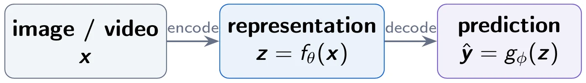{#fig-encode-decode fig-alt="Three boxes: image or video x, representation z equals f theta of x, prediction y hat equals g phi of z"}
:::

$$
\mathbf{z}=f_\theta(\mathbf{x}),
\qquad
\hat{\mathbf{y}}=g_\phi(\mathbf{z}).
$$

The **backbone** $f_\theta$ is typically a convolutional or attention-based network with parameters $\theta$; the **head** $g_\phi$ is another, usually much smaller, network with parameters $\phi$. The central learning question is not "which network?" but **what representation makes the target predictable from finite data?** A good $\mathbf{z}$ makes the head's job easy: linear for classification, a few convolutions for masks.

### Vision as an inverse problem

Computer graphics goes forward: given a scene $S$ (shapes, poses, materials), lighting $\ell$, and a camera $c$, render an image. Computer vision goes backward.

::: {.figure-panel}
{#fig-inverse fig-alt="A 3D scene with a light, a camera, a cube, a sphere, and a cylinder, with arrows labelled graphics render and vision infer, and a box explaining ill-posedness"}
:::

Write the image formation process as

$$
I = R(S,\ell,c)+\varepsilon,
$$ {#eq-image-formation}

where $R$ is the rendering function and $\varepsilon$ collects sensor noise and every effect the model does not capture. Recovering $S$ from $I$ is **ill-posed** in the sense of Hadamard: many worlds $S'\neq S$ produce nearly the same image, and small perturbations of $I$ can change the best explanation drastically. Projection alone destroys depth: an object of size $h$ at distance $d$ projects to an image height proportional to $h/d$, so $(h,d)$ and $(2h,2d)$ are indistinguishable from one image.

Ill-posed problems are solved by adding **priors** — assumptions about which worlds are plausible. Classical vision wrote the priors by hand (smoothness, rigid motion, Lambertian surfaces). Deep learning *learns* them from data, and the architecture adds more (locality, translation equivariance). **Vision succeeds by combining data with priors.**

### Why computer vision is hard

::: {.figure-panel}
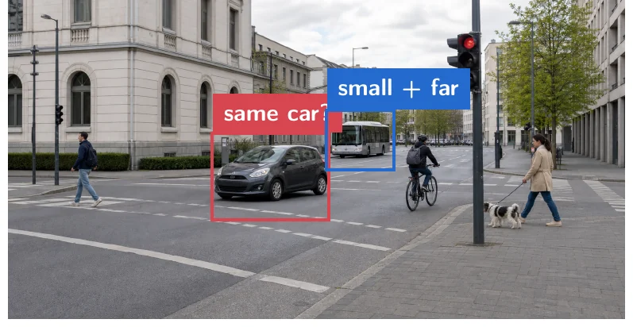{#fig-why-hard fig-alt="Street scene with a red box labelled same car and a blue box labelled small plus far around a bus"}
:::

::: {.figure-panel}
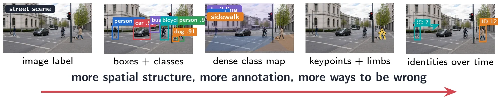{#fig-progressive fig-alt="Five thumbnails of the street scene with increasingly detailed annotations and an arrow underneath"}
:::

The difficulties fall into six families.

- **Projection.** Depth collapses onto the image plane (@eq-image-formation).
- **Appearance.** Lighting, weather, texture, and sensor noise change every pixel value without changing the object.
- **Geometry.** Viewpoint, deformation, articulation, and scale change the shape of the object's image.
- **Visibility.** Occlusion, truncation at the image border, and clutter remove or confuse evidence.
- **Semantics.** Context matters, and some categories are ambiguous (is a pickup a car or a truck?).
- **Open world.** Rare and unseen cases matter most in deployment and are least represented in training data.

::: {.checkpoint}
**Check 1 — Invariance and sensitivity at the same time**

A classifier should be **invariant** to many nuisances: shifting the car by ten pixels should not change "car". But a detector must be **sensitive** to exactly that shift — its box should move by ten pixels. The same tension appears everywhere: segmentation needs invariance to lighting but sensitivity to boundaries; tracking needs invariance to pose but sensitivity to identity. Much of architecture design, from pooling to skip connections, is about deciding *where* in the network each property should hold.
:::

### The task taxonomy

| Task | Output unit | Central question | Typical metric |
|---|---|---|---|
| Classification | image | What is present? | top-$k$ accuracy |
| Localization | one box + class | Where is the main object? | IoU / accuracy |
| Detection | set of boxes | What objects, and where? | AP / mAP |
| Semantic segmentation | pixel | Which class per pixel? | mIoU |
| Instance segmentation | object mask | Which pixels belong together? | mask AP |
| Pose estimation | keypoint / part | Where are the articulated parts? | PCK / OKS AP |
| Tracking | trajectory + ID | Which observation is the same entity? | HOTA / IDF1 |

: Computer-vision tasks covered in the lecture. The output space determines annotation cost, architecture, loss, inference, and metric. {#tbl-taxonomy}

The rest of this note is organized by this table. Each section answers the same five questions for its task: what is the **output representation**, what **architecture** produces it, what **loss** trains it, what **inference** procedure turns network outputs into an answer, and what **metric** evaluates it.

## A brief history

::: {.figure-panel}
![Milestones of computer vision: Hubel and Wiesel's study of the visual cortex [@hubel1962receptive], the MIT Summer Vision Project [@papert1966summer], LeNet [@lecun1998gradient], SIFT and HOG [@lowe2004distinctive; @dalal2005histograms], ImageNet [@deng2009imagenet], AlexNet [@krizhevsky2012imagenet], ViT [@dosovitskiy2021image], and foundation models. Three eras: hand-designed features, supervised deep learning, and pretraining at scale.](../../assets/figures/dl4cv/l01-history.webp){#fig-history fig-alt="A timeline from 1959 to 2023 with eight milestones and three era labels underneath"}
:::

Three eras are worth distinguishing, because each changed *where the prior lives*.

1. **Hand-designed features** (until about 2012). Engineers designed invariant descriptors — SIFT keypoints, histograms of oriented gradients — from geometry and signal processing, then trained a shallow classifier on top. The prior lived in the descriptor.
2. **Supervised deep learning** (2012–2020). The features themselves are learned end to end from labelled data; the prior lives in the architecture (convolutions) and in the data (ImageNet).
3. **Pretraining at scale** (2020–). Transformers and very large, often unlabelled or weakly labelled datasets produce transferable representations; the prior lives increasingly in the pretraining data and objective. Lecture 2 picks up here.

### From handcrafted features to learned representations

The histogram of oriented gradients (HOG) pedestrian detector [@dalal2005histograms] is the clearest example of the first era, and it is worth understanding in detail because every one of its stages has a learned counterpart in a CNN.

::: {.figure-panel}
{#fig-hog fig-alt="Top row, the HOG pipeline with gradient image, cell grid, orientation histogram, and SVM; bottom row, a CNN with stacked feature blocks labelled edges, textures, parts, and objects"}
:::

::: {.worked-example}
**Worked example — Where the 3780 HOG dimensions come from**

1. Compute horizontal and vertical gradients with the filter $[-1,0,1]$ and its transpose, giving a magnitude and an unsigned orientation in $[0^\circ,180^\circ)$ at every pixel.
2. Divide the $64\times128$ window into $8\times8$-pixel **cells**: $8\times16$ cells. In each cell, accumulate a **9-bin** orientation histogram ($20^\circ$ per bin), each pixel voting with its gradient magnitude.
3. Group cells into overlapping $2\times2$ **blocks** with a stride of one cell: $(8-1)\times(16-1)=7\times15=105$ blocks. Normalize each block's $4\times9=36$ values (L2-Hys) for robustness to illumination.
4. Concatenate: $105\times36=3780$ numbers.

A linear SVM $\hat y=\operatorname{sign}(\mathbf{w}^\top\mathbf{x}+b)$ on $\mathbf{x}\in\mathbb{R}^{3780}$ then decides "person" or "background". Detection is a sliding window of this classifier over positions and scales — an idea we will meet again, and improve, in @sec-detection.
:::

Every hand-designed stage has a CNN analogue: the gradient filters are a first convolutional layer, the cell histograms are a nonlinearity followed by pooling, block normalization is a normalization layer, and the SVM is a linear head. The decisive difference is that in the CNN all of these are **learned jointly** from the loss. End-to-end learning replaces hand-designed interfaces — but not the need for good assumptions or for careful evaluation.

### Why deep learning changed computer vision

::: {.figure-panel}
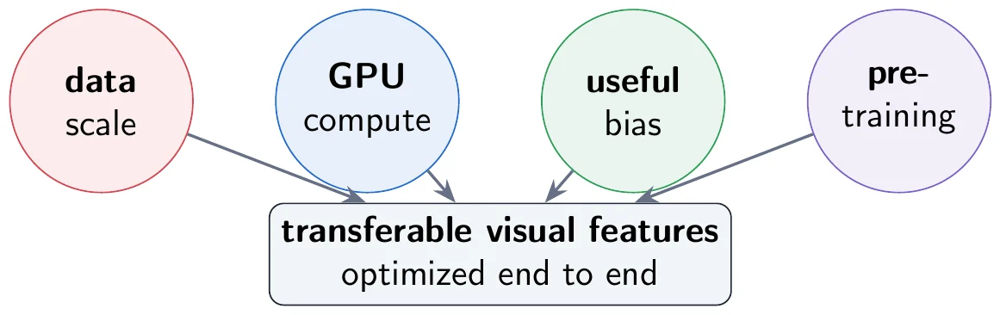{#fig-why-dl fig-alt="Four circles labelled data scale, GPU compute, useful bias, and pre-training, all pointing to a box labelled transferable visual features optimized end to end"}
:::

No single ingredient explains the change. Convolution encoded locality and weight sharing; attention later added adaptive global interaction. Large labelled datasets made comparisons credible, and large unlabelled datasets later widened pretraining. GPUs made the computation feasible. And better optimization — ReLU, normalization, residual connections — made much deeper networks trainable.

## Supervised learning for images

### The learning problem

Given a training set $\mathcal{D}_{\text{train}}=\{(\mathbf{x}_i,\mathbf{y}_i)\}_{i=1}^{N}$ and a model $\hat{\mathbf{y}}_i=f_\theta(\mathbf{x}_i)$, we choose the parameters by regularized empirical risk minimization:

$$
\theta^{*}=\arg\min_{\theta}\;\frac{1}{N}\sum_{i=1}^{N}\mathcal{L}\big(f_\theta(\mathbf{x}_i),\mathbf{y}_i\big)+\lambda\,\Omega(\theta).
$$ {#eq-erm}

In practice the sum is never computed in full. Each step samples a mini-batch $\mathcal{B}$ of size $B$, computes $\mathcal{L}_{\mathcal{B}}(\theta)=\frac1B\sum_{i\in\mathcal{B}}\mathcal{L}(f_\theta(\mathbf{x}_i),\mathbf{y}_i)$, and updates $\theta\leftarrow\theta-\eta\nabla_\theta\mathcal{L}_{\mathcal{B}}$ (or uses Adam, AdamW, SGD with momentum).

Three datasets play three different roles, and confusing them is the most common methodological error in student projects:

- the **training** set is what the loss is optimized on;
- the **validation** set is what *choices* are made on — architecture, learning rate, number of epochs, threshold;
- the **test** set estimates final generalization, and is used **once, at the very end**.

### Image classification

::: {.figure-panel}
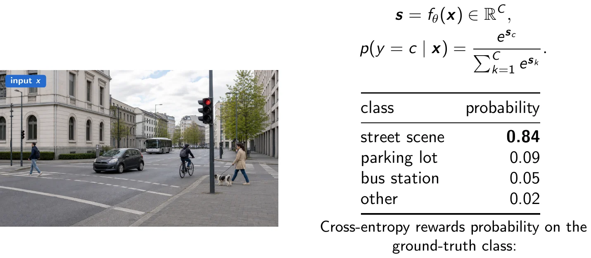{#fig-classification fig-alt="The street scene beside a table of class probabilities: street scene 0.84, parking lot 0.09, bus station 0.05, other 0.02"}
:::

A classifier produces a vector of **logits** $\mathbf{s}=f_\theta(\mathbf{x})\in\mathbb{R}^{C}$, and the softmax converts them into a distribution:

$$
p(y=c\mid\mathbf{x})=\frac{e^{s_c}}{\sum_{k=1}^{C}e^{s_k}},
\qquad
\mathcal{L}_{\text{CE}}=-\log p(y\mid\mathbf{x}).
$$ {#eq-softmax-ce}

For the scene in @fig-classification with true class "street scene", $\mathcal{L}_{\text{CE}}=-\ln 0.84=0.174$. Had the model put only $0.09$ on the correct class, the loss would be $-\ln0.09=2.41$, fourteen times larger. Cross-entropy is unbounded as the correct-class probability goes to zero, which is what makes it push hard on confident mistakes.

Top-$k$ accuracy counts a prediction as correct when the true class is among the $k$ highest-scoring classes; ImageNet results are traditionally reported as top-1 and top-5.

### A machine-learning pipeline for images

::: {.figure-panel}
{#fig-pipeline fig-alt="Six connected panels: dataset and splits, augment and normalize, model, loss and optimizer, metrics, deploy and monitor, with a dashed arrow labelled new failures become data"}
:::

Each stage has a technical content worth stating explicitly.

- **Augmentation** draws a random transformation $\tilde{\mathbf{x}}=T(\mathbf{x})$ — horizontal flip, random crop, small rotation, colour jitter — at every step, so the model sees a different version of each image every epoch. It encodes invariances we *believe* the task has; a horizontal flip is harmless for street scenes and wrong for reading text.
- **Normalization** standardizes each channel, $\tilde{\mathbf{x}}=(\mathbf{x}-\boldsymbol\mu)/\boldsymbol\sigma$, using the statistics the backbone was pretrained with (for ImageNet, $\boldsymbol\mu=(0.485,0.456,0.406)$ and $\boldsymbol\sigma=(0.229,0.224,0.225)$ on $[0,1]$-scaled images).
- **The loss and optimizer** implement @eq-erm on mini-batches.
- **Metrics** go beyond accuracy: a confusion matrix shows *which* classes are confused; validation curves decide early stopping.
- **Deployment** is not the end. Monitoring the confidence distribution flags shifts (night, rain, a new camera); flagged images are labelled and become training data.

::: {.checkpoint}
**Check 2 — Before training, and the most common leakage**

*Before training:* define the target, fix the split, inspect the labels, and establish a simple baseline. A baseline that you understand is worth more than a strong model you cannot diagnose.

*Leakage:* the validation or test data are not truly independent of the training data, so the measured performance looks better than the model's real ability to generalize. In vision this is easy to do by accident — consecutive frames of the same video split across train and test, the same patient in both medical splits, near-duplicate web images, or a threshold tuned on the test set. Split by the unit you want to generalize over (video, patient, location), not by image.
:::

```{=html}
<div class="note-part"><span>Part II</span>Representations: CNN and ViT recap</div>
```

## Convolutional networks

### Convolution: a learned local pattern detector

::: {.figure-panel}
{#fig-convolution fig-alt="A grayscale traffic-light crop, an 8 by 8 grid of pixel values with a 3 by 3 window highlighted, a Sobel kernel, the response 906, and the red-blue output feature map"}
:::

A convolutional layer with a $K\times K$ kernel computes, at every output position $(i,j)$,

$$
y_{i,j}=b+\sum_{u,v}\sum_{c}K_{u,v,c}\,x_{i+u,\,j+v,\,c}.
$$ {#eq-conv}

Strictly speaking this is a **cross-correlation** — a true convolution flips the kernel — but since the kernel is learned the distinction is irrelevant, and every deep-learning library implements @eq-conv under the name "convolution".

::: {.worked-example}
**Worked example — One output of the Sobel filter**

The Sobel-$x$ kernel is
$$
K=\begin{bmatrix}-1&0&1\\-2&0&2\\-1&0&1\end{bmatrix}.
$$
The highlighted window in @fig-convolution has left column $(21,19,23)$ and right column $(248,247,246)$; its middle column is multiplied by zero. With $b=0$,
$$
y=-21+248-2\cdot19+2\cdot247-23+246=906.
$$
A large positive response means "dark on the left, bright on the right" — a vertical edge of a particular polarity. On a flat region the left and right columns cancel and $y\approx0$.
:::

Three facts are worth keeping. The **same weights** are applied at every location, so the layer's parameter count does not depend on the image size. A **high response** means the local patch matches the pattern stored in the kernel — the operation is a template match. And **training learns** $K$: the network discovers which local patterns are useful, while sliding records *where* they occur. In one sentence: *convolution is a local linear operator with shared parameters.*

### Channels, kernels, and feature maps

::: {.figure-panel}
{#fig-conv-layer fig-alt="An RGB traffic-light crop split into R, G, B channels, four colour-coded 3 by 3 by 3 kernels, and four black-and-white feature maps"}
:::

A layer maps $H\times W\times C_{\text{in}}$ to $H'\times W'\times C_{\text{out}}$. Each of the $C_{\text{out}}$ kernels has shape $K\times K\times C_{\text{in}}$ plus one bias, so

$$
\#\text{params}=K^{2}C_{\text{in}}C_{\text{out}}+C_{\text{out}},
$$

which for @fig-conv-layer is $3^2\cdot3\cdot4+4=112$, independent of $H$ and $W$. Each output channel mixes **all** input channels but only a **local** spatial neighbourhood. A $1\times1$ convolution is the extreme case: it mixes channels at each pixel without enlarging the spatial receptive field — a per-pixel linear layer, used everywhere to change the channel count cheaply.

```python
import torch
from torch import nn

x = torch.randn(1, 3, 96, 96)            # PyTorch layout: (batch, channels, H, W)
conv = nn.Conv2d(in_channels=3, out_channels=4, kernel_size=3)  # no padding
print(conv(x).shape)                     # torch.Size([1, 4, 94, 94])
print(sum(p.numel() for p in conv.parameters()))  # 112
```

### Stride, padding, and dilation

::: {.figure-panel}
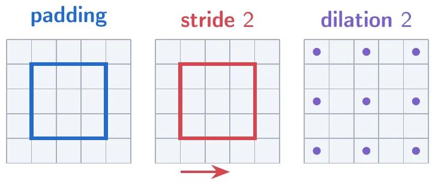{#fig-stride fig-alt="Three grids: a blue square with a padded border, a red square with an arrow for stride two, and a grid with spaced purple dots for dilation two"}
:::

For one spatial dimension of size $H$, a kernel of size $K$ with stride $S$, padding $P$, and dilation $D$ produces

$$
H'=\left\lfloor\frac{H+2P-D(K-1)-1}{S}\right\rfloor+1 .
$$ {#eq-conv-size}

- $S$ is the **sampling step**: stride 2 halves the resolution and the compute of everything downstream.
- $P$ controls the **border context** and the output size; "same" padding $P=D(K-1)/2$ with $S=1$ keeps $H'=H$.
- $D$ is the **spacing inside the kernel**; the effective kernel size is $D(K-1)+1$.

These three hyperparameters determine resolution, compute, and visible context, and their arithmetic is part of architecture design: a skip connection or a dense output will not line up unless the shapes do.

::: {.worked-example}
**Worked example — The mini-quiz from the lecture**

A 1-D input has length $H=32$; the convolution has $K=3$, $S=2$, $P=1$, $D=1$. Then
$$
H'=\left\lfloor\frac{32+2-2-1}{2}\right\rfloor+1=\lfloor15.5\rfloor+1=16 .
$$
Which single change increases the output length?

- $S:2\to1$ gives $H'=\lfloor31/1\rfloor+1=32$ — **larger**: twice the sampling density.
- $P:1\to0$ gives $H'=\lfloor29/2\rfloor+1=15$ — smaller: the kernel no longer fits at the borders.
- $K:3\to5$ gives $H'=\lfloor29/2\rfloor+1=15$ — smaller: a wider kernel fits in fewer positions.
- $D:1\to2$ gives $H'=\lfloor29/2\rfloor+1=15$ — smaller: same effective kernel width as $K=5$.

The subtle point is the last two: a larger kernel or a larger dilation **expands context but does not preserve size** unless the padding is adjusted.
:::

### Pooling: invariance versus spatial precision

::: {.figure-panel}
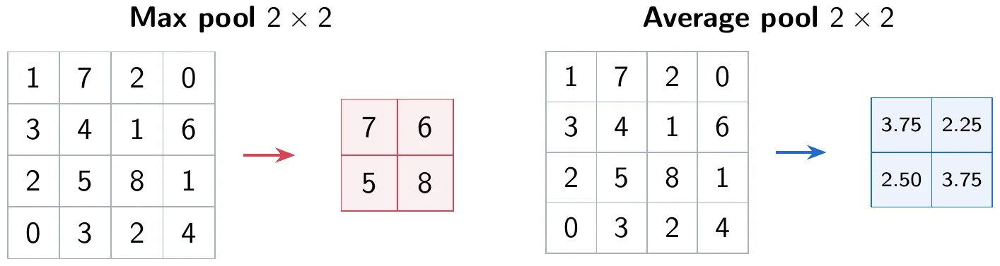{#fig-pooling fig-alt="A 4 by 4 grid of numbers reduced to a 2 by 2 grid by max pooling, giving 7, 6, 5, 8, and by average pooling, giving 3.75, 2.25, 2.50, 3.75"}
:::

For the input in @fig-pooling, the top-left window is $\{1,7,3,4\}$: max pooling gives $7$ and average pooling gives $15/4=3.75$. Pooling summarizes a neighbourhood and reduces resolution and compute. It increases tolerance to small shifts — moving the $7$ by one pixel inside its window does not change the max — but by the same token exact boundaries and keypoints become harder to recover. Modern networks often downsample with a **strided convolution** instead, which lets the network learn how to summarize.

### Receptive field: how much context can a feature use?

::: {.figure-panel}
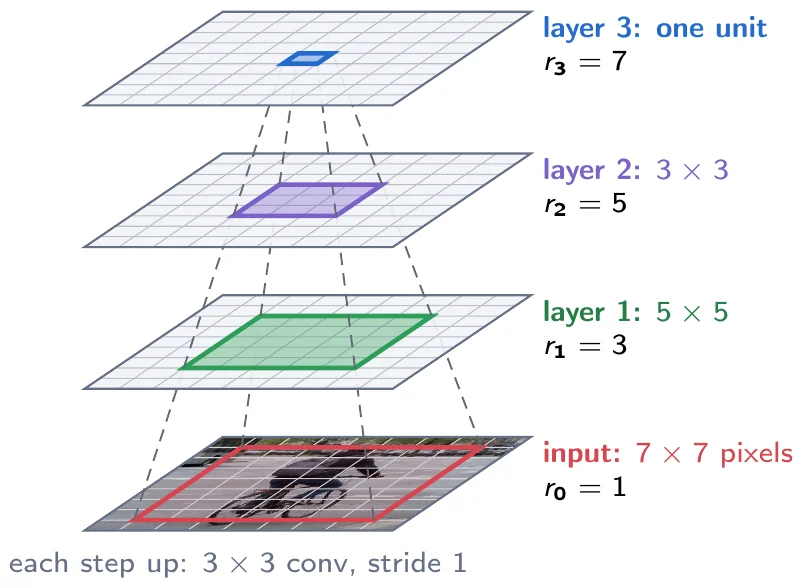{#fig-receptive-field fig-alt="Four stacked grids with highlighted squares of growing size, labelled r0 equals 1, r1 equals 3, r2 equals 5, r3 equals 7"}
:::

The **receptive field** $r_\ell$ of a unit in layer $\ell$ is the size of the input region that can influence it. Track it together with the **jump** $j_\ell$, the distance in input pixels between adjacent units of layer $\ell$:

$$
j_\ell=j_{\ell-1}\,s_\ell,
\qquad
r_\ell=r_{\ell-1}+(k_\ell-1)\,d_\ell\,j_{\ell-1},
\qquad
j_0=r_0=1 .
$$ {#eq-receptive-field}

With $k_\ell=3$ and $s_\ell=d_\ell=1$, every layer adds $2$, so $r_\ell=1+2\ell$, as in @fig-receptive-field. Now give the second layer stride $2$: $j_1=1$, $j_2=2$, so $r_2=3+2\cdot1=5$ and $r_3=5+2\cdot2=9$. **Depth, stride, and dilation all expand context**, and a stride multiplies the effect of every later layer.

Two cautions. First, the *theoretical* receptive field is not the influence distribution: the gradient of a unit with respect to its inputs is concentrated near the centre and decays roughly like a Gaussian, so the *effective* receptive field is much smaller [@luo2016understanding]. Second, dense prediction needs both a broad context and high-resolution detail — the tension at the heart of segmentation (@sec-segmentation).

### The recurring CNN architecture pattern

::: {.figure-panel}
{#fig-cnn-pattern fig-alt="A block diagram conv, norm, activation, downsample, repeat, global average, linear head, above real ResNet-18 activation maps shrinking from 224 by 224 to 7 by 7, ending in class probabilities"}
:::

A standard classification CNN repeats one stage: **conv** (local mixing) → **norm** (stabilize) → **activation** (nonlinearity) → **downsample**, increasing the channel count each time the resolution halves. ResNet-18 makes the pattern concrete:

| Block | Operation | Output shape |
|---|---|---|
| input | — | $224\times224\times3$ |
| stem | $7\times7$ conv, stride 2 | $112\times112\times64$ |
| stem | $3\times3$ max pool, stride 2 | $56\times56\times64$ |
| stage 1 | 2 residual blocks | $56\times56\times64$ |
| stage 2 | 2 residual blocks, first with stride 2 | $28\times28\times128$ |
| stage 3 | 2 residual blocks, first with stride 2 | $14\times14\times256$ |
| stage 4 | 2 residual blocks, first with stride 2 | $7\times7\times512$ |
| head | global average pool, linear | $512\to1000$ |

: ResNet-18 at $224\times224$ input; output stride $32$. {#tbl-resnet18}

Two trades happen together. The **spatial trade**: $H$ and $W$ decrease while the receptive field and the semantic abstraction increase. The **channel trade**: more channels preserve diverse evidence as spatial resolution shrinks. At the very end, global average pooling throws away *all* spatial layout — fine for classification, fatal for detection and segmentation, which is why dense tasks tap the **intermediate** maps before the spatial detail disappears.

### LeNet to AlexNet: depth meets data and compute

| | LeNet-5 (1998) | AlexNet (2012) | Why the jump mattered |
|---|---|---|---|
| Input | $32\times32$ grayscale | $224\times224$ RGB | richer natural-image variation |
| Feature extractor | 2 conv stages | 5 conv layers | deeper hierarchy, larger capacity |
| Nonlinearity | tanh / sigmoid | ReLU | faster, less saturating optimization |
| Regularization | subsampling | dropout + augmentation | control overfitting at scale |
| Compute | CPU-era design | 2 GPUs | feasible large-scale convolution |
| Benchmark | digit recognition | ImageNet | decisive natural-image result |

: From LeNet [@lecun1998gradient] to AlexNet [@krizhevsky2012imagenet]. {#tbl-lenet-alexnet}

AlexNet's 2012 ImageNet result — a top-5 error of about $15\%$ against about $26\%$ for the next entry — was not produced by one idea. It came from a system of choices: architecture, data, compute, augmentation, and optimization. That observation will recur: in detection, segmentation, and tracking, the headline method is usually inseparable from its training recipe.

### VGG: small filters, deep and simple

::: {.figure-panel}
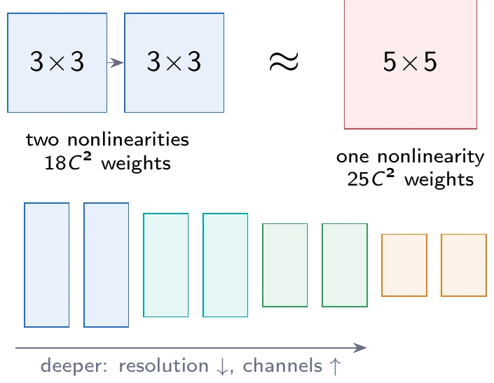{#fig-vgg fig-alt="Two 3 by 3 boxes approximately equal to one 5 by 5 box, with weight counts 18 C squared and 25 C squared, above a row of coloured layer blocks"}
:::

VGG [@simonyan2015very] uses only $3\times3$ convolutions, in networks of 16 or 19 weight layers. With $C$ channels in and out, two stacked $3\times3$ layers cost $2\cdot9C^2=18C^2$ weights and cover a $5\times5$ receptive field, against $25C^2$ for a single $5\times5$; three $3\times3$ layers cost $27C^2$ against $49C^2$ for a $7\times7$. The stack is cheaper **and** more expressive, since it interleaves more nonlinearities.

VGG-16 has about 138 million parameters, but almost 90% of them sit in the three fully connected layers: the first alone maps $7\cdot7\cdot512=25\,088$ inputs to $4096$ outputs, about $103$M weights. Its clean, uniform design became a template, even though later networks are far more compute- and parameter-efficient.

### ResNet: learn a residual correction

::: {.figure-panel}
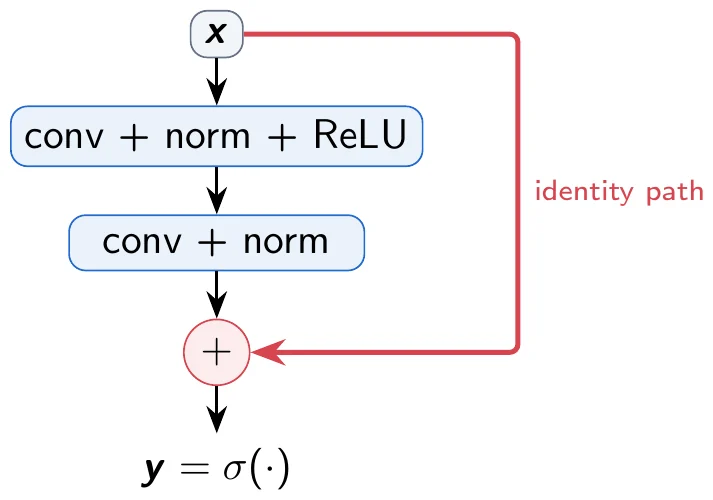{#fig-resnet fig-alt="A block diagram with input x passing through conv plus norm plus ReLU and conv plus norm, then added to x via an identity path, then sigma"}
:::

Plain networks get *worse* as they get very deep — not from overfitting but from optimization difficulty. ResNet [@he2016deep] reparameterizes each block as a correction to the identity:

$$
\mathbf{y}=\sigma\big(\mathcal{F}(\mathbf{x};\theta)+\mathbf{x}\big).
$$ {#eq-residual}

If the best block is close to the identity, it only has to learn a small $\mathcal{F}$, which is easy to reach from small initial weights. And gradients flow through the identity path untouched: ignoring the final $\sigma$, $\partial\mathbf{y}/\partial\mathbf{x}=\mathbf{I}+\partial\mathcal{F}/\partial\mathbf{x}$, so the backward signal cannot vanish just because $\partial\mathcal{F}/\partial\mathbf{x}$ is small. When a block changes the shape (stride 2, more channels), a **projection shortcut** $\mathbf{W}_s\mathbf{x}$ — a $1\times1$ convolution with the same stride — aligns the two branches. Residual connections made networks of 50, 101, and 152 layers trainable, and ResNet-50 remains the default backbone of many detection and segmentation systems.

```python
class BasicBlock(nn.Module):
    def __init__(self, c_in, c_out, stride=1):
        super().__init__()
        self.conv1 = nn.Conv2d(c_in, c_out, 3, stride, padding=1, bias=False)
        self.bn1 = nn.BatchNorm2d(c_out)
        self.conv2 = nn.Conv2d(c_out, c_out, 3, 1, padding=1, bias=False)
        self.bn2 = nn.BatchNorm2d(c_out)
        self.shortcut = nn.Identity()
        if stride != 1 or c_in != c_out:      # projection shortcut
            self.shortcut = nn.Sequential(
                nn.Conv2d(c_in, c_out, 1, stride, bias=False), nn.BatchNorm2d(c_out)
            )

    def forward(self, x):
        out = torch.relu(self.bn1(self.conv1(x)))
        out = self.bn2(self.conv2(out))
        return torch.relu(out + self.shortcut(x))
```

### Normalization and activations

::: {.figure-panel}
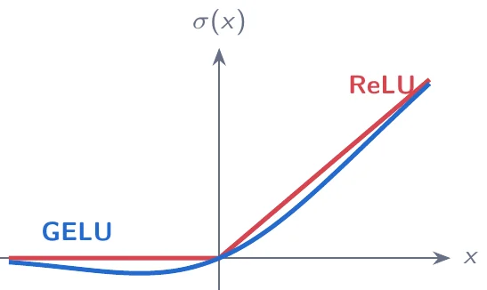{#fig-activations fig-alt="Plot of the ReLU and GELU activation functions"}
:::

**Batch normalization** [@ioffe2015batch] standardizes each channel over the mini-batch (and, for images, over the spatial positions), then restores a learnable scale and shift:

$$
\hat x=\frac{x-\mu_{\mathcal{B}}}{\sqrt{\sigma_{\mathcal{B}}^{2}+\epsilon}},
\qquad
y=\gamma\hat x+\beta .
$$ {#eq-batchnorm}

It improves optimization and permits larger learning rates, but its behaviour **depends on batch statistics and on train/eval mode**. During training it uses the statistics of the current batch and updates running averages; in `model.eval()` it uses the running averages. Two consequences bite students regularly: forgetting `model.eval()` at test time silently changes every prediction, and very small batches (common in detection and segmentation, where images are large) make the batch statistics noisy — group normalization, or freezing the backbone's BatchNorm, is the usual fix.

**Layer normalization** [@ba2016layer] normalizes within each token or example, across its channels. It needs no batch statistics and behaves identically in training and inference, which is why transformers use it.

**Activations.** ReLU, $\max(0,x)$, is cheap, sparse, and piecewise linear. GELU [@hendrycks2016gaussian], $x\,\Phi(x)$ with $\Phi$ the standard normal CDF, is a smooth gate that is common in transformers.

### Transfer learning: reuse a pretrained backbone

A backbone pretrained on a large dataset already computes generic visual features. A new task replaces the head and adapts some or all of the weights.

| Strategy | Trainable weights | Best when | Main risk |
|---|---|---|---|
| Linear probe | head only | little data; diagnosing the representation | under-adaptation |
| Partial fine-tune | head + late blocks | moderate data / related domain | brittle layer choice |
| Full fine-tune | all weights | enough data and compute | overfitting / forgetting |

: Transfer-learning strategies. Validation data, not intuition, decides between them. {#tbl-transfer}

Always adapt the preprocessing and normalization to the **exact** pretrained checkpoint — resolution, resize policy, mean and standard deviation, colour order. A mismatch does not crash; it just quietly costs accuracy.

### A hierarchy of visual features

::: {.figure-panel}
![What ResNet-18 computes on the scene, early to late. Early: the 64 first-layer filters ($7\times7\times3$) are edge, colour, and micro-texture detectors. Middle: the scene patches that most activate three layer-3 units look like wheels, heads, and legs — object parts. Late: class activation maps [@zhou2016learning] for "minivan" and "traffic light" localize whole objects. A task head reads these features.](../../assets/figures/dl4cv/l01-feature-hierarchy.webp){#fig-hierarchy fig-alt="Four panels: a grid of 64 small coloured filters, patches of wheels, heads, and legs, class activation maps over the scene, and a detection head output"}
:::

Resolution decreases and abstraction increases with depth. Classification can use the final semantic vector alone. Detection and segmentation must combine late semantics with earlier spatial detail. And these "features" are **task- and training-dependent** — what a unit responds to depends on the data and the objective, not on a universal visual vocabulary.

### CNN strengths: a useful inductive bias

An **inductive bias** is an assumption built into the model class that makes some solutions easier to learn than others. CNNs build in five.

- **Locality.** Nearby pixels interact first.
- **Parameter sharing.** The same detector works at every location.
- **Hierarchical composition.** Local evidence is composed into parts and objects.
- **Data efficiency.** The built-in assumptions constrain the hypothesis space, so less data is needed.
- **Multi-scale maps.** Intermediate layers naturally provide the multi-resolution features dense tasks need.

::: {.definition}
**Definition 1 — Translation equivariance**

Let $T_\delta$ shift an image by $\delta$: $(T_\delta x)[i]=x[i-\delta]$. A map $\Phi$ is **equivariant** to translation if $\Phi(T_\delta x)=T_\delta\Phi(x)$ and **invariant** if $\Phi(T_\delta x)=\Phi(x)$. A stride-1 convolution is equivariant:
$$
(K*T_\delta x)[i]=\sum_{u}K[u]\,x[i+u-\delta]=(K*x)[i-\delta]=T_\delta(K*x)[i].
$$
:::

Equivariance preserves *where*: shift the car, and its feature-map response shifts with it. Pooling and global averaging later create partial *invariance*. Two honest caveats: equivariance is exact only away from the borders (padding breaks it), and a layer with stride $s$ is equivariant only to shifts that are multiples of $s$ — small shifts of the input can change the output of a strided CNN noticeably. A good inductive bias, in short, says which solutions should be easy to learn; it does not guarantee them.

### CNN limitations: global context is indirect

::: {.figure-panel}
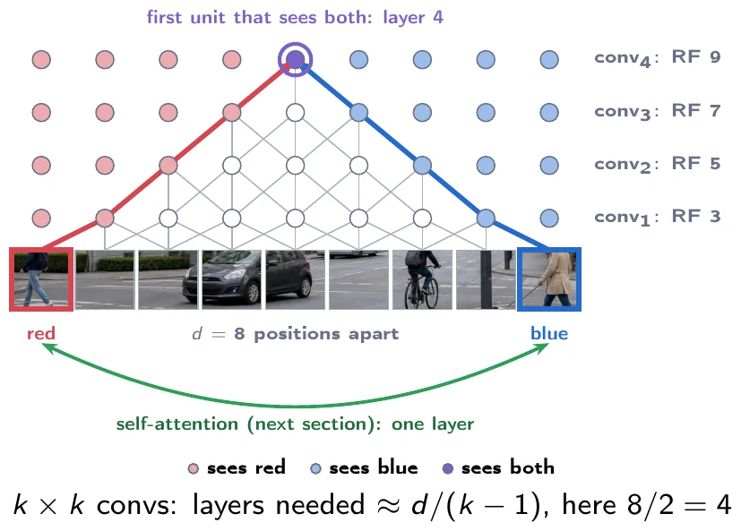{#fig-cnn-limits fig-alt="A triangular lattice of units over a row of image patches, with red and blue paths meeting at layer 4, and a green arc labelled self-attention one layer"}
:::

With $k\times k$ convolutions and stride 1, a unit's receptive field grows by $k-1$ per layer, so two positions $d$ apart first interact after about $d/(k-1)$ layers — $8/2=4$ in @fig-cnn-limits. More generally:

- long-range interaction needs depth, large kernels, dilation, or pooling;
- repeated downsampling discards fine spatial detail;
- the mixing pattern is fixed: a convolution does not adapt its connectivity to the content of the image;
- strong locality can favour texture or shortcuts over global shape [@geirhos2019imagenet].

These are trade-offs, not a verdict. Modern CNNs such as ConvNeXt [@liu2022convnet] are very strong, and transformers introduce their own costs.

## Vision Transformers

### Attention: content-dependent interaction

::: {.figure-panel}
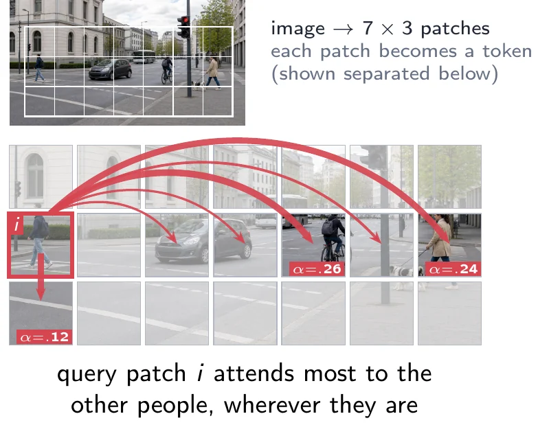{#fig-attention-intuition fig-alt="The street scene split into a grid of patches with red arcs from one pedestrian patch to other patches labelled with attention weights 0.26, 0.24, and 0.12"}
:::

Self-attention replaces the fixed local weights of a convolution by weights computed from the data:

$$
\mathbf{z}'_i=\sum_{j}\alpha_{ij}\,\mathbf{v}_j,
\qquad
\sum_{j}\alpha_{ij}=1,
\qquad
\alpha_{ij}\ge0 .
$$

- The weights $\alpha_{ij}$ **depend on token content**.
- Interaction is **global** in a standard transformer: every token can read every other token in one layer.
- Attention is a weighted *set* operation, blind to order, so **geometry must be supplied** through position information.
- Full attention costs $O(N^2)$ token interactions.

### From an image to a sequence of patches

::: {.figure-panel}
{#fig-patchify fig-alt="A car image overlaid with a 14 by 14 patch grid, one patch zoomed and flattened, a linear embedding E, and the resulting token sequence with a CLS token"}
:::

The Vision Transformer [@dosovitskiy2021image] treats an image as a sentence of patches. With patch side $P$ and an $H\times W\times C$ image,

$$
N=\frac{HW}{P^2},
\qquad
\mathbf{x}_p^{k}\in\mathbb{R}^{P^2C},
\qquad
\mathbf{z}_0=\big[\mathbf{x}_{\text{cls}};\,\mathbf{x}_p^{1}\mathbf{E};\,\dots;\,\mathbf{x}_p^{N}\mathbf{E}\big]+\mathbf{E}_{\text{pos}},
$$ {#eq-vit-embed}

with $\mathbf{E}\in\mathbb{R}^{(P^2C)\times D}$ and $\mathbf{E}_{\text{pos}}\in\mathbb{R}^{(N+1)\times D}$.

::: {.worked-example}
**Worked example — ViT-B/16 at $224\times224$**

$P=16$, so $N=14\cdot14=196$ patches, each of $P^2\cdot3=768$ values. The token width is $D=768$ — a design choice, not a consequence of the patch size: ViT-S uses $384$ and ViT-L $1024$. So $\mathbf{E}$ is $768\times768$, $\mathbf{E}_{\text{pos}}$ is $197\times768$, and $\mathbf{z}_0\in\mathbb{R}^{197\times768}$.

In code, "flatten each patch and multiply by $\mathbf{E}$" is exactly a convolution whose kernel size equals its stride:

```python
patch_embed = nn.Conv2d(3, 768, kernel_size=16, stride=16)
tokens = patch_embed(torch.randn(1, 3, 224, 224))   # (1, 768, 14, 14)
tokens = tokens.flatten(2).transpose(1, 2)          # (1, 196, 768)
```
:::

Smaller patches preserve detail but increase $N$, and with it the attention cost. The class token $\mathbf{x}_{\text{cls}}$ is a learnable global readout — it carries no patch content and gathers information from all patches through attention; averaging the patch tokens is a common alternative.

### The Vision Transformer pipeline

::: {.figure-panel}
{#fig-vit-pipeline fig-alt="A pipeline diagram from a 3 by 3 patch image through embedding, position encoding, L transformer blocks, a classification head reading the CLS token, and a decoder for dense prediction"}
:::

### Self-attention mechanics: query, key, value

::: {.figure-panel}
{#fig-qkv fig-alt="Six token thumbnails, their query, key, and value vectors, a 6 by 6 attention matrix with the pedestrian row highlighted, and the weighted sum of values"}
:::

Stack the $N$ tokens into $\mathbf{X}\in\mathbb{R}^{N\times D}$. Three learned projections produce queries, keys, and values,

$$
\mathbf{Q}=\mathbf{X}\mathbf{W}_Q,
\quad
\mathbf{K}=\mathbf{X}\mathbf{W}_K,
\quad
\mathbf{V}=\mathbf{X}\mathbf{W}_V,
\qquad
\mathbf{A}=\operatorname{softmax}\!\left(\frac{\mathbf{Q}\mathbf{K}^{\top}}{\sqrt{d_k}}\right),
\qquad
\operatorname{Attn}(\mathbf{X})=\mathbf{A}\mathbf{V}.
$$ {#eq-attention}

Read the pieces one at a time [@vaswani2017attention].

- The **query** $\mathbf{q}_i$ says what token $i$ is looking for; the **key** $\mathbf{k}_j$ what token $j$ offers; the **value** $\mathbf{v}_j$ what it passes on if selected.
- $\mathbf{q}_i\cdot\mathbf{k}_j$ scores the compatibility of every (query, key) pair, so $\mathbf{Q}\mathbf{K}^\top$ is $N\times N$.
- The **row-wise softmax** makes each query's weights positive and sum to one: row $i$ of $\mathbf{A}$ is a probability distribution over tokens.
- Output row $i$ is a weighted mix of the values.

::: {.checkpoint}
**Check 3 — Why divide by $\sqrt{d_k}$?**

If the components of $\mathbf{q}$ and $\mathbf{k}$ are independent with zero mean and unit variance, then $\mathbf{q}\cdot\mathbf{k}=\sum_{m=1}^{d_k}q_mk_m$ has mean $0$ and variance $d_k$. With $d_k=64$, raw scores have a standard deviation of $8$, so the softmax is almost one-hot and its gradient almost zero. Dividing by $\sqrt{d_k}$ restores unit variance and keeps the softmax in a regime where it can learn.
:::

```python
def self_attention(x, w_q, w_k, w_v):
    """x: (N, D); w_*: (D, d_k). Returns (N, d_k) and the (N, N) attention matrix."""
    q, k, v = x @ w_q, x @ w_k, x @ w_v
    scores = q @ k.T / k.shape[-1] ** 0.5
    attn = scores.softmax(dim=-1)            # each row sums to 1
    return attn @ v, attn
```

### Multi-head attention

::: {.figure-panel}
{#fig-mha fig-alt="The scene with a query patch marked, and four heat-map overlays for heads 5, 6, 7, and 9 of ViT-B/16 layer 9, feeding a concatenate and W O projection block"}
:::

One attention pattern per layer is restrictive. Multi-head attention runs $h$ attentions in parallel, each with its own $\mathbf{W}_Q^{(m)},\mathbf{W}_K^{(m)},\mathbf{W}_V^{(m)}\in\mathbb{R}^{D\times d_k}$, $d_k=D/h$:

$$
\operatorname{MHA}(\mathbf{X})=\operatorname{Concat}(\text{head}_1,\dots,\text{head}_h)\,\mathbf{W}_O,
\qquad
\mathbf{W}_O\in\mathbb{R}^{D\times D}.
$$

For ViT-B, $h=12$ and $d_k=768/12=64$, so multi-head attention costs the same as one wide head. The heads provide separate **learned subspaces** — they are not guaranteed to have human-interpretable roles, and the descriptions in @fig-mha are a reading of one example, not a property of the model.

### The transformer block

::: {.figure-panel}
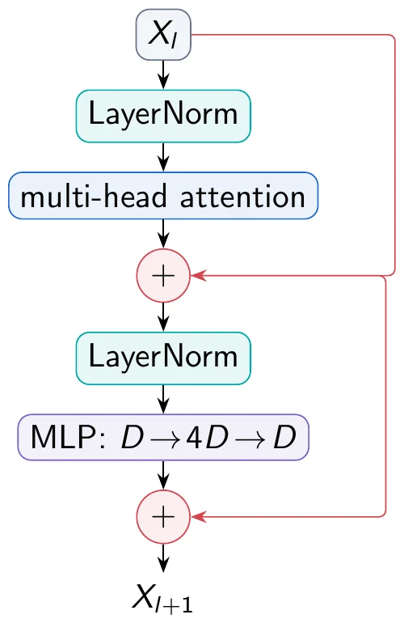{#fig-transformer-block fig-alt="A vertical block diagram: X l, LayerNorm, multi-head attention, plus, LayerNorm, MLP D to 4D to D, plus, X l plus 1, with residual arrows"}
:::

$$
\mathbf{X}'=\mathbf{X}_\ell+\operatorname{MHA}\big(\operatorname{LN}(\mathbf{X}_\ell)\big),
\qquad
\mathbf{X}_{\ell+1}=\mathbf{X}'+\operatorname{MLP}\big(\operatorname{LN}(\mathbf{X}')\big).
$$ {#eq-transformer-block}

The block performs two complementary operations. **Attention mixes information between tokens.** The **MLP mixes information between channels**, independently at each token. Residual paths stabilize deep optimization, exactly as in ResNet; pre-normalization (LayerNorm *inside* the residual branch) is the common modern choice; and position information is what prevents the permutation ambiguity of a pure set model.

::: {.worked-example}
**Worked example — Where ViT-B's 86 million parameters live, and what attention costs**

*Parameters.* Per block, the four $D\times D$ projections $\mathbf{W}_Q,\mathbf{W}_K,\mathbf{W}_V,\mathbf{W}_O$ cost $4D^2$, and the MLP $D\to4D\to D$ costs $8D^2$ (ignoring biases and LayerNorm). With $D=768$ that is $12D^2\approx7.1$M per block, $85$M for 12 blocks, plus about $0.7$M for the patch and position embeddings: the familiar 86M.

*Compute per block.* The projections and MLP cost about $12ND^2$ multiply–adds; forming $\mathbf{Q}\mathbf{K}^\top$ and $\mathbf{A}\mathbf{V}$ costs about $2N^2D$. The ratio is $N/(6D)$. At $224^2$ ($N=197$) attention proper is only about $4\%$ of the block — the linear layers dominate. The quadratic term takes over when $N>6D=4608$ tokens, i.e. around $1086\times1086$ pixels with $16\times16$ patches. *Memory* is the sharper constraint: at $N=4608$, one layer's $12$ attention matrices hold $12\cdot4608^2\approx2.5\times10^8$ entries, about 1 GB in 32-bit floats. This is why high-resolution dense prediction motivates windowed and hierarchical transformers.
:::

### CNN versus ViT: different inductive biases

| Dimension | Convolutional network | Vision Transformer |
|---|---|---|
| Connectivity | local, fixed kernel support | global and content-dependent by default |
| Position | encoded by the grid and the convolution | added explicitly to patch tokens |
| Weight sharing | across spatial locations | projections shared across tokens |
| Translation bias | strong equivariance (before borders and stride) | weaker; learned from data and augmentation |
| Data regime | often strong with less data | benefits greatly from large-scale pretraining |
| Resolution cost | roughly linear in pixels per conv | full attention quadratic in token count |
| Dense outputs | natural multi-scale feature maps | tokens must be reshaped / made hierarchical |

: CNNs and ViTs encode different assumptions. {#tbl-cnn-vit}

The one-line summary: a CNN *assumes* locality and translation structure, so it learns them for free; a ViT must *learn* them, which costs data, but it is not limited by them once it has.

### Hybrid and hierarchical vision models

::: {.figure-panel}
{#fig-swin fig-alt="A pipeline: image, conv stem, fine tokens with windows, patch merging from 4C to 2C, shifted window attention, and a multi-scale feature pyramid"}
:::

The Swin Transformer [@liu2021swin] is the reference design. Three ideas make attention practical for dense prediction:

- **Local windows.** Attention is computed only inside non-overlapping windows of $M\times M$ tokens. For an $h\times w$ token map with $C$ channels the cost of the attention matrices falls from $2(hw)^2C$ to $2M^2hwC$ — linear in the number of tokens. At stage 1 of Swin-T ($56\times56$ tokens, $M=7$) that is a factor $hw/M^2=64$.
- **Shifted windows.** Alternate blocks shift the window grid by $\lfloor M/2\rfloor$ tokens, so information crosses window borders.
- **Hierarchy.** Patch merging halves the resolution and doubles the channels between stages, producing exactly the multi-scale feature maps that detection and segmentation heads expect.

### The backbone: a reusable feature extractor

::: {.figure-panel}
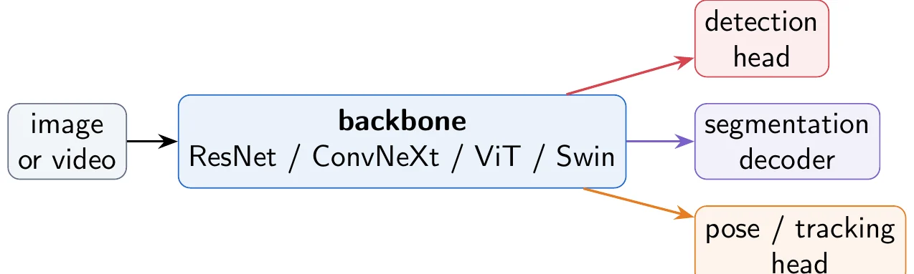{#fig-backbone fig-alt="Image or video feeding a backbone box, which feeds a detection head, a segmentation decoder, and a pose or tracking head"}
:::

A backbone outputs feature vectors or feature maps; the head maps them to a task representation. Pretraining can be supervised, self-supervised, or multimodal (Lecture 2). But "same backbone" does **not** imply the same preprocessing, input scale, output stride, or fine-tuning recipe, and those details routinely matter more than the backbone's name.

### Feature pyramids: a preview of multi-scale prediction

::: {.figure-panel}
{#fig-fpn fig-alt="Four backbone activation maps C2 to C5 on the left connected by lateral 1 by 1 convolutions and top-down arrows to four pyramid maps P2 to P5, with detections on the scene"}
:::

Objects in one image span two orders of magnitude in size. Deep maps are semantically strong but coarse; shallow maps are fine but semantically weak. The feature pyramid network [@lin2017feature] gives every scale strong semantics with a top-down pathway and lateral connections. Let $C_\ell$ be the backbone output after stage $\ell$ (stride $2^\ell$). Then

$$
P_5=\operatorname{conv}_{1\times1}(C_5),
\qquad
P_\ell=\operatorname{conv}_{3\times3}\!\Big(\operatorname{conv}_{1\times1}(C_\ell)+\operatorname{up}_{2\times}(P_{\ell+1})\Big),
\quad \ell=4,3,2,
$$ {#eq-fpn}

where the $1\times1$ "lateral" convolution brings every level to 256 channels and the $3\times3$ convolution smooths the aliasing of the upsampling. Each level then predicts objects of a suitable size. In Faster R-CNN with FPN, a region of size $w\times h$ is assigned to level

$$
k=\left\lfloor k_0+\log_2\!\big(\sqrt{wh}/224\big)\right\rfloor,
\qquad k_0=4,
$$

clamped to $[2,5]$: a $224$-pixel object goes to $P_4$, a $448$-pixel one to $P_5$, a $56$-pixel one to $P_2$. The pyramid reappears in every detector and segmenter below.

::: {.checkpoint}
**Check 4 — Classification is not enough**

Return to @fig-classification: "street scene, $0.84$". A single label discards the **object count**, each object's **location and scale**, their **overlaps and relationships**, and the **uncertainty per object**. Mapping an image to a *set of objects* changes both the prediction space and the evaluation protocol — which is the subject of the next part.
:::

```{=html}
<div class="note-part"><span>Part III</span>Object detection</div>
```

## The detection problem {#sec-detection}

Detection turns one image into a **variable-size set of localized objects**, each answering three questions: *what?* (a class), *where?* (a box), and *how sure?* (a score).

### Localization versus detection

::: {.figure-panel}
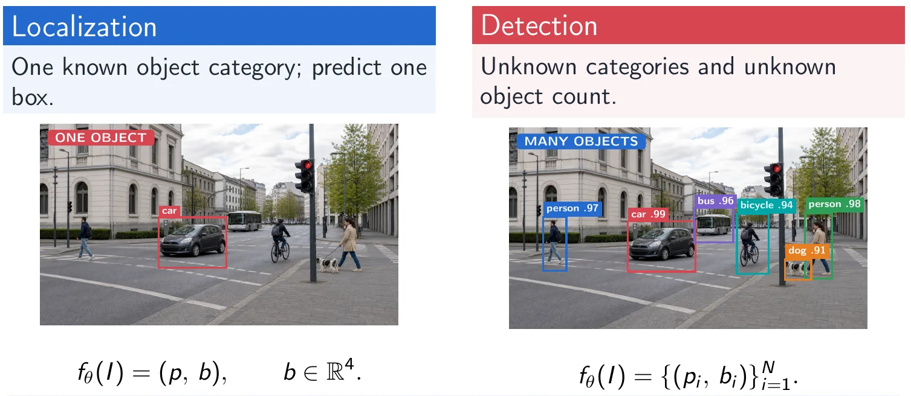{#fig-loc-vs-det fig-alt="Two versions of the scene: on the left one red box around the car labelled one object; on the right six coloured boxes labelled many objects"}
:::

$$
\text{localization: } f_\theta(I)=(p,\mathbf{b}),\ \mathbf{b}\in\mathbb{R}^4;
\qquad
\text{detection: } f_\theta(I)=\{(\mathbf{p}_i,\mathbf{b}_i)\}_{i=1}^{N}.
$$

Localization is just classification plus four regressed numbers. Detection adds a **cardinality problem**: the model must decide which of its candidates correspond to real objects, and how many there are.

### Bounding-box parameterization

::: {.figure-panel}
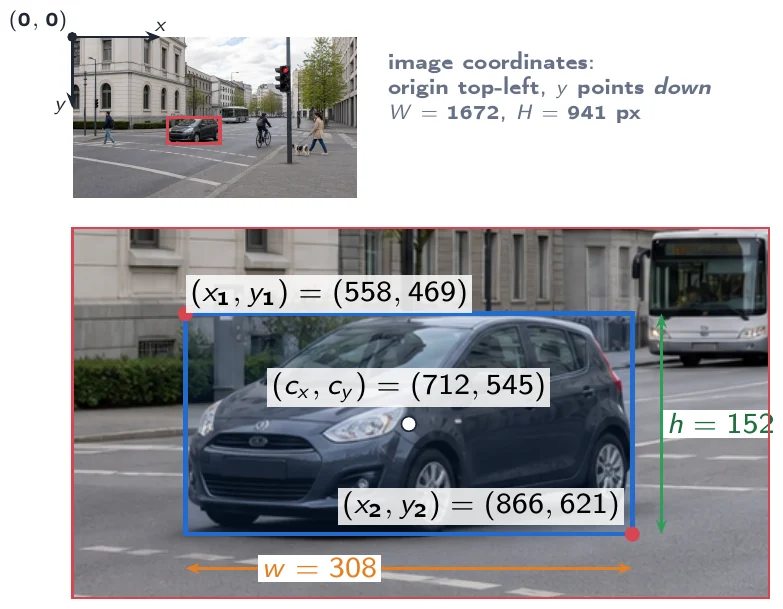{#fig-box-param fig-alt="The car with its bounding box annotated with corner coordinates, centre coordinates, width 308, and height 152"}
:::

A box is four numbers, in one of two equivalent forms:

$$
(x_1,y_1,x_2,y_2)=(558,469,866,621)
\;\Longleftrightarrow\;
(c_x,c_y,w,h)=\Big(\tfrac{x_1+x_2}{2},\tfrac{y_1+y_2}{2},x_2-x_1,y_2-y_1\Big)=(712,545,308,152).
$$

Dividing by $(W,H)=(1672,941)$ gives the normalized box $(0.426,0.579,0.184,0.162)$. Three practical rules follow: normalize coordinates by the image width and height, so that the targets do not depend on resolution; enforce $w,h>0$ through a suitable transform (an exponential, below); and regress **relative offsets** rather than absolute positions, because they are easier to learn across scales. A box is only four numbers, but their scale and parameterization shape optimization.

### The detection output

A detector emits a fixed budget of $K$ candidates, $\hat{\mathcal{Y}}=\{(\hat{\mathbf{p}}_i,\hat{\mathbf{b}}_i)\}_{i=1}^{K}$, each with class probabilities $\hat{\mathbf{p}}_i\in[0,1]^{C+1}$ — the extra class is "no object", $\varnothing$ — and box coordinates $\hat{\mathbf{b}}_i\in\mathbb{R}^4$. The target set has variable size $N$, and typically $K\gg N$. **Assignment** (during training) and **filtering** (at inference) decide which predictions count. Producing the predictions is easy to tensorize; deciding which ones count is the central difficulty of detection, and most of this part is about it.

### Detection as multitask learning

::: {.figure-panel}
{#fig-multitask fig-alt="Scene with three numbered dashed candidate boxes and refined solid boxes, above a table of IoU, class head output, box head status, and loss"}
:::

Each candidate $i$, once assigned a ground-truth class $c_i$ (possibly $\varnothing$) and box $\mathbf{b}_i^*$, contributes

$$
\mathcal{L}_i=\mathcal{L}_{\text{cls}}(\mathbf{p}_i,c_i)+\lambda\,\mathbf{1}[c_i\neq\varnothing]\,\mathcal{L}_{\text{box}}(\mathbf{b}_i,\mathbf{b}_i^{*}).
$$ {#eq-det-loss}

Every candidate learns foreground versus background; only matched positives receive box supervision — there is no "correct box" for background. The loss scales must be balanced through $\lambda$. Common choices for $\mathcal{L}_{\text{box}}$ are the smooth-$L_1$ loss of Fast R-CNN [@girshick2015fast] on the offsets of @sec-anchors,

$$
\operatorname{smooth}_{L_1}(x)=\begin{cases}0.5\,x^2 & |x|<1,\\ |x|-0.5 & \text{otherwise},\end{cases}
$$

and IoU-based losses such as $1-\mathrm{GIoU}$ [@rezatofighi2019generalized], defined below.

### Intersection over Union

::: {.figure-panel}
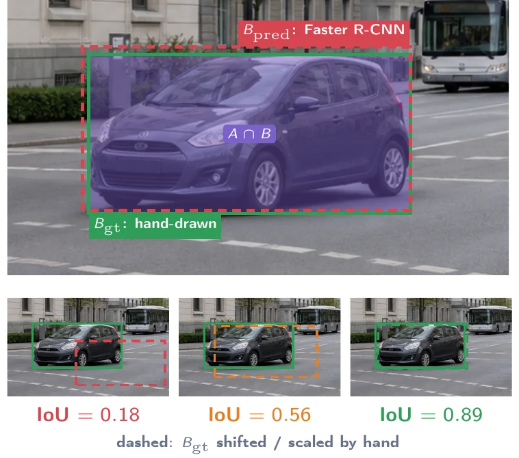{#fig-iou fig-alt="The car with overlapping predicted and ground-truth boxes, the intersection shaded, and three smaller examples with IoU 0.18, 0.56, and 0.89"}
:::

::: {.definition}
**Definition 2 — Intersection over Union and its generalization**

For two boxes $A$ and $B$,
$$
\operatorname{IoU}(A,B)=\frac{|A\cap B|}{|A\cup B|}\in[0,1],
$$
equal to $0$ for disjoint boxes and $1$ for identical ones. Let $C$ be the smallest box enclosing both. The **generalized IoU** is
$$
\operatorname{GIoU}(A,B)=\operatorname{IoU}(A,B)-\frac{|C\setminus(A\cup B)|}{|C|}\in(-1,1].
$$
:::

IoU is **scale invariant**: doubling both boxes leaves it unchanged, so a 5-pixel error on a pedestrian far away counts as much as a 50-pixel error on a nearby bus. It is used both for **matching** (training and evaluation) and as a **threshold** that turns a continuous overlap into a discrete true/false-positive decision. As a loss, $1-\mathrm{IoU}$ has zero gradient for non-overlapping boxes; the enclosing-box penalty of GIoU fixes this by still telling the prediction which way to move.

For axis-aligned boxes in corner form, the intersection is $\max(0,\min(x_2,x_2')-\max(x_1,x_1'))\cdot\max(0,\min(y_2,y_2')-\max(y_1,y_1'))$ and the union is the sum of the areas minus the intersection — in torchvision, `torchvision.ops.box_iou`.

## Evaluating detectors

### Precision and recall for detection

::: {.figure-panel}
{#fig-pr fig-alt="Three crops with true-positive and false-positive boxes, above a table of score thresholds with TP, FP, FN counts and precision and recall bars"}
:::

A prediction is a **true positive** (TP) when its class is correct, its IoU with a ground-truth object is at least $\tau$, and that object is **not already matched** to a higher-scoring prediction. Otherwise it is a **false positive** (FP). Ground-truth objects left unmatched are **false negatives** (FN). Then

$$
\mathrm{P}=\frac{\mathrm{TP}}{\mathrm{TP}+\mathrm{FP}},
\qquad
\mathrm{R}=\frac{\mathrm{TP}}{\mathrm{TP}+\mathrm{FN}} .
$$

::: {.worked-example}
**Worked example — Sweeping the threshold on the scene**

With 11 ground-truth objects (objects under 30 pixels tall ignored, like VOC's "difficult" flag):

| score $\ge$ | TP | FP | FN | precision | recall |
|---|---|---|---|---|---|
| 0.995 | 7 | 0 | 4 | 1.00 | $7/11=0.64$ |
| 0.9 | 11 | 0 | 0 | 1.00 | 1.00 |
| 0.5 | 11 | 1 | 0 | $11/12=0.92$ | 1.00 |
| 0.05 | 11 | 10 | 0 | $11/21=0.52$ | 1.00 |

Raising the threshold usually raises precision and lowers recall. Duplicates count as false positives; missed objects reduce recall. No single row describes the detector — which is why a detector is evaluated **over a confidence sweep**, not at one arbitrary threshold.
:::

### Average precision and mAP

::: {.figure-panel}
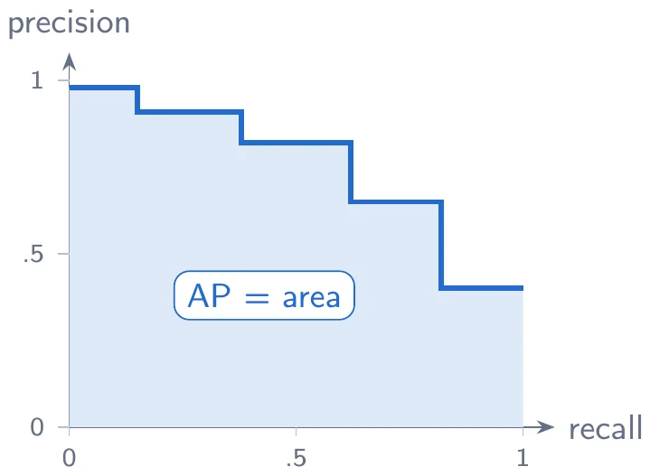{#fig-ap fig-alt="A stepwise decreasing precision-recall curve with the area underneath shaded and labelled AP equals area"}
:::

Sort all predictions of class $c$ over the whole dataset by decreasing confidence; walk down the list, accumulating TP and FP; each prefix gives one (recall, precision) point. **Average precision** summarizes the curve,

$$
\mathrm{AP}_c=\int_0^1 p_c(r)\,dr,
\qquad
\mathrm{mAP}=\frac1C\sum_{c=1}^{C}\mathrm{AP}_c .
$$

In practice the curve is first made monotone with the *interpolated* precision $p^{\text{interp}}(r)=\max_{r'\ge r}p(r')$, then integrated: PASCAL VOC 2007 sampled 11 recall points, later VOC editions used all points [@everingham2010pascal], and COCO uses 101 points [@lin2014microsoft]. The details change the number, so only compare APs computed with the same toolkit.

COCO's headline metric, written AP or AP\@[.50:.95], averages AP over ten IoU thresholds $\tau\in\{0.50,0.55,\dots,0.95\}$ and over the 80 classes. It therefore rewards **precise localization**, not just finding the object. COCO also reports AP$_{50}$ and AP$_{75}$ (single thresholds) and AP$_S$, AP$_M$, AP$_L$ for small ($<32^2$ pixels), medium, and large ($>96^2$) objects — the first place to look when a detector disappoints.

## From sliding windows to dense prediction

### Why not slide a classifier everywhere?

::: {.figure-panel}
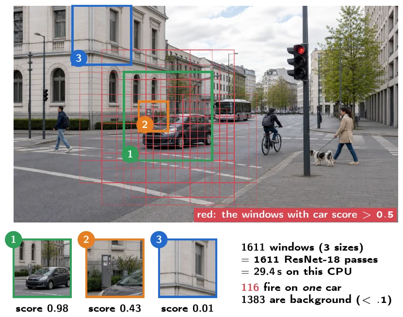{#fig-sliding fig-alt="The scene covered by a grid of red windows, with three numbered example windows and their car scores 0.98, 0.43, and 0.01"}
:::

The oldest detector is the HOG idea: classify every window at every position and scale. Its problems are structural:

- adjacent windows repeat **almost identical computation**;
- object **size and aspect ratio are unknown**, multiplying the number of windows;
- one object activates **many overlapping windows**;
- background windows **vastly outnumber** objects.

The question that unlocks modern detection is: *which computation can be shared across all windows?*

### Fully convolutional detection

::: {.figure-panel}
{#fig-fcn-detection fig-alt="The scene, a ResNet-18 feature block, a 1 by 1 conv labelled classifier fc applied at every cell, and a grid of car scores glowing red on the car"}
:::

A fully connected layer applied to a $1\times1\times512$ feature vector is the same as a $1\times1$ convolution applied at one position. Applying it at every position of a feature map evaluates the classifier on every receptive field at once [@sermanet2014overfeat]:

$$
s_{ij}=\operatorname{softmax}\big(\mathbf{W}\mathbf{f}_{ij}+\mathbf{b}\big)_{\text{car}} .
$$

The backbone runs once; every feature is reused by all neighbouring predictions; the spatial layout is preserved in a dense output tensor; and the receptive field grows without cropping patches. On the scene, the speedup is $29.4/0.58\approx50\times$. **A sliding classifier becomes one shared convolution over a feature map.** Every modern detector is built on this observation.

### Anchor boxes {#sec-anchors}

::: {.figure-panel}
{#fig-anchors fig-alt="The car with nine nested anchor boxes of different sizes and shapes centred on one grid cell, the best one highlighted"}
:::

A dense output gives one prediction per cell, but objects have different sizes and shapes. **Anchors** are reference boxes attached to every cell, $\mathbf{a}=(c_x^a,c_y^a,w_a,h_a)$, with several scales and aspect ratios [@ren2015faster; @liu2016ssd]. For each anchor, the head predicts objectness, class scores, and four offsets $\mathbf{t}=(t_x,t_y,t_w,t_h)$ that are decoded as

$$
\hat c_x=c_x^a+t_x w_a,
\qquad
\hat c_y=c_y^a+t_y h_a,
\qquad
\hat w=w_a e^{t_w},
\qquad
\hat h=h_a e^{t_h}.
$$ {#eq-anchor-decode}

The centre offsets are measured in units of the anchor size, which makes them scale-free; the exponential makes the width and height positive and turns a multiplicative size change into an additive target. To train, invert @eq-anchor-decode: $t_x=(c_x-c_x^a)/w_a$, $t_w=\ln(w/w_a)$, and similarly for $y$ and $h$.

::: {.worked-example}
**Worked example — Encoding the car against its best anchor**

The best anchor is $\mathbf{a}=(712,552,362,181)$ and the car is $(712,545,308,152)$. The regression targets are
$$
t_x=\frac{712-712}{362}=0,
\quad
t_y=\frac{545-552}{181}=-0.039,
\quad
t_w=\ln\frac{308}{362}=-0.162,
\quad
t_h=\ln\frac{152}{181}=-0.175 .
$$
Small numbers of order $0.1$, whatever the size of the object: exactly what a regression head likes. Plugging them into @eq-anchor-decode returns $(712,545,308,152)$.
:::

### Anchor matching

::: {.figure-panel}
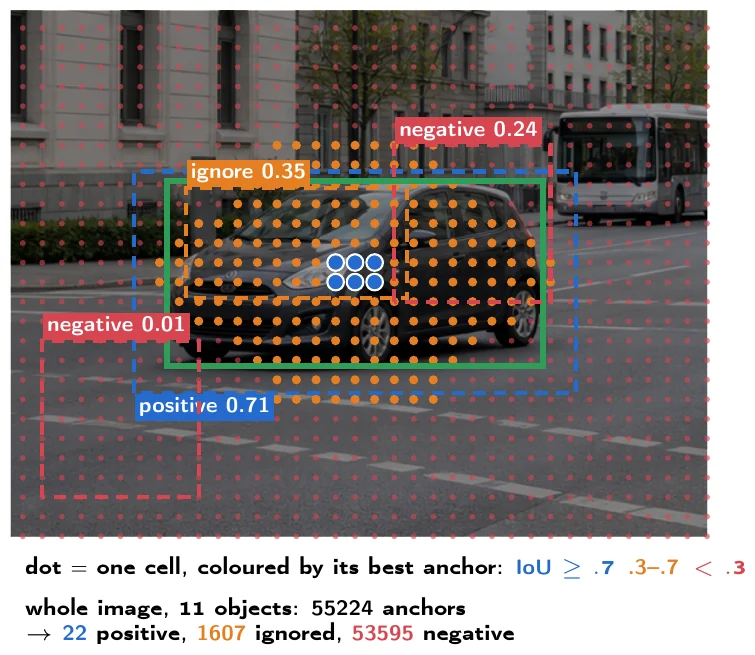{#fig-anchor-matching fig-alt="The car covered by a grid of dots coloured blue, orange, or grey, with four example anchors labelled negative 0.24, ignore 0.35, negative 0.01, and positive 0.71"}
:::

Before computing @eq-det-loss we must decide which anchors are responsible for which objects. The rule used by the Faster R-CNN region proposal network is

$$
y(\mathbf{a},\mathbf{g})=
\begin{cases}
+1 & \operatorname{IoU}(\mathbf{a},\mathbf{g})\ge\tau_+,\\
0 & \operatorname{IoU}(\mathbf{a},\mathbf{g})<\tau_-\ \text{for every }\mathbf{g},\\
\perp & \text{otherwise},
\end{cases}
\qquad
\tau_+=0.7,\ \tau_-=0.3,
$$

and, so that no object is left without a positive, the anchor with the highest IoU for each ground truth is also made positive. Ignored ($\perp$) anchors contribute no classification loss. RetinaNet uses $\tau_+=0.5$, $\tau_-=0.4$. These thresholds are design choices, not universal constants — and the assignment rule **defines the labels the network sees during training**. Change the rule, and you have changed the learning problem.

Notice the imbalance in @fig-anchor-matching: 22 positives for 53 595 negatives, a ratio of about $1:2400$. Faster R-CNN's RPN samples mini-batches of 256 anchors with up to half positives to cope with it; @sec-focal shows a more principled answer.

## Detector architectures

### Two-stage detectors: proposals, then decisions

::: {.figure-panel}
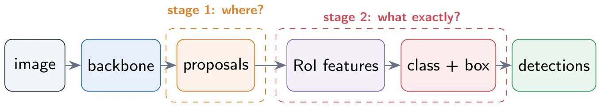{#fig-two-stage fig-alt="A pipeline: image, backbone, proposals, RoI features, class plus box, detections, grouped into stage 1 and stage 2"}
:::

The R-CNN family [@girshick2014rich; @girshick2015fast; @ren2015faster] splits detection in two. The strength: expensive per-object reasoning is applied only to a **sparse proposal set** (hundreds of regions instead of hundreds of thousands of anchors). The cost: proposal generation and per-region processing add latency and pipeline complexity. The lineage is instructive:

- **R-CNN** (2014) cropped every external proposal (selective search) from the *image* and ran a CNN on each: about 2000 forward passes per image.
- **Fast R-CNN** (2015) ran the CNN once and cropped each proposal from the *feature map* with RoI pooling — the fully convolutional idea applied to proposals.
- **Faster R-CNN** (2015) replaced the external proposal algorithm by a learned **region proposal network** sharing the same features.

### Faster R-CNN

::: {.figure-panel}
{#fig-faster-rcnn fig-alt="The two-stage Faster R-CNN pipeline: image, shared FPN features, RPN objectness map, top proposals, three proposal crops pooled by RoIAlign, class and box outputs, and final detections"}
:::

1. The **backbone + FPN** computes shared features once.
2. The **RPN** slides a small network over every pyramid level and predicts, for every anchor, an objectness score and box offsets. Proposals are **class-agnostic**: the RPN only says "something is here". After decoding, NMS and a top-$k$ selection keep about 1000 proposals.
3. **RoIAlign** extracts a fixed-size $7\times7$ feature for each proposal from the appropriate pyramid level, using bilinear sampling without coordinate rounding (@sec-mask-rcnn).
4. The **second stage** classifies each RoI into $C+1$ classes and regresses class-specific box refinements.
5. **Per-class NMS** removes duplicates.

The RPN is learned, and both stages reuse the same feature map — the "Faster" in the name.

### One-stage detectors

::: {.figure-panel}
{#fig-one-stage fig-alt="Three brightened copies of the scene for pyramid levels P3, P4, and P5, each highlighting objects of a different size, and the final detections after decoding and NMS"}
:::

One-stage detectors [@liu2016ssd; @redmon2016you; @lin2017focal] drop the proposal stage and predict class and box **densely**, at every anchor of every pyramid level, in one pass. Low latency and simple batching made them the default for real-time applications; multi-scale maps serve different object sizes, as @fig-one-stage shows. The price is that dense supervision creates **severe class imbalance**: almost all of the 193 374 anchors are background.

### YOLO

::: {.figure-panel}
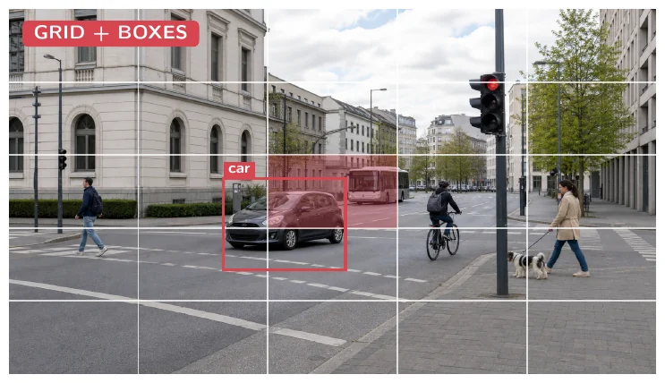{#fig-yolo fig-alt="The scene with a coarse white grid and the car's box highlighted in the cell that contains its centre"}
:::

YOLO [@redmon2016you] framed detection as a single regression. The image is divided into an $S\times S$ grid; each cell predicts $B$ boxes with $(x,y,w,h,\text{confidence})$ and one set of $C$ class probabilities, so the output tensor is

$$
S\times S\times(B\cdot5+C),
$$

which for the original configuration ($S=7$, $B=2$, $C=20$) is $7\times7\times30$. One network maps pixels directly to detections, and the prediction is made with global image context. Modern YOLO variants keep the name and the speed but use different heads, multi-scale features, and different assignment rules.

### Class imbalance and the focal loss {#sec-focal}

::: {.figure-panel}
{#fig-focal fig-alt="Scene with example anchors, a bar chart comparing the share of total loss for positives, hard negatives, and easy negatives under cross-entropy and focal loss, and loss curves for several gamma values"}
:::

Each easy negative contributes a tiny cross-entropy, but there are so many of them that together they dominate the gradient, and the rare informative examples are drowned out. Write $p_t=p$ if the anchor is positive and $p_t=1-p$ otherwise, so $p_t$ is the probability assigned to the *correct* answer. The **focal loss** [@lin2017focal] is

$$
\operatorname{FL}(p_t)=-\alpha_t\,(1-p_t)^{\gamma}\log p_t .
$$ {#eq-focal}

The modulating factor $(1-p_t)^\gamma$ is close to $0$ when the example is already correct ($p_t\to1$) and close to $1$ when it is wrong. With $\gamma=0$ the focal loss is weighted cross-entropy; larger $\gamma$ focuses learning on hard mistakes. $\alpha_t$ ($\alpha=0.25$ for positives, $1-\alpha$ for negatives) is a class-balancing weight.

::: {.worked-example}
**Worked example — How much the focal loss suppresses an easy negative**

An easy negative with $p_t=0.9994$: cross-entropy is $-\ln0.9994\approx6\times10^{-4}$; the focal factor is $(1-0.9994)^2=3.6\times10^{-7}$, so the focal loss is about $0.75\cdot3.6\times10^{-7}\cdot6\times10^{-4}\approx1.6\times10^{-10}$.

A hard example with $p_t=0.1$: cross-entropy is $2.30$; the focal loss is $0.25\cdot0.81\cdot2.30=0.47$.

Relative to cross-entropy, the easy negative is down-weighted by a factor of almost $4\times10^{6}$, the hard example by about $5$. Multiply the first factor by 191 102 easy negatives and you see why the share of the loss moves as it does in @fig-focal. This is what made accurate dense one-stage detection possible in RetinaNet. (The anchors in neither group of @fig-focal — about 500 of them — are the ignored ones, with IoU between $0.4$ and $0.5$.)
:::

## Post-processing and set prediction

### Non-maximum suppression

::: {.figure-panel}
{#fig-nms fig-alt="Two car crops, one covered with 79 red boxes and one with a single green box, above a table of rank, score, IoU with the top box, and fate"}
:::

Dense heads cast many redundant local votes for each object. **Non-maximum suppression** [@neubeck2006efficient] keeps one per object, greedily:

1. select the highest-scoring box and keep it;
2. remove every remaining box **of the same class** whose IoU with it exceeds $\tau_{\text{nms}}$;
3. repeat until no candidates remain.

```python
import torchvision

# boxes: (K, 4) in (x1, y1, x2, y2); scores: (K,); labels: (K,)
keep = torchvision.ops.batched_nms(boxes, scores, labels, iou_threshold=0.5)
boxes, scores, labels = boxes[keep], scores[keep], labels[keep]
```

`batched_nms` performs per-class NMS by never letting boxes of different labels suppress each other; `torchvision.ops.nms` is the class-agnostic version.

### NMS limitations

::: {.figure-panel}
{#fig-nms-limits fig-alt="A cyclist crop with overlapping person and bicycle boxes and the outcome under three NMS variants, and a car crop with 16 duplicate boxes at threshold 0.9"}
:::

NMS is simple and effective, but:

- **Crowds.** Real objects may overlap strongly — the same problem as the cyclist and bicycle arises *within* one class among pedestrians in a crowd or parked cars.
- **Thresholds.** One $\tau$ does not fit every class and scale.
- **Score myopia.** Suppression looks only at scores and box overlap, ignoring the image evidence.
- **A discrete step.** NMS is not learned end to end; the network is trained to produce duplicates that a hand-written rule then removes.

**Soft-NMS** [@bodla2017soft] decays neighbouring scores instead of deleting them: $s_j\leftarrow s_j\,e^{-\operatorname{IoU}(M,b_j)^2/\sigma}$, where $M$ is the selected box. With $\sigma=0.5$, the bicycle's score becomes $0.99\,e^{-0.31^2/0.5}=0.99\cdot0.825=0.82$, as in @fig-nms-limits.

### Modern detection as set prediction

::: {.figure-panel}
{#fig-set-prediction fig-alt="Six prediction slots on the left with class and score, connected by coloured lines to four targets and a no-object node on the right"}
:::

DETR [@carion2020end] removes both anchors and NMS by treating detection as **direct set prediction**. The model outputs a fixed-size, unordered set of $N$ predictions ($N=100$ in DETR, much larger than the number of objects). During training, each ground-truth object is matched to **exactly one** prediction; unmatched predictions are trained to output $\varnothing$. Because a duplicate is matched to $\varnothing$ and penalized, duplicate removal becomes **part of the learning objective**.

### DETR

::: {.figure-panel}
{#fig-detr fig-alt="The DETR pipeline: image, CNN spatial tokens with positional encoding, transformer encoder and decoder with object queries, and class plus box heads"}
:::

1. A CNN backbone produces $C_5\in\mathbb{R}^{H/32\times W/32\times2048}$; a $1\times1$ convolution reduces it to $d=256$ channels, and the map is flattened into $HW/32^2$ tokens — $24\cdot42=1008$ for the scene.
2. Fixed sinusoidal **positional encodings** are added, since attention is permutation invariant.
3. A **transformer encoder** applies global self-attention over the image tokens.
4. A **transformer decoder** takes $N$ learned **object queries**, which attend to each other (so they can coordinate and avoid duplicates) and to the encoder output.
5. Shared feed-forward **heads** turn each decoded query into a class distribution over $C+1$ classes and a normalized box $(c_x,c_y,w,h)\in[0,1]^4$.

Global attention connects distant image regions; the learned queries compete for objects in parallel; and the bipartite set loss trains the complete pipeline end to end. The original DETR, however, converges slowly — hundreds of training epochs — and struggles with small objects, since it uses a single stride-32 map and full attention is too expensive at higher resolution. Deformable DETR [@zhu2021deformable], which attends to a few sampled points on a multi-scale pyramid, addresses both.

### Hungarian matching

::: {.figure-panel}
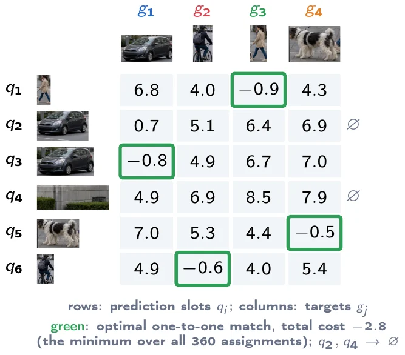{#fig-hungarian fig-alt="A 6 by 4 table of costs with object thumbnails as row and column headers and four green cells marking the optimal assignment"}
:::

Matching is a minimum-cost bipartite assignment. With a cost $\mathcal{C}(i,j)$ between prediction $i$ and target $j$,

$$
\hat\sigma=\arg\min_{\sigma}\sum_{j}\mathcal{C}\big(\sigma(j),j\big),
\qquad
\mathcal{C}(i,j)=-\hat p_i(c_j)+\lambda_1\lVert\mathbf{b}_i-\mathbf{b}_j\rVert_1+\lambda_g\mathcal{L}_{\text{GIoU}}(\mathbf{b}_i,\mathbf{b}_j),
$$ {#eq-hungarian}

where $\sigma$ ranges over injective maps from targets to predictions and $\mathcal{L}_{\text{GIoU}}=1-\operatorname{GIoU}$. The Hungarian algorithm [@kuhn1955hungarian] solves it exactly in $O(n^3)$. **Match first; then compute the class and box losses on the selected pairs**, and the "no object" loss on the rest. DETR uses $\lambda_1=5$ and $\lambda_g=2$, and down-weights the $\varnothing$ class by a factor 10 to balance it.

::: {.worked-example}
**Worked example — One entry and the optimum in @fig-hungarian**

For $q_3$ against $g_1$ (the car), $\hat p_3(\text{car})=0.96$, the normalized $L_1$ box distance is $0.009$, and $\mathcal{L}_{\text{GIoU}}=0.06$:
$$
\mathcal{C}(3,1)=-0.96+5\cdot0.009+2\cdot0.06=-0.80 .
$$
The optimal assignment is $q_3\to g_1$, $q_6\to g_2$, $q_1\to g_3$, $q_5\to g_4$, with total cost $-0.8-0.6-0.9-0.5=-2.8$. In code:

```python
from scipy.optimize import linear_sum_assignment

rows, cols = linear_sum_assignment(cost)   # cost: (num_predictions, num_targets)
# rows[k] is matched to cols[k]; every other prediction is trained as "no object"
```
:::

## Detection in practice

### Datasets

| Benchmark | Classes | Distinctive supervision | What it stresses |
|---|---|---|---|
| PASCAL VOC [@everingham2010pascal] | 20 | boxes, compact taxonomy | foundational AP and transfer |
| COCO [@lin2014microsoft] | 80 things | boxes, masks, keypoints | small objects and crowded scenes |
| LVIS [@gupta2019lvis] | 1203 | instance masks, long tail | rare categories and calibration |
| Open Images [@kuznetsova2020open] | 600 box classes | hierarchy and image-level labels | scale and label relationships |

: Detection benchmarks. {#tbl-detection-datasets}

**Dataset choice is a model choice.** The object vocabulary, the image source, the annotation policy, and the class frequencies define what "good detection" means. Benchmark scores do not transfer automatically: audit domain shift, missing labels (Open Images and LVIS are *federated* — not every image is exhaustively labelled for every class), duplicated categories, and deployment costs.

### Running a pretrained detector

```python
import torch
from torchvision.io import read_image
from torchvision.models.detection import (
    fasterrcnn_resnet50_fpn, FasterRCNN_ResNet50_FPN_Weights,
)

weights = FasterRCNN_ResNet50_FPN_Weights.DEFAULT
model = fasterrcnn_resnet50_fpn(weights=weights, box_score_thresh=0.5).eval()
preprocess = weights.transforms()                  # the checkpoint's own preprocessing

image = read_image("street.png")[:3]               # (3, H, W), uint8
with torch.no_grad():
    out = model([preprocess(image)])[0]            # dict: boxes, labels, scores

names = [weights.meta["categories"][i] for i in out["labels"]]
```

The model takes a *list* of images of any size, resizes them internally, and returns boxes in the original image's pixel coordinates, already post-processed by NMS. `box_score_thresh` is an inference-time choice — evaluate with a low threshold, deploy with the one your application needs.

### Failure modes

::: {.figure-panel}
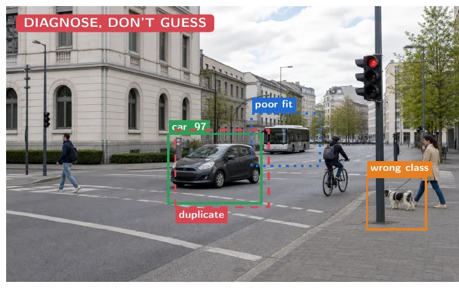{#fig-det-failures fig-alt="The scene with boxes labelled poor fit, car 0.97, wrong class, and duplicate"}
:::

- **Classification:** wrong label, or background hallucinated as an object.
- **Localization:** a shifted or oversized box — counted as a TP at IoU $0.5$ but as an FP at $0.75$.
- **Coverage:** small or occluded objects missed.
- **Multiplicity:** duplicates, or two adjacent instances merged into one box.
- **Shift:** sensor, weather, and geography differ between training and deployment.

Slice errors by class, scale, occlusion, and domain. One mAP number hides the cause.

::: {.checkpoint}
**Check 5 — Boxes are coarse; pixels matter**

::: {.figure-panel}
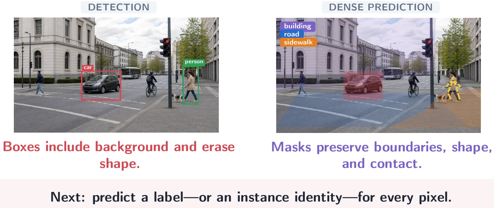{#fig-boxes-vs-masks fig-alt="Two copies of the scene, one with detection boxes, one with coloured segmentation masks for road, sidewalk, car, and person"}
:::

A box around the cyclist contains as much road as cyclist. For a robot grasping an object, a car estimating free space, or a radiologist measuring a tumour, that is not good enough. The next part predicts a label — or an instance identity — for **every pixel** [@he2017mask].
:::

```{=html}
<div class="note-part"><span>Part IV</span>Segmentation</div>
```

## Semantic segmentation {#sec-segmentation}

::: {.figure-panel}
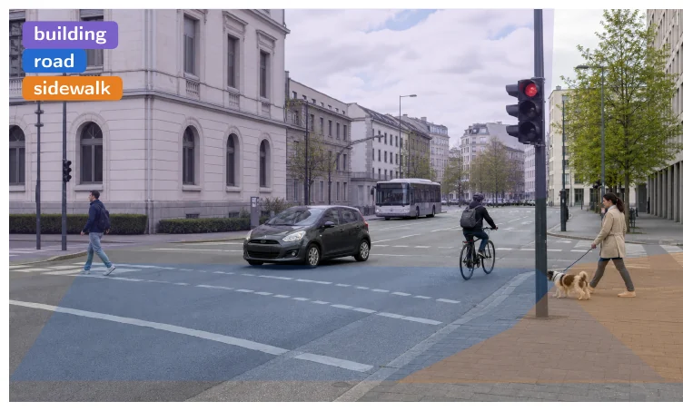{#fig-semantic fig-alt="The street scene with purple building, blue road, and orange sidewalk regions overlaid"}
:::

A semantic segmentation network outputs a score for every class at every pixel and takes the most likely one:

$$
\mathbf{z}=f_\theta(\mathbf{x})\in\mathbb{R}^{H\times W\times C},
\qquad
\hat y_{ij}=\arg\max_{c}\,z_{ijc}.
$$ {#eq-semantic}

The output remains aligned with the input image. Amorphous **"stuff"** (road, sky, vegetation) and countable **"things"** (car, person) share one label map, and same-class objects are **not** separated into instances: two adjacent pedestrians become one "person" region. Classification asks *what*; segmentation asks *what at each location*.

::: {.figure-panel}
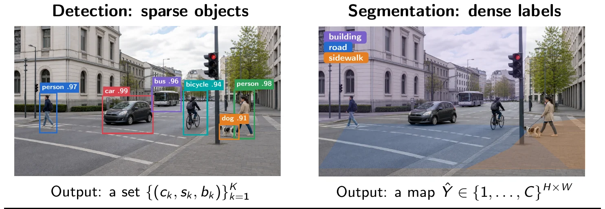{#fig-det-vs-seg fig-alt="Two copies of the scene: one with labelled detection boxes, one with coloured semantic regions"}
:::

| | Detection | Semantic segmentation |
|---|---|---|
| Geometry | coarse box extent | object boundaries and background |
| Identity | separates detections | merges pixels of the same class |
| Supervision | boxes | pixel-level masks |

: Detection and semantic segmentation answer different questions. {#tbl-det-vs-seg}

Pixel-level masks are expensive: a COCO-style polygon takes minutes per object, against seconds for a box. That cost is a recurring theme of the course, and one reason why promptable segmentation foundation models such as SAM [@kirillov2023segment] matter.

### Naive patch classification

::: {.figure-panel}
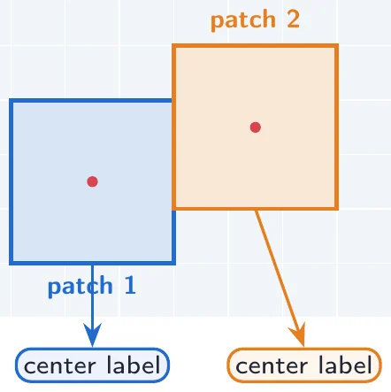{#fig-patch-classification fig-alt="Two overlapping square patches, each with a red centre dot pointing to a centre label"}
:::

The first idea is to train a classifier on a crop around each pixel and predict that pixel's label [@farabet2013learning]. It is correct but wasteful: neighbouring patches overlap almost completely, so their convolutional features are recomputed again and again; small patches miss context while large ones multiply the cost; and a full image needs about $H\times W$ classifier calls — 330 000 for a $432\times768$ image. Exactly as for detection, the missing ingredient is **shared computation**.

### Fully convolutional networks

::: {.figure-panel}
{#fig-fcn fig-alt="Pipeline: image, shared convolutional features, a stack of class-score maps with the person channel shown, the upsampled map, and the final coloured label map"}
:::

The fully convolutional network [@long2015fully] makes the same conversion as @fig-fcn-detection: replace the classifier's dense layers by convolutions, and spatial score maps emerge in one forward pass. The resulting network

- **accepts variable image sizes**, since nothing in it depends on $H$ or $W$;
- **shares features across locations**;
- **trades resolution for receptive field** — its coarse output must be upsampled.

Dense prediction does not require dense repetition. What it does require is a way to recover the resolution lost in the encoder.

### Encoder–decoder design

::: {.figure-panel}
{#fig-encoder-decoder fig-alt="A row of encoder activation maps C2 to C5 shrinking in size, followed by decoder label maps growing back to full resolution"}
:::

The **encoder** answers *what?*: downsampling enlarges the receptive field and builds invariance, but discards precise location. The **decoder** answers *where?*: upsampling restores spatial resolution, but must reconstruct boundaries from compressed features. Segmentation needs both global context and pixel-level localization, and every architecture below is a different compromise between them.

### Upsampling methods

::: {.figure-panel}
{#fig-upsampling fig-alt="An 8 by 8 score patch and four 16 by 16 upsampled versions labelled nearest, bilinear, transposed conv, and resize plus 3 by 3 conv, with an overlap count pattern"}
:::

A **transposed convolution** ("deconvolution", although it inverts nothing) is the adjoint of a strided convolution: each input value scatters a scaled copy of the kernel into the output, with a step of $S$ [@dumoulin2016guide]. Its output size is

$$
H'=(H-1)S-2P+D(K-1)+P_{\text{out}}+1,
$$

so $K=3$, $S=2$, $P=1$, $P_{\text{out}}=1$ maps $8\to16$. When $K$ is not divisible by $S$, the scattered kernels overlap unevenly: in 1-D with $K=3$, $S=2$, even outputs receive two contributions and odd outputs one; in 2-D the counts are $1$, $2$, and $4$, a periodic pattern that the learned weights must fight and that often survives as **checkerboard artefacts** [@odena2016deconvolution]. Resizing (nearest or bilinear) followed by a regular convolution avoids it.

Whatever the method, **upsampling increases sampling density; it cannot recover detail that the encoder never preserved.** That is the job of skip connections.

### Skip connections recover detail

::: {.figure-panel}
{#fig-skip fig-alt="Two activation maps, one fine and one coarse, above two segmentation results: a detailed one with a skip connection and a blobby one without"}
:::

Early maps retain edges, corners, and accurate coordinates; deep maps encode class and broad context. A **skip connection** carries an encoder map to the decoder stage of the same resolution, where it is concatenated with or added to the upsampled features, letting the decoder use both. The feature sizes must be aligned by padding, cropping, or resizing — this is where @eq-conv-size earns its keep.

Contrast this with ResNet: *these* links bridge **scales**, carrying fine detail to a coarse decoder; residual links mainly ease **optimization** within one scale.

### U-Net

::: {.figure-panel}
{#fig-unet fig-alt="A U-shaped diagram of feature maps from 224 squared down to 14 squared and back up, with horizontal cyan copy and concatenate arrows"}
:::

U-Net [@ronneberger2015unet] was designed for biomedical images, where annotated data are scarce and boundaries matter. Its encoder and decoder are symmetric; skip features are **concatenated**, not merely added, so the decoder can learn how to combine them; and the result is strong localization with limited annotated data. The original network used unpadded convolutions (a $572\times572$ input gives a $388\times388$ output, with the copied maps cropped to match) and channel widths from 64 to 1024. Modern U-Nets add padding, normalization, and residual blocks — and U-Nets are also the denoising backbone of many diffusion models. The enduring idea: **pair semantics with same-scale detail.**

### DeepLab: context at multiple scales

::: {.figure-panel}
{#fig-deeplab fig-alt="The scene with three sets of dilated sampling points around one cell, five ASPP branches feeding a concat and 1 by 1 projection, and the resulting label map"}
:::

DeepLab takes the other route: instead of downsampling and recovering, it **keeps** the resolution higher (output stride 8 or 16) and enlarges the receptive field with **atrous** (dilated) convolutions:

$$
y[p]=\sum_{k}w[k]\,x[p+r k] .
$$ {#eq-atrous}

With rate $r$, a $3\times3$ kernel covers $(2r+1)\times(2r+1)$ pixels of its input with the same nine weights — a larger field of view without another pooling step, and without losing resolution. **Atrous spatial pyramid pooling** (ASPP) runs several rates in parallel so that objects at different scales are captured, plus a global image-pooling branch for scene-level context [@chen2017rethinking]. DeepLabV3+ adds a light decoder that fuses stride-4 features to sharpen boundaries [@chen2018encoder]. Multi-scale context disambiguates local texture using the surrounding scene: a grey patch is "road" because of what surrounds it.

```python
from torchvision.models.segmentation import deeplabv3_resnet50, DeepLabV3_ResNet50_Weights

weights = DeepLabV3_ResNet50_Weights.DEFAULT        # 21 Pascal VOC classes
model = deeplabv3_resnet50(weights=weights).eval()
with torch.no_grad():
    logits = model(weights.transforms()(image).unsqueeze(0))["out"]  # (1, 21, H', W')
labels = logits.argmax(dim=1)                                        # (1, H', W')
```

### Segmentation losses

::: {.figure-panel}
{#fig-seg-losses fig-alt="A dog crop with its reference mask, the model's dog probability map, and the per-pixel cross-entropy map, above a table comparing cross-entropy and Dice for two predictions"}
:::

The default is **pixel-wise cross-entropy**, averaged over the set $\Omega$ of labelled pixels, optionally with class weights $w_c$:

$$
\mathcal{L}_{\text{CE}}=-\frac{1}{|\Omega|}\sum_{i\in\Omega}\sum_{c=1}^{C}w_c\,y_{ic}\log p_{ic} .
$$ {#eq-pixel-ce}

It is probabilistic and stable, and class weights can protect rare labels. Its weakness is that it is an **average over pixels**: thousands of easy background pixels can hide a badly segmented small object.

The **soft Dice loss** [@milletari2016v] measures overlap directly, for one foreground class with predicted probabilities $p_i$ and binary targets $y_i$:

$$
\mathcal{L}_{\text{Dice}}=1-\frac{2\sum_i p_iy_i+\varepsilon}{\sum_i p_i+\sum_i y_i+\varepsilon} .
$$ {#eq-dice}

It is a differentiable relaxation of the Dice coefficient $2|A\cap B|/(|A|+|B|)$, and it sees the foreground region as a whole, which makes it useful for small foreground regions.

::: {.worked-example}
**Worked example — Why cross-entropy hides the "always background" model**

Predict $p(\text{dog})=0.05$ at every pixel, when the dog covers a fraction $f=0.055$ of the image. Per pixel, cross-entropy is $-\ln0.05=3.00$ on dog pixels and $-\ln0.95=0.051$ on background pixels, so
$$
\mathcal{L}_{\text{CE}}=0.055\cdot3.00+0.945\cdot0.051=0.165+0.048=0.212 .
$$
For Dice, with $n$ pixels, $\sum_ip_iy_i=0.05\cdot0.055n$, $\sum_ip_i=0.05n$, $\sum_iy_i=0.055n$, and (ignoring $\varepsilon$)
$$
\mathcal{L}_{\text{Dice}}=1-\frac{2\cdot0.00275}{0.05+0.055}=1-0.052=0.95 .
$$
The trivial model is only six times worse than DeepLabV3 under cross-entropy, but its Dice loss is near the maximum of $1$.
:::

A common recipe: **start with cross-entropy**; add Dice, focal, or boundary terms only for a **diagnosed** imbalance.

```python
import torch.nn.functional as F

def soft_dice_loss(logits, target, eps=1.0):
    """logits: (B, H, W) for one foreground class; target: (B, H, W) in {0, 1}."""
    p = logits.sigmoid().flatten(1)
    t = target.float().flatten(1)
    dice = (2 * (p * t).sum(1) + eps) / (p.sum(1) + t.sum(1) + eps)
    return 1 - dice.mean()

# Multi-class cross-entropy on (B, C, H, W) logits and (B, H, W) labels;
# pixels labelled 255 (borders, "void") are excluded from the average.
ce = F.cross_entropy(logits, labels, ignore_index=255)
```

### Segmentation metrics

::: {.figure-panel}
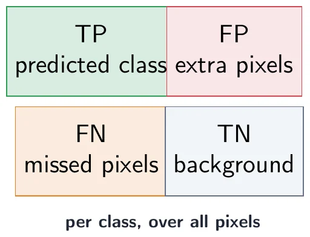{#fig-seg-metrics fig-alt="A two by two grid labelled TP predicted class, FP extra pixels, FN missed pixels, TN background"}
:::

$$
\text{pixel accuracy}=\frac{\sum_c\mathrm{TP}_c}{|\Omega|},
\qquad
\mathrm{IoU}_c=\frac{\mathrm{TP}_c}{\mathrm{TP}_c+\mathrm{FP}_c+\mathrm{FN}_c},
\qquad
\mathrm{mIoU}=\frac1C\sum_{c=1}^{C}\mathrm{IoU}_c .
$$ {#eq-miou}

The counts are accumulated over the **whole dataset** before dividing, not averaged per image. Accuracy can look excellent when the background dominates; mIoU gives each class equal weight. And before comparing models, fix the **ignore regions** and the **resize policy** (is the metric computed at the original resolution or at the network's?), which can move mIoU by several points.

::: {.worked-example}
**Worked example — A model that predicts only "road"**

Suppose road covers $70\%$ of the pixels, cars $20\%$, and people $10\%$. A model that predicts "road" everywhere has pixel accuracy $0.70$, which sounds respectable. But $\mathrm{IoU}_{\text{road}}=0.70/(0.70+0.30+0)=0.70$, $\mathrm{IoU}_{\text{car}}=\mathrm{IoU}_{\text{person}}=0$, so $\mathrm{mIoU}=0.23$. The failure is invisible in accuracy and obvious in mIoU.
:::

## Instance and panoptic segmentation

### Instance segmentation

::: {.figure-panel}
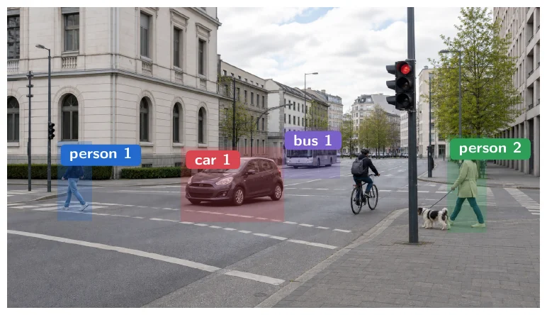{#fig-instance fig-alt="The scene with separate coloured masks and labels for two people, a car, and a bus"}
:::

Instance segmentation predicts a **set** of object-level masks,

$$
\big\{(c_k,s_k,\mathbf{b}_k,\mathbf{M}_k)\big\}_{k=1}^{K},
\qquad
\mathbf{M}_k\in\{0,1\}^{H\times W},
$$

combining the set output of detection with the pixel accuracy of segmentation [@hariharan2014simultaneous]. Each countable thing receives an identity; overlapping objects remain separate; masks capture shape while boxes still help to localize the proposals. "Stuff" is usually left to a semantic branch. It is evaluated by **mask AP**: the AP of @sec-detection with box IoU replaced by mask IoU.

### Mask R-CNN {#sec-mask-rcnn}

::: {.figure-panel}
{#fig-mask-rcnn fig-alt="The Mask R-CNN pipeline: FPN feature map, RPN proposals, a RoIAlign grid over a pedestrian, a class plus box head, a 28 by 28 person mask, and the scene with pasted masks"}
:::

Mask R-CNN [@he2017mask] is Faster R-CNN with **one extra branch**. Faster R-CNN supplies proposals, classes, and boxes; a parallel FCN predicts an $m\times m$ mask ($m=28$) for each RoI. Three design decisions matter.

- **RoIAlign instead of RoIPool.** RoIPool rounds the proposal's coordinates to the feature grid, then rounds again when dividing it into bins. At stride 16, a rounding of half a cell is 8 pixels — harmless for a box, ruinous for a boundary. RoIAlign keeps real-valued coordinates, samples each bin at regular points by **bilinear interpolation**, and averages: no quantization anywhere.
- **Per-class binary masks.** The mask head outputs $C$ masks of $m\times m$ with a per-pixel **sigmoid**, and only the mask of the ground-truth class enters the loss — a pixel-wise binary cross-entropy. Classes do not compete inside the mask; the classification branch decides the class. This decoupling was found to work markedly better than a per-pixel softmax over classes.
- **Shared features.** Detection and masks share the backbone, so the mask costs little extra.

Precise alignment matters when the output is a boundary, not just a box.

### Panoptic segmentation

Semantic segmentation labels stuff and things but merges instances; instance segmentation separates things but ignores stuff. **Panoptic segmentation** [@kirillov2019panoptic] asks for both at once: every pixel gets a class and, for things, an instance identity, with no overlaps. It is evaluated with **panoptic quality**: predicted and ground-truth segments are matched when their IoU exceeds $0.5$ (which makes the match unique), and

$$
\mathrm{PQ}=\frac{\sum_{(p,g)\in\mathrm{TP}}\operatorname{IoU}(p,g)}{|\mathrm{TP}|+\tfrac12|\mathrm{FP}|+\tfrac12|\mathrm{FN}|}
=\underbrace{\frac{\sum_{\mathrm{TP}}\operatorname{IoU}}{|\mathrm{TP}|}}_{\text{segmentation quality}}\times\underbrace{\frac{|\mathrm{TP}|}{|\mathrm{TP}|+\tfrac12|\mathrm{FP}|+\tfrac12|\mathrm{FN}|}}_{\text{recognition quality}},
$$

computed per class and averaged. PQ thus separates *how well* matched segments fit from *how many* segments were found.

```{=html}
<div class="note-part"><span>Part V</span>Pose estimation and tracking</div>
```

## Human pose estimation

::: {.figure-panel}
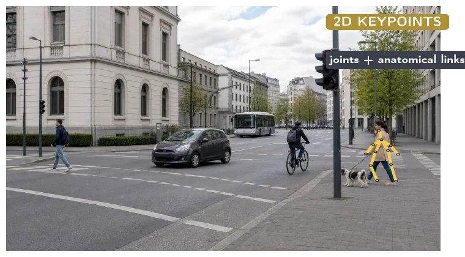{#fig-pose fig-alt="The street scene with a yellow skeleton of joints and limbs drawn over the walking woman"}
:::

Pose estimation predicts a structured set of landmarks for a person (or an animal, a hand, an object):

$$
\mathcal{K}=\{(x_j,y_j,v_j)\}_{j=1}^{J},
$$

where $v_j$ records visibility or confidence. COCO uses $J=17$ body keypoints (nose, eyes, ears, shoulders, elbows, wrists, hips, knees, ankles) with $v_j\in\{0,1,2\}$ for "not labelled", "labelled but occluded", and "visible".

- **2D or 3D.** 2D pose gives keypoints in image coordinates; 3D pose gives joints in camera or world coordinates — an ill-posed lifting problem in the sense of @eq-image-formation.
- **Structure.** A fixed **skeleton graph** connects related joints; predictions that violate it (a wrist far from its elbow) are implausible.
- **Multiple people** add a second problem: assigning joints to identities.

The first deep approach, DeepPose [@toshev2014deeppose], regressed the $2J$ coordinates directly with a CNN. Almost all later methods predict **heatmaps** instead (@sec-heatmaps), and differ in how they handle multiple people.

### Top-down pose estimation

::: {.figure-panel}
{#fig-top-down fig-alt="Pipeline: full image with three person boxes, three resized crops, three crops with yellow skeletons, and the scene with skeletons mapped back"}
:::

Detect first, then estimate one pose per detection [@xiao2018simple]. Each crop is mapped back to the image by undoing the crop and the resize,

$$
(x,y)_{\text{image}}=\text{box corner}+\text{scale}\cdot(x,y)_{\text{crop}} .
$$

**Why it works well:** each crop has normalized scale, little background, and one main subject, so a high-resolution head can refine joint locations. **The detector is the bottleneck:** a missed or badly cropped person cannot be recovered, and the runtime grows roughly with the number of people detected. Top-down methods trade detector dependence and per-person cost for clean single-person reasoning.

### Bottom-up pose estimation

::: {.figure-panel}
{#fig-bottom-up fig-alt="Pipeline: full image, crops with coloured joint candidates, candidate limb pairs with affinity scores, and two assembled skeletons"}
:::

Detect all body parts first, then solve identity through **grouping**. OpenPose [@cao2017realtime] computes keypoint heatmaps once for the whole scene, plus **part affinity fields** — 2D vector fields along each limb whose line integral between two candidate joints scores how likely they belong to one limb — and then assembles compatible limbs into people by a greedy matching on the skeleton tree.

The trade-offs mirror the top-down ones: the cost depends only **weakly on crowd size**; small people must share the same feature-map resolution as large ones; and grouping becomes ambiguous under overlap and occlusion.

### Heatmap regression {#sec-heatmaps}

::: {.figure-panel}
{#fig-heatmaps fig-alt="Four person crops with heatmaps for nose, left wrist, left knee, right ankle, and two 9 by 9 grids showing a Gaussian target and a predicted heatmap"}
:::

Instead of regressing $(x_j,y_j)$, predict one map per joint and train it towards a Gaussian bump centred at the target position $\mathbf{p}_j$ [@newell2016stacked]:

$$
H_j(\mathbf{p})=\exp\!\left(-\frac{\lVert\mathbf{p}-\mathbf{p}_j\rVert_2^{2}}{2\sigma^{2}}\right),
\qquad
\hat{\mathbf{p}}_j=\arg\max_{\mathbf{p}}\hat H_j(\mathbf{p}).
$$ {#eq-heatmap}

- Train with **mean-squared error** between $\hat H_j$ and $H_j$, or with a normalized spatial loss. Heatmaps preserve uncertainty better than direct regression, and they keep the output spatially aligned with the convolutional features — the same reason dense prediction works.
- Heatmaps live on a **downsampled** grid (typically stride 4), so the arg max is quantized to a cell. Refinement — shifting a quarter of a cell towards the second-highest neighbour — or a **soft-argmax**, $\hat{\mathbf{p}}_j=\sum_{\mathbf{p}}\mathbf{p}\,\operatorname{softmax}(\beta\hat H_j)(\mathbf{p})$, restores sub-pixel precision; the soft-argmax is also differentiable.
- **Multiple peaks** can represent ambiguity (which knee is the left one?) or multiple people in the crop.

### Pose metrics

**PCK** (percentage of correct keypoints): a joint is correct when $\lVert\hat{\mathbf{p}}_j-\mathbf{p}_j\rVert_2\le\alpha L$, where $L$ is a person, torso, or head scale; average the indicator over joints. **PCKh\@0.5** [@andriluka2014human] uses $\alpha=0.5$ and the head-segment length.

**Object keypoint similarity** plays for poses the role IoU plays for boxes. With $\mathcal{V}=\{j:v_j>0\}$ the labelled keypoints,

$$
\mathrm{OKS}=\frac{1}{|\mathcal{V}|}\sum_{j\in\mathcal{V}}\exp\!\left(-\frac{d_j^{2}}{2s^{2}\kappa_j^{2}}\right),
$$ {#eq-oks}

where $d_j$ is the keypoint error, $s$ the person scale ($s^2$ is the object's segment area in COCO), and $\kappa_j$ a per-keypoint tolerance — larger for hips, whose position is ambiguous even to annotators, than for eyes. **Keypoint AP** treats OKS like IoU: match poses at several OKS thresholds, build precision–recall curves, and average; COCO reports AP\@[.50:.95]. Compare pose scores only under the same scale, visibility, matching, and threshold protocol.

### Applications and failure modes

::: {.figure-panel}
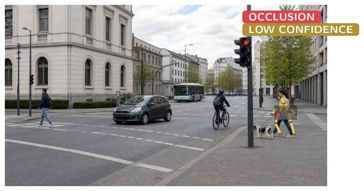{#fig-pose-failures fig-alt="The scene with the walking woman partly occluded and tags reading occlusion and low confidence"}
:::

Pose estimation serves sports analysis, human–robot interaction, ergonomics, animation and augmented reality, rehabilitation, and gesture interfaces. It fails under occlusion, truncation, and crowded overlap; rare viewpoints and unusual articulation; blur, low resolution, or loose clothing; left/right swaps and implausible limbs; and domain and demographic shift [@ronchi2017benchmarking].

## Multi-object tracking

::: {.figure-panel}
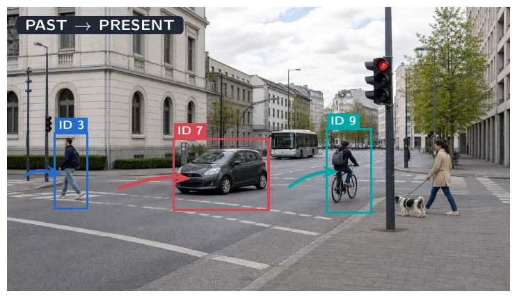{#fig-mot fig-alt="The scene with three boxes labelled ID 3, ID 7, ID 9 and coloured trails showing their past positions"}
:::

Given detections over a video, multi-object tracking (MOT) estimates trajectories

$$
\mathcal{T}_i=\big\{(t,\mathbf{b}^{i}_t,c_i,\mathrm{ID}_i)\big\}_{t=t_s}^{t_e}.
$$

The task has four parts: **localize** each object at each time; **preserve a stable identity** through motion and occlusion; **start and terminate** tracks as objects enter or leave; and **diagnose** false and missed tracks, fragmentation, and **identity switches** [@milan2016mot16].

### Tracking by detection

::: {.figure-panel}
![One step of tracking by detection on the scene. (1) Detect at frame $t$ (white boxes). (2) Predict each track forward from $t-1$ (dashed; frame $t-1$ is simulated). (3) Gate and build the cost matrix $c_{ij}=1-\operatorname{IoU}(\hat{\mathbf{b}}_i,\mathbf{d}_j)$, with pairs of IoU below $0.3$ gated out (×). (4) Solve a minimum-cost one-to-one assignment: $T_5$, hidden behind the pole, and $d_5$, the dog, stay unmatched. (5) Update: matched tracks are corrected by their detection; the unmatched detection starts a tentative new track; the unmatched track is kept briefly and deleted after repeated misses.](../../assets/figures/dl4cv/l01-tracking-by-detection.webp){#fig-tracking-by-detection fig-alt="Two copies of the scene with detection and track boxes, a 5 by 5 cost matrix with four circled matches, and numbered annotations for the five steps"}
:::

The dominant paradigm runs a detector on every frame and **links** detections over time. SORT [@bewley2016simple] is the minimal, and surprisingly strong, version:

1. **Detect** objects in frame $t$: $\{\mathbf{d}_j\}$.
2. **Predict** every existing track forward with a motion model: $\{\hat{\mathbf{b}}_i\}$.
3. **Gate and build a cost matrix** $\mathbf{C}\in\mathbb{R}^{T\times D}$; implausible pairs get infinite cost.
4. **Assign** one-to-one by the Hungarian algorithm — the same tool as DETR's matching.
5. **Update** each track's state and lifecycle.

A simple online loop becomes a tracker when **association** and **lifecycle** rules are explicit. Lifecycle rules matter as much as the cost: a new detection starts a **tentative** track that is confirmed after a few consecutive matches (three in Deep SORT); a confirmed track that goes unmatched is kept alive for a number of frames (up to 30 in Deep SORT), so that it can survive a short occlusion, then deleted.

### Motion: the Kalman filter

SORT models each box with a constant-velocity **Kalman filter** whose state is the box centre, its scale (area), and its aspect ratio, plus the velocities of the first three: $\mathbf{x}=[u,v,s,r,\dot u,\dot v,\dot s]^\top$. The model is linear-Gaussian,

$$
\mathbf{x}_t=\mathbf{F}\mathbf{x}_{t-1}+\mathbf{w}_t,
\quad\mathbf{w}_t\sim\mathcal{N}(\mathbf{0},\mathbf{Q}),
\qquad
\mathbf{z}_t=\mathbf{H}\mathbf{x}_t+\mathbf{n}_t,
\quad\mathbf{n}_t\sim\mathcal{N}(\mathbf{0},\mathbf{R}),
$$

where $\mathbf{F}$ adds each velocity to its position and $\mathbf{H}$ picks the observed box $(u,v,s,r)$ out of the state. Each frame alternates two steps.

$$
\textbf{Predict:}\quad
\hat{\mathbf{x}}_{t|t-1}=\mathbf{F}\hat{\mathbf{x}}_{t-1|t-1},
\qquad
\mathbf{P}_{t|t-1}=\mathbf{F}\mathbf{P}_{t-1|t-1}\mathbf{F}^\top+\mathbf{Q}.
$$

$$
\textbf{Update:}\quad
\mathbf{S}=\mathbf{H}\mathbf{P}_{t|t-1}\mathbf{H}^\top+\mathbf{R},
\quad
\mathbf{K}=\mathbf{P}_{t|t-1}\mathbf{H}^\top\mathbf{S}^{-1},
\quad
\hat{\mathbf{x}}_{t|t}=\hat{\mathbf{x}}_{t|t-1}+\mathbf{K}\big(\mathbf{z}_t-\mathbf{H}\hat{\mathbf{x}}_{t|t-1}\big),
\quad
\mathbf{P}_{t|t}=(\mathbf{I}-\mathbf{K}\mathbf{H})\mathbf{P}_{t|t-1}.
$$

The prediction moves the box and **grows** its uncertainty $\mathbf{P}$; the update pulls it towards the matched detection, weighted by the Kalman gain $\mathbf{K}$, and shrinks the uncertainty. An unmatched track only predicts, so its uncertainty keeps growing during an occlusion.

The innovation covariance $\mathbf{S}$ gives a principled **gate**: the squared Mahalanobis distance $d^2=(\mathbf{z}-\mathbf{H}\hat{\mathbf{x}})^\top\mathbf{S}^{-1}(\mathbf{z}-\mathbf{H}\hat{\mathbf{x}})$ follows a $\chi^2$ distribution if the detection belongs to the track, so pairs with $d^2$ above the $95\%$ quantile — $5.99$ for a 2-D position, $9.49$ for a 4-D box — are rejected.

### Motion, geometry, and appearance for association

::: {.figure-panel}
![Combining cues for tracks $T_3$ (cyclist) and $T_4$ (woman) against detections $d_3$, $d_4$, $d_5$. Motion: the ellipse is the gate around the Kalman prediction; pairs outside it ($d^2>5.99$) are never matched. Geometry: $1-\mathrm{IoU}$ between the predicted and detected boxes. Appearance: $1-\cos$ of ResNet-18 embeddings of the crops. With $C=0.5\,\text{geo}+0.5\,\text{app}$, the Hungarian matches are $T_3\to d_3$ ($C=0.10$) and $T_4\to d_4$ ($C=0.11$); the woman and the dog are far apart in appearance ($0.53$).](../../assets/figures/dl4cv/l01-association.webp){#fig-association fig-alt="Crops of a cyclist and a woman with Kalman gating ellipses, and a 2 by 3 table of geometric and appearance costs, with two cells highlighted as Hungarian matches"}
:::

For track $i$ and detection $j$, combine a geometric and an appearance cost on the pairs that pass the gate:

$$
c^{\text{geo}}_{ij}=1-\operatorname{IoU}(\hat{\mathbf{b}}_i,\mathbf{d}_j),
\qquad
c^{\text{app}}_{ij}=1-\mathbf{e}_i^\top\mathbf{e}_j,
\qquad
C_{ij}=\lambda_g c^{\text{geo}}_{ij}+\lambda_a c^{\text{app}}_{ij},
\qquad
\pi^{*}=\arg\min_{\pi}\sum_iC_{i,\pi(i)},
$$ {#eq-association}

where $\mathbf{e}$ are L2-normalized appearance embeddings — in Deep SORT [@wojke2017simple], from a network trained for person re-identification, and for each track, the best match over a gallery of its recent appearances. Each cue covers a different failure: **motion** rejects implausible jumps; **IoU** favours spatial continuity between consecutive frames; **appearance** recovers identities after crossings and short occlusions, when the motion prediction has drifted.

```python
import numpy as np
from scipy.optimize import linear_sum_assignment
from torchvision.ops import box_iou

def associate(pred_boxes, det_boxes, iou_min=0.3):
    """pred_boxes: (T, 4) Kalman predictions; det_boxes: (D, 4). Returns matched pairs."""
    cost = 1 - box_iou(pred_boxes, det_boxes).numpy()
    cost[cost > 1 - iou_min] = 1e6                     # gate implausible pairs
    rows, cols = linear_sum_assignment(cost)
    return [(r, c) for r, c in zip(rows, cols) if cost[r, c] < 1e6]
```

### Tracking metrics

The taxonomy table listed HOTA and IDF1. Three metrics are in common use, and they weigh errors differently.

- **MOTA** [@bernardin2008evaluating] counts the three error types per frame: $\mathrm{MOTA}=1-\frac{\sum_t(\mathrm{FN}_t+\mathrm{FP}_t+\mathrm{IDSW}_t)}{\sum_t\mathrm{GT}_t}$. Because detection errors vastly outnumber identity switches, MOTA is dominated by detection quality.
- **IDF1** [@ristani2016performance] first matches whole predicted trajectories to whole ground-truth trajectories, then computes an F1 score of correctly identified detections: $\mathrm{IDF1}=\frac{2\,\mathrm{IDTP}}{2\,\mathrm{IDTP}+\mathrm{IDFP}+\mathrm{IDFN}}$. It emphasizes keeping identities over time.
- **HOTA** [@luiten2021hota] balances the two explicitly: at a localization threshold $\alpha$, $\mathrm{HOTA}_\alpha=\sqrt{\mathrm{DetA}_\alpha\cdot\mathrm{AssA}_\alpha}$, the geometric mean of a detection accuracy and an association accuracy, then averages over $\alpha\in\{0.05,0.10,\dots,0.95\}$.

Report more than one, and say which: a tracker can improve MOTA by detecting more while switching identities more often.

## Exercises

### Exercise 1 — Shape arithmetic

A $224\times224\times3$ image passes through: a $7\times7$ convolution with 64 filters, stride 2, padding 3; a $3\times3$ max pool, stride 2, padding 1; and two $3\times3$ convolutions with 64 filters, stride 1, padding 1. Give the output shape after each layer and the parameter count of each convolution (with biases). Then compute the receptive field and the jump of the last layer with @eq-receptive-field.

### Exercise 2 — Equivariance and its limits

Show that a stride-1 convolution with circular padding is exactly equivariant to circular shifts. Then give a 1-D example where a convolution with stride 2 is *not* equivariant to a shift by one sample. What does this imply for the robustness of a CNN classifier to one-pixel shifts?

### Exercise 3 — ViT budget

For ViT-B/16 ($D=768$, $L=12$, $h=12$), compute $N$, the number of multiply–adds of the attention matrices ($2N^2D$) and of the linear layers ($12ND^2$) per block, for $224\times224$ and for $1024\times1024$ inputs. At which resolution do they become equal? Repeat with patch size 8. Which design changes would you consider for dense prediction at $1024\times1024$?

### Exercise 4 — IoU and anchors

Compute the IoU of the boxes $(0,0,4,4)$ and $(2,2,6,6)$, and their GIoU. Then encode the ground truth $(100,100,200,150)$ (corner form) against the anchor $(c_x,c_y,w,h)=(140,130,128,64)$ with @eq-anchor-decode, and decode it back.

### Exercise 5 — Average precision by hand

A detector returns, for one class, predictions with scores $0.95, 0.9, 0.8, 0.7, 0.6, 0.5$ whose matching outcomes are TP, TP, FP, TP, FP, TP, on a dataset with 5 ground-truth objects. Trace the precision–recall points, interpolate, and compute AP with the all-point method. What is the maximum recall, and why is it not 1?

### Exercise 6 — Focal loss gradients

Differentiate $\operatorname{FL}(p_t)$ with respect to the logit $x$ of a positive anchor ($p_t=\sigma(x)$), and plot the gradient magnitude against $p_t$ for $\gamma\in\{0,1,2,5\}$. Explain in one paragraph why the shares in @fig-focal move as they do.

### Exercise 7 — NMS versus set prediction

Implement greedy NMS in fewer than fifteen lines of PyTorch and check it against `torchvision.ops.nms`. Construct a case with two heavily overlapping objects of the same class where NMS must fail at any threshold, and explain why a DETR-style set predictor does not have this failure in principle.

### Exercise 8 — Segmentation losses and metrics

For a $10\times10$ binary image with a $2\times2$ foreground square, compute pixel accuracy, foreground IoU, mIoU (two classes), cross-entropy, and Dice loss for (a) a prediction of $p=0.1$ everywhere and (b) a prediction that is correct except for a one-pixel shift of the square. Which metric and which loss rank the two predictions as you would?

### Exercise 9 — A tracker in practice (preparation for TP 1)

Run torchvision's Faster R-CNN on every frame of a short video. Implement the association of @eq-association with IoU only, then add a constant-velocity Kalman filter and gating, then an appearance term using a pretrained ResNet-18 embedding of each crop. Count identity switches by inspection for each version, and relate each improvement to the failure it addresses.

## Main takeaways

1. **Match the output to the task.** Classification predicts labels; detection, sets of boxes; segmentation, labels for pixels; pose, keypoints; tracking, identities through time. The output space determines the annotation, the head, the loss, the inference procedure, and the metric.
2. **Learn useful representations.** CNNs encode locality and translation structure and are data-efficient; ViTs use content-dependent global interaction and need more data or pretraining. Both serve as reusable backbones, and hierarchical models such as Swin and feature pyramids give the multi-scale maps dense tasks need.
3. **Share computation.** The step from sliding windows to fully convolutional networks — run the backbone once, predict everywhere — underlies detection, segmentation, and bottom-up pose alike.
4. **Assignment defines learning.** Anchor matching, Hungarian matching in DETR, and data association in tracking all decide which prediction is responsible for which target; the losses are only computed afterwards.
5. **Resolution versus context** is the central tension of dense prediction. Skip connections, atrous convolutions, feature pyramids, RoIAlign, and heatmap refinement are all answers to it.
6. **Evaluate what matters.** Use task-aligned metrics (AP over IoU thresholds, mIoU, OKS AP, HOTA and IDF1) under a fixed protocol, and slice errors by scale, class, occlusion, localization, and identity.
7. **Build by diagnosing failures.** Start with a measurable baseline, visualize its mistakes, and add complexity only to address a specific failure. Align representation, output, loss, metric, and data with the failure you need to fix.

## References and provenance {.unnumbered}

This web note is adapted from the Lecture 1 slides of Deep Learning for Computer Vision by Jhony H. Giraldo. The course logistics were moved to the [course page](index.qmd); the derivations, worked examples, code, and exercises were expanded; and several topics that the slides only name were developed: COCO-style AP, GIoU, Swin's attention cost, the Kalman filter, panoptic quality, and the MOTA, IDF1, and HOTA metrics.

The figures are cropped from the compiled slides by `scripts/figures/dl4cv_lecture_01_figures.py` in this repository. Most of them are original TikZ drawn over a street scene generated for the lecture with an image-generation model, annotated with the outputs of torchvision's pretrained models (BSD-3-Clause). Where no model was available, the slides use labelled stand-ins: Faster R-CNN's confident detections as "ground truth", RetinaNet boxes in place of DETR outputs, ResNet and FCN maps in place of a trained U-Net, schematic limb affinities for bottom-up pose, and a simulated frame $t-1$ for tracking. The slides' CPU timings (29.4 s and 0.58 s) were measured on the machine that generated the figures.

Recommended reading: Stanford CS231n, *Deep Learning for Computer Vision*; Goodfellow, Bengio, and Courville, *Deep Learning* [@goodfellow2016deep]; and the original papers cited above — read the method *and* the ablations. For code and empirical context: torchvision, Detectron2, and MMDetection.

::: {#refs .references-small}
:::

